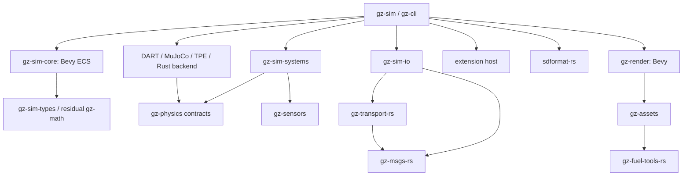

# Runtime architecture

## Workspace boundaries

These are proposed crate boundaries, not a requirement to create every crate
before it has code. Start with the smallest P2 set and split where dependencies,
reuse, or build profiles justify it. Cargo package names below need availability
checks before publishing; repository names keep the required `-rs` suffix.

| Crate / area | Owns | Must not own |
| --- | --- | --- |
| gz-math | Missing inertia/frame/robotics math semantics over existing math crates | New generic vectors, matrices, RNG, or graph library |
| gz-sim-types | Stable IDs, simulation time, domain value/configuration types | ECS storage, network messages, native engine handles |
| gz-physics | Backend capabilities, validated construction/step contracts, query interfaces | C++ feature-template hierarchy or one mandatory engine |
| gz-physics-dart | DART ownership, cxx/native bridge, batched transfers | Simulator lifecycle or transport |
| gz-physics-mujoco | MuJoCo C API adapter and model/state mapping | SDF XML parser or rendering |
| gz-physics-tpe | TPE behavior in Rust using reusable geometry | A replacement full dynamics engine |
| gz-physics-rapier or gz-physics-avian | Chosen Rust engine integration into Bevy scheduling | Undocumented precision conversion or hidden fallback |
| gz-sensors | Sensor configuration, timing, noise, analytical sensor models | Mandatory renderer or transport dependency |
| gz-render | Bevy scene extraction, sensor passes, offscreen GPU/readback | General cross-renderer abstraction or GUI application |
| gz-assets | URI/resource policy, loading/cache, mesh/terrain/material conversion | SDF semantic graph or Fuel HTTP implementation |
| gz-sim-core | Bevy world, schedules, lifecycle, stable-ID lookup, system registration | Second ECS, presentation UI, synchronous network IO |
| gz-sim-systems | Cohesive controller/environment/system modules | Unstructured utility collection |
| gz-sim-io | Transport adapters, services, logs, scene protocol, external GUI contract | Transport wire protocol implementation |
| gz-extension-api / host | Versioned native plugin contract and lifecycle | Rust ABI promises or unbounded raw access to World |
| gz-sim | Server library and executable composition | Monolithic implementation of all domain code |
| gz-cli | CLI parsing/dispatch and command manifests | Ruby library loading or simulator dependency for independent commands |
| xtask / test-support | Check orchestration, fixture/probe runners, parity reports | Production behavior hidden from coverage |

Sensor model code should accept domain observations and emit domain samples.
Server integration wraps it in Bevy systems. The optional rendered sensor layer
uses gz-render. No core dependency enables rendering transitively by default.

Arrows are allowed dependency directions, not a complete crate graph. Engine
adapters implement contracts; runtime composition selects one per simulation
world. Independent repositories must never depend back on this workspace. Keep
their public values dependency-light; convert at the boundary when necessary.

## Bevy ECS and ownership

Use Bevy World, Entity, Component, Resource, queries, system sets, change detection,
and deferred commands directly. Do not wrap each operation in an ECM clone.
Expose a small server API for world lifecycle, stepping, observations, and commands.

Start with one Bevy World per simulated world, plus independent render extraction
state. This isolates backend resources, reset, time, seeds, and entity lifetimes.
A server hosts multiple worlds through explicit world IDs. Distributed worlds
exchange protocol state; they do not share raw ECS entities.

Assign stable domain IDs independently of Bevy's generational Entity values.
Maintain a compact ID-to-entity index; never serialize Bevy's internal IDs as a
wire or log contract. Runtime creation/removal commits at defined boundaries.
Handle generation checks prevent stale plugin/backend references from resolving
to newly created objects. Names, scoped names, SDF IDs, and public IDs are distinct.

Separate model ownership, joint graph, SDF frame graph, and render transform
hierarchy. They are not the same tree. ECS membership does not replace SDF frame
resolution. Create small components for frequently queried state; avoid a single
giant mutable WorldState resource that serializes every system.

Bevy's render world and backend caches are justified derived representations.
They must have explicit synchronization and ownership. They are not competing
authoritative ECSs. Physics backends own their solver internals; canonical domain
state is authoritative outside the physics step, with a single writer per phase.

## Simulation clock and schedule

The server drives simulation from requested steps and an integer timebase, not
wall-clock frame accumulation. Real-time pacing is an optional outer loop.
`step(N)` performs exactly N accepted timesteps. Fast-as-possible stepping does
not drop work to meet a display framerate. Use a dedicated Bevy schedule rather
than relying on the game loop's default fixed-rate catch-up policy.

Preserve upstream's end-of-step UpdateInfo timestamp semantics. Record both
start and end times internally so sensor acquisition and command application are
unambiguous. Use nanoseconds or a documented rational scheduler; test overflow,
rate changes, non-divisible sensor periods, pause, reset, and time rewind rules.

| Order | Set | Contract |
| --- | --- | --- |
| 1 | Ingress | Drain bounded commands; validate target world/epoch; deterministic sequence ordering |
| 2 | Lifecycle | Apply validated spawn/remove/configure transactions; flush deferred changes |
| 3 | PreStep | Controllers, forces, environmental inputs; honor priority and load-order dependencies |
| 4 | PhysicsPrepare | Update changed shapes/poses/commands in one batch; resolve topology transactions |
| 5 | PhysicsStep | Advance selected engine exactly once using explicit dt and configured substeps |
| 6 | PhysicsCommit | Write poses, velocities, contacts, joint state; flush before consumers |
| 7 | PostStep | Update derived frames, evaluate due non-rendered sensors, build render requests |
| 8 | Publish | Produce versioned state/samples/clock/log batches; enqueue bounded IO |
| 9 | Finalize | Commit step count/time and completion signals; cleanup retired resources |

This order is a design contract to validate against upstream tests, not a claim
that every upstream system already uses these exact phases. Keep legacy priority
and load-order guarantees where externally visible. Add explicit ordering edges
only where data/behavior requires them; Bevy may parallelize independent work.
Diagnose schedule ambiguity in tests. HashMap iteration and task completion order
must not choose command, force-reduction, seed, or publication order.

Paused ticks may process permitted edits/services without advancing physics or
simulation time. Define whether each sensor runs while paused from its existing
tests; do not add a global “run everything anyway” rule. Reset creates a new epoch,
clears queued old observations, resets backend state and RNG streams, and preserves
or recreates IDs according to the compatibility contract.

## Numeric and coordinate contract

Use meters, seconds, radians, kilograms, and documented derived SI units. Keep
authoritative poses, velocities, forces, inertia, and sensor calculations in f64.
Use existing f64 vector/quaternion/matrix types with small frame-aware wrappers
only where they prevent mistakes. Quaternions need explicit component order,
normalization, multiplication convention, and invalid-input handling.

Keep Gazebo's Z-up physical coordinates. Convert to Bevy's rendering convention
in one tested boundary; for an X-preserving Y-up view a possible proper rotation
is `(x, y, z) -> (x, z, -y)`. Adopt it only after camera-forward and optical-frame
fixtures agree. Positions, rotations, normals, joint axes, inertia tensors, rays,
and winding must transform consistently. Do not swap axes in individual sensors.

Bevy Transform is presentation state. Its vector/quaternion types are not the
canonical f64 simulation representation. Use a floating render origin where
needed, carrying epoch and origin metadata through readbacks and GUI snapshots.
Test millimeter-scale motion at large world offsets and nested transforms.
[Bevy Transform documentation](https://docs.rs/bevy/latest/bevy/transform/components/struct.Transform.html)

## Physics backend contract

Bevy provides integration facilities; it does not select one mandatory robotics
physics engine. Use a capability-oriented contract, with separate construction,
step, state, contact, joint, ray query, and optional advanced feature interfaces.
Avoid replicating gz-physics's C++ template feature hierarchy in Rust.

For each capability record: native, emulated with tested semantics, unsupported,
or unverified; supported shapes/joint types; numeric precision; constraints;
test IDs; and performance implications. Unverified is not supported. At load time
validate a world's requirements and return specific unsupported-feature errors.
Never silently choose another backend or replace a missing joint with a fixed one.

All backends must define creation/destruction, stable handle mapping, step and
reset, poses/velocities, requested commands, and their advertised query semantics.
Optional capabilities include articulated loops, mimic joints, motors/limits,
transmitted wrench, added mass, contact modification, CCD, soft bodies, heightmaps,
and incremental topology edits. Backend parity means matching contracts for its
supported features, not identical trajectories across different solvers.

- **DART:** retain native DART through a focused cxx/C++ bridge. Reuse supported
  upstream behavior and same-engine tests. Batch updates and extraction rather
  than one FFI call per field. Pin DART/collision dependencies and solver settings.
- **MuJoCo:** use the supported C API behind a safe Rust ownership layer. Resolve
  SDF semantics once and lower into the engine model. Model changes may require
  compilation/recompilation; preserve state by stable identities and commit
  atomically. Test failure rollback and model removal. Do not treat readme TODOs
  as authoritative. MuJoCo exposes a model-editing workflow through mjSpec and
  compilation; exact supported operations depend on the pinned version.
  [MuJoCo model editing](https://mujoco.readthedocs.io/en/stable/programming/modeledit.html)
- **TPE:** preserve the upstream lightweight engine's tested motion/contact
  semantics. Reuse geometry/math primitives where equivalent. Do not quietly
  turn TPE into Rapier or promise articulated dynamics it did not provide.
- **Rust backend:** evaluate Avian and Rapier as documented in DEPENDENCIES.md.
  Current recommendation is a Rapier f64 engine integrated through a Bevy plugin
  in this workspace. Source registration and scheduling remain native Bevy.

Each world owns its backend instance. Native objects stay on their documented
thread; use a Bevy non-send resource or dedicated worker if needed. No blanket
unsafe Send/Sync. Keep native lifetime, callbacks, error translation, panic/
exception boundaries, and crash behavior explicit. Avoid nested thread pools
oversubscribing Bevy, backend, asset, and IO workers.

## Sensors and rendering

The sensor scheduler uses simulation acquisition time, not render completion or
publication time. Carry acquisition timestamp, sequence, world epoch, frame,
calibration version, and status through every asynchronous result. Use per-sensor
deterministic random streams seeded from stable identity and reset policy.

Non-rendered sensors read committed state: IMU, magnetometer, altimeter, air
pressure/speed, NavSat, force/torque, logical sensors, DVL, and environmental data.
Contact sensing may belong to simulator systems rather than the sensor library;
the inventory must cover both. Preserve update rates, noise/bias evolution,
connection-driven behavior, frame conventions, clipping, and output units.

Use Bevy render extraction and offscreen textures for cameras and GPU sensors.
Implement explicit passes for RGB, depth, RGBD, segmentation, bounding boxes,
thermal, wide-angle, distortion, and GPU lidar. Depth linearization, intrinsics,
near/far clipping, texture formats, label IDs, and thermal quantities require
sensor tests; ordinary scene rendering is insufficient. Follow the pinned Bevy
release's rendering APIs, not an obsolete RenderGraph design.

CPU lidar uses tested scene/physics query geometry; GPU lidar uses its own range
and intensity contract. Audit visual-versus-collision geometry differences.
Multiple modalities can share scene extraction and geometry but must not inherit
game-camera postprocessing or temporal effects without modeled sensor semantics.

Use reusable staging buffers and bounded asynchronous readback. In **lockstep
mode**, step completion waits for all due required observations. In **throughput
mode**, policies may drop/coalesce samples only when configured; expose counters
and sequence gaps. Never label an old image with the current simulation timestamp.
Reset/despawn cancels or discards old-epoch readbacks. GPU shader execution is
validated separately from CPU coverage.

## Assets, transport, and the external GUI

Resolve `file`, model, package, Fuel, and relative resource references through a
single policy preserving upstream search precedence and error behavior. Cache
decoded assets by content/version/configuration, not ambiguous basenames. Separate
load/validate from world mutation. No resource download in the physics step.

Transport callbacks enqueue typed commands and bounded samples; they never hold
the ECS world while blocking. Preserve topic/service names, message types,
partitions, namespaces, timestamps, and response semantics. Keep serialization
out of inner numerical loops. Logging must retain schema/version and world epoch.

The separate GUI consumes a documented scene snapshot/delta and command protocol:
stable entity IDs, hierarchy, poses, lights, materials, asset URIs, deletion,
selection identifiers, clock/pause/reset state, and sensor streams. Negotiate
protocol versions and provide resynchronization after dropped deltas. Keep current
Gazebo clients supported where part of the baseline. Server rendering for sensors
does not imply building a GUI inside the server.

## Native extension ABI

The owner requires native systems to load without rebuilding the simulator.
Built-ins remain source-built Bevy plugins. External plugins use a narrow C ABI
maintained in this workspace, with a Rust convenience SDK over the same boundary.

An entry point returns a descriptor containing ABI major/minor, structure sizes,
plugin identity/version, required capabilities, lifecycle callbacks, and function
tables. Version mismatches fail before callbacks run. Define ownership, alignment,
length, UTF-8 policy, allocator/free pairing, callback duration, and thread affinity.
Use opaque generational handles and caller-owned buffers or explicit release
functions. A major version is needed for incompatible layouts or semantics.

Plugins declare scheduling phases and read/write interests. Native callbacks
operate on versioned batch views and command buffers, not arbitrary ECS pointers.
Start with a serialized external-plugin phase unless conflict-free access is
proven; performance is measured. Typed component schemas/extensions need explicit
IDs and serialization contracts, not Rust TypeId across libraries.

Test load/configure/step/reset/destroy, partial construction, missing symbols,
wrong versions, malformed lengths, stale handles, failed callbacks, and shutdown
with outstanding work. The default lifetime is process/world-scoped with no hot
unload. Native plugins are trusted code; this ABI is not a memory-safety sandbox.
Old C++ gz-plugin binaries require a separate explicit compatibility bridge if
ever requested. Do not confuse native DART linking with this extension protocol.
