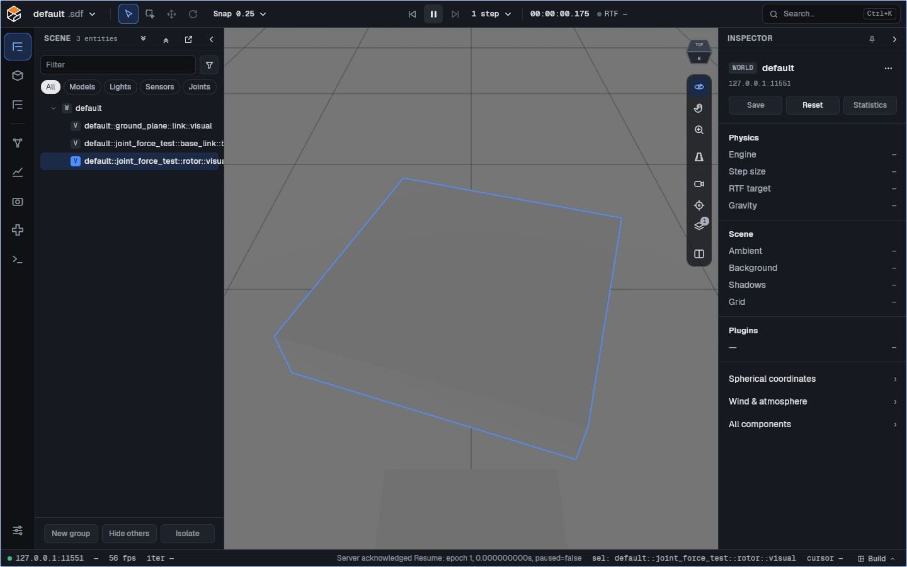

# Run a robot with the local Rust physics engine

Source candidate `836bbcd` includes published Gazebo port commit `dddf1f4` and runs rigid-body robots in a local Bevy world. The two starting points are an unchanged Gazebo motor on a free base and a screw-driven gripper that lifts a 200 g parcel. Start with the gripper to see a full task, or use the motor to test your own torque commands. The examples below use the locked Rust toolchain and an empty output directory.

## Watch the recordings

Open the gripper replay and press Play. Both jaws touch at 1.274 s, lift the parcel 126.6 mm and release it onto the plate. Move the pointer into the viewport and press **3** for the side view. In the rotor replay, select the row ending in **rotor::visual**, move the pointer into the viewport and press **F**. The upstream ground is 100 m wide, so framing the rotor makes its rotation visible. [Gripper with tier switching](http://127.0.0.1:8082/?backend=primitive&ui=full&quality=low&replay=1&lifecycle=1&url=ws%3A%2F%2F127.0.0.1%3A11547%2F) · [Always-dynamic gripper](http://127.0.0.1:8082/?backend=primitive&ui=full&quality=low&replay=1&lifecycle=1&url=ws%3A%2F%2F127.0.0.1%3A11548%2F) · [Upstream motor](http://127.0.0.1:8082/?backend=primitive&ui=full&quality=low&replay=1&lifecycle=1&url=ws%3A%2F%2F127.0.0.1%3A11551%2F)



The links use replay servers on the development machine. On another machine, build the CLI from this checkout, unpack the recordings, and start one replay server. The archive contains the original two gripper runs, both motor runs before and after reset, and the ground-plane mesh. Use a free socket port, and substitute it in the viewer URL. [Portable gz-web-rs recordings](measurements/local-manipulation/mvp-robot-replays.tar.xz)

```sh
export RUSTC_WRAPPER=
cargo build --release --locked --no-default-features -p gz-sim-cli \
  --bin gz-sim-rs --bin gz-sim-local-replay
mkdir -p target/mvp-replays
tar -xJf docs/measurements/local-manipulation/mvp-robot-replays.tar.xz -C target/mvp-replays
(cd target/mvp-replays && sha256sum --quiet -c SHA256SUMS)
target/release/gz-sim-rs target/mvp-replays/switched --server --replay --web-viewer 9002
```

Serve a built sibling gzweb-rs checkout on HTTP port 8082, then open the viewer. The simulation and command executables are Rust. The static file server solely delivers the viewer's WebAssembly application to the browser. [Open replay on port 9002](http://127.0.0.1:8082/?backend=primitive&ui=full&quality=low&replay=1&lifecycle=1&url=ws%3A%2F%2F127.0.0.1%3A9002%2F)

```sh
(cd ../gzweb-rs && ./build.sh && python3 -m http.server 8082 --bind 127.0.0.1)
```

## Drive the upstream motor

A paused server for the upstream robot is also running on the development machine in partition `gz_local_cpu_mvp`. [Open the live motor in gz-web-rs](http://127.0.0.1:8082/?backend=primitive&ui=full&quality=low&url=ws%3A%2F%2F127.0.0.1%3A11552%2F)

To launch your own, start the ordinary server paused. Its gz-web view supports play, pause and reset. Gazebo clients can publish a `gz.msgs.Double` torque in N·m on `/model/joint_force_test/joint/j1/cmd_force` and send `gz.msgs.WorldControl` to `/world/default/control` to step. A 0.012 N·m command held for 100 steps spins the rotor to 10 rad/s. [Open the live server](http://127.0.0.1:8082/?backend=primitive&ui=full&quality=low&url=ws%3A%2F%2F127.0.0.1%3A9003%2F)

```sh
target/release/gz-sim-rs examples/worlds/upstream_joint_force.sdf \
  --physics-engine multifidelity --server --web-viewer 9003
```

For repeatable controls on Linux x86-64, edit the ordered JSON journal. The shipped one applies torque for 100 ms, coasts for 200 ms, reverses torque for 200 ms, resets and repeats the first drive. The verification process checks the executable identity and every observation. The two epoch directories can each be served with the replay command above.

```sh
mkdir -p target/mvp-drive
world=examples/worlds/upstream_joint_force.sdf
journal=examples/replay/upstream_joint_force.json
target/release/gz-sim-local-replay "$world" "$journal" --threads 1 \
  --trace target/mvp-drive/trace.jsonl --record target/mvp-drive/recording --record-every 5
target/release/gz-sim-local-replay "$world" "$journal" --threads 8 \
  --verify target/mvp-drive/trace.jsonl
```

To run a different supported SDF, substitute its file and world name. To exercise the live transport check or regenerate the switched and always-dynamic gripper measurements, use the ordinary workspace commands below. The gripper example accepts a fresh output directory.

```sh
cargo test --release --locked --no-default-features -p gz-sim-cli --test native upstream_motor
cargo run --release --locked --no-default-features -p gz-sim-cli --example parked_spindle -- \
  target/mvp-gripper --capped --threads 1
```

## What this build covers

The CPU solver has physical regression tests for fixed, revolute, prismatic, ball, universal and screw joints. The independently authored model qualifies a free-base revolute joint, sustained effort, loaded inertia, plane contact, friction and reset. The full gripper task qualifies multiple joints, contact impulses and automatic tier changes against an always-dynamic run. The motor's reference is analytical. The gripper's reference uses the same dynamic solver. [Motor measurements and source](measurements/local-manipulation/mvp-independent-robot.md) · [Gripper accuracy, p95 and real-time factor](measurements/local-manipulation/mvp-local-performance.md)

Ordinary SDF support is still selective. On this candidate three unmodified Gazebo test worlds failed at load time. The differential-drive world requests joint-state axes for a ball caster, the double pendulum specifies an offset mass center in an unsupported inertial form, and the position-controller world requests a world plugin outside the admitted set. The loader reports the first unsupported feature in each file. Release-wide coverage is tracked independently for the CPU and renderer profiles. [Release qualification](measurements/local-manipulation/mvp-release-coverage.md)
