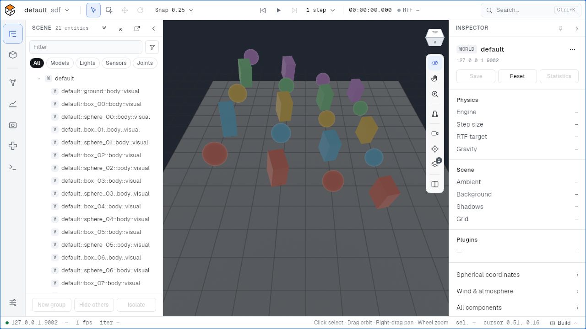
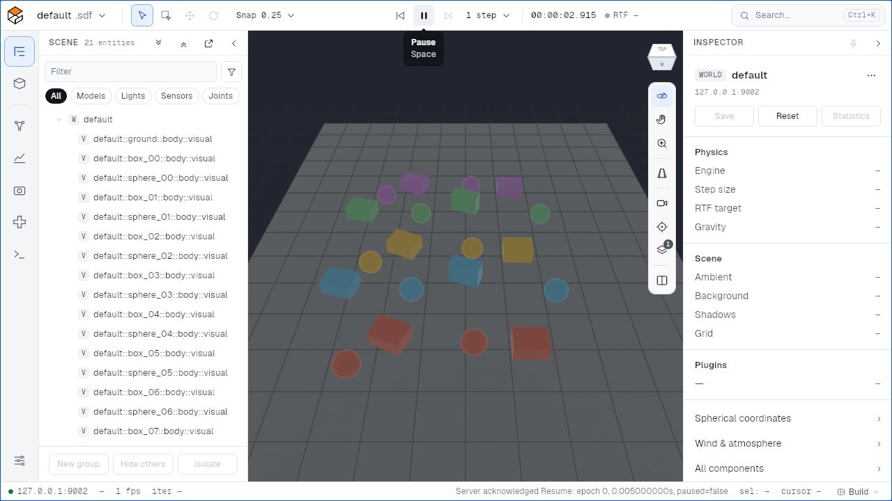
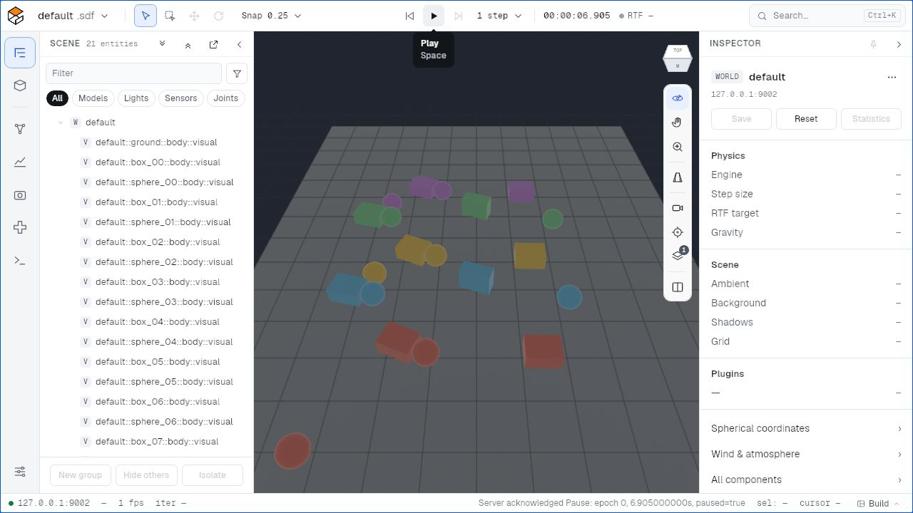
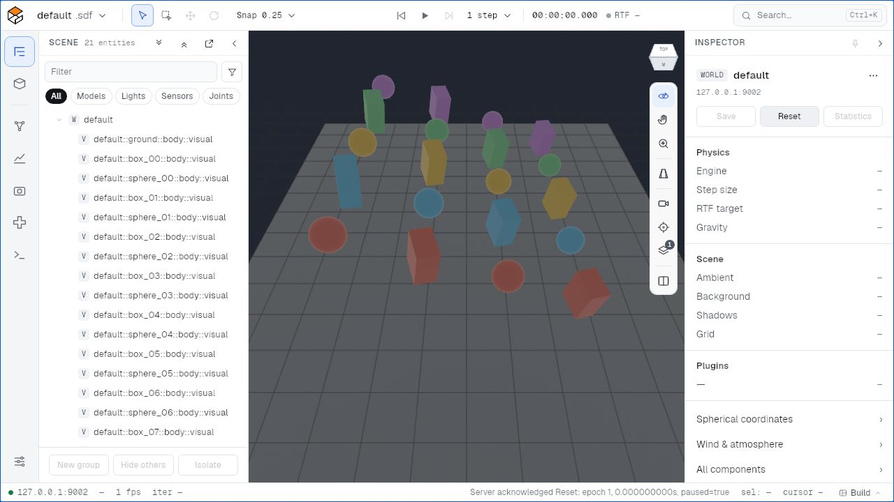

<!-- Copyright (C) 2026 Open Source Robotics Foundation -->
<!-- SPDX-License-Identifier: Apache-2.0 -->

# M1 real browser observations

The actual WebGL2 viewer displayed all 20 Rapier boxes and spheres plus ground,
with 21 truthful visual rows. The same saved and displayed frames show motion at
2.915 s, committed pause at 6.905 s, then reset to paused epoch 1 at zero time
with initial poses restored. Unreported metrics remain unavailable. The current
preview emitted no automatic unsupported SDF query.

Release acceptance remains pending mandatory consolidated qualification and
hosted CI. These images record the bounded local browser observations. Bundle
and image hashes are in [observations.json](observations.json).

