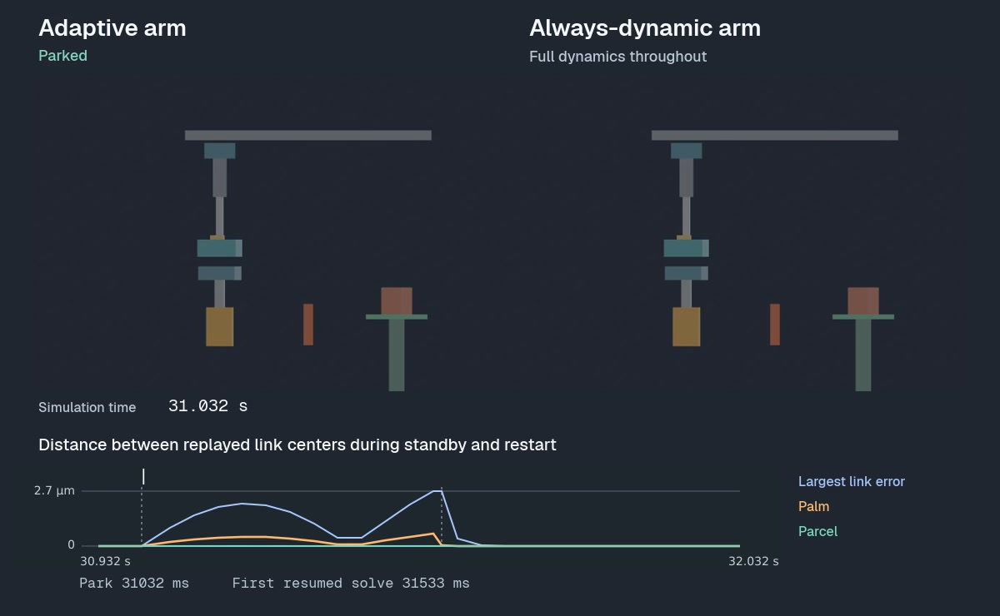

<!-- Copyright (C) 2026 Open Source Robotics Foundation -->
<!-- SPDX-License-Identifier: Apache-2.0 -->

# Watch the arm park and wake

The two arms follow the same commands to place a 1 kg parcel on the receiving shelf and move back to the empty pickup station. The adaptive arm parks at **31.032 s**. A new pickup command after 500 quiet steps wakes it for the solve ending at **31.533 s**. The film shows both real gz-web-rs runs at shared simulation times. The chart magnifies the difference between the six moving link centers around the handoff. [Watch the film](adaptive-arm-view.mp4) · [Download the four recordings](adaptive-arm-view.tar.xz)

[](adaptive-arm-view.mp4)

| Interactive recording | What to watch |
|---|---|
| [Adaptive arm](http://127.0.0.1:8082/?backend=primitive&ui=full&quality=low&replay=1&lifecycle=1&url=ws%3A%2F%2F127.0.0.1%3A11566%2F) | The fingers open at 9.195 s. The empty pickup tray disappears at 18 s, and the arm returns to standby. |
| [Always-dynamic arm](http://127.0.0.1:8082/?backend=primitive&ui=full&quality=low&replay=1&lifecycle=1&url=ws%3A%2F%2F127.0.0.1%3A11567%2F) | Compare the same placement, standby interval and next pickup command. |
| [Adaptive arm with shelf removed](http://127.0.0.1:8082/?backend=primitive&ui=full&quality=low&replay=1&lifecycle=1&url=ws%3A%2F%2F127.0.0.1%3A11568%2F) | The green shelf disappears at 31.282 s. The parcel begins to fall on the next solve at 31.283 s. |
| [Always-dynamic support-loss control](http://127.0.0.1:8082/?backend=primitive&ui=full&quality=low&replay=1&lifecycle=1&url=ws%3A%2F%2F127.0.0.1%3A11569%2F) | The parcel follows the same path after the shelf disappears. |

Across 805 common displayed times, the largest separation on the ordinary route was **2.6855 µm** at the left jaw on the first resumed solve. At the full 1 ms physics cadence the largest separation was **2.8274 µm**. On the shelf-removal route those values were **2.0752 µm** at 800 displayed times and **2.0782 µm** at physics cadence. The parcel centers agreed at every recorded time in both comparisons. The shelf's last upward impulse was 0.00981 N·s. By 31.400 s the parcel had fallen 68.37 mm in 118 ms. [Physics, impulse and timing results](adaptive-arm-switching.md)

## Playback checks

Chromium played each recording in gz-web-rs with WebGPU, checked every frame's entity catalog, visual pose and shape, then reset to time zero. The one-thread recordings matched fresh runs on eight Bevy threads byte for byte. At every shared post-delivery time, the six measured link positions and rotations from that independent run reproduced their aligned visual transforms exactly.

| Recording | Frames and catalogs | Visual poses and shapes | Link poses matched to independent physics |
|---|---:|---:|---:|
| Adaptive arm | 806 | 14,802 | 2,118 |
| Always-dynamic arm | 806 | 14,802 | 2,118 |
| Adaptive arm with shelf removed | 801 | 14,697 | 2,088 |
| Always-dynamic arm with shelf removed | 801 | 14,697 | 2,088 |

Each recording includes the two catalogs at the paused pickup-tray retirement. The downloadable archive contains the recordings, measured outcomes, verification summaries and center-to-center differences. The final film chapter shows the last supported frame at 31.280 s, the shelf removal at 31.282 s and the falling parcel at 31.400 s.

## Run the recordings

Use the matching local replay endpoint and a gz-web-rs frontend on port 8082. For the arm, move the pointer into the viewport, press **1** for a side view, then press **F** to frame the workcell. Press **Play** in the toolbar. **Step** advances one recorded frame and **Reset** returns to the start.

From the simulator checkout, serve the adaptive archive with the following commands. For continuous dynamics, replace `adaptive` with `dynamic` and change the port to 11567. [Build and run the frontend](../../LOCAL_CPU_MVP.md#watch-the-recordings)

```sh
mkdir -p target/adaptive-arm
tar -xJf docs/measurements/local-manipulation/adaptive-arm-view.tar.xz -C target/adaptive-arm
(cd target/adaptive-arm/adaptive-arm-view && sha256sum --quiet -c SHA256SUMS)
RUSTC_WRAPPER= cargo run --release --locked --no-default-features -p gz-sim-cli --bin gz-sim-rs -- \
  --server --replay --web-viewer 11566 target/adaptive-arm/adaptive-arm-view/adaptive
```

To recompute the displayed six moving link-center distances from the portable archives, run the Rust comparator. Each sample gives simulation time in nanoseconds, palm and parcel distances in millimetres, and the largest distance across the carriage, nut, palm, both jaws and parcel with its visual name. The output lists any timestamps unique to either archive. A paused edit can create two frames at the same instant. The comparator counts that instant once when all six tracked centers agree.

```sh
RUSTC_WRAPPER= cargo run --release --locked --manifest-path tools/physics-audit/numerics/Cargo.toml \
  --bin arm_replay_delta -- target/adaptive-arm/adaptive-arm-view/adaptive target/adaptive-arm/adaptive-arm-view/dynamic \
  > target/adaptive-arm/checked-deltas.json
cmp target/adaptive-arm/checked-deltas.json target/adaptive-arm/adaptive-arm-view/checks/display-deltas.json
```

To rerun the browser comparison against its source archive, use the server started above and the Rust verifier. Repeat with `dynamic` and port 11567 for the reference.

```sh
RUSTC_WRAPPER= cargo run --release --locked --manifest-path tools/physics-audit/browser/Cargo.toml -- \
  target/adaptive-arm/adaptive-arm-view/adaptive target/adaptive-arm/adaptive-arm-view/checks/adaptive.json \
  target/adaptive-arm/checked-adaptive 11566
```

The portable archive has SHA-256 `26199c994b13bf11da32ab4bc4317831b37c01299743a54ae95961ca9842b385`.
