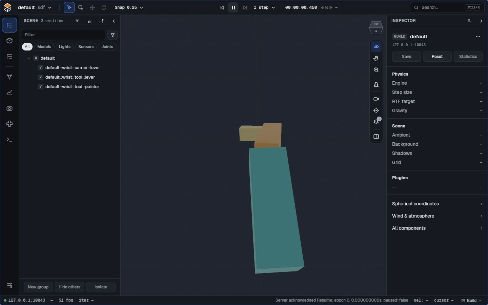

<!-- Copyright (C) 2026 Open Source Robotics Foundation -->
<!-- SPDX-License-Identifier: Apache-2.0 -->

# Driving a free or parked wrist to a specified orientation

The Rust CPU journal accepts a spherical joint target for a specified number of advancing ticks. Each tick reads the committed joint orientation and angular velocity, computes the bounded feedback torque in the parent joint axes, queues it and takes one normal physics step. An application can use the same one-tick scene API directly. The target includes a quaternion, optional desired angular velocity and optional feedforward torque. A gain or target error leaves the queued external load intact.

The floating robot turned 41.25° with its parent free to react. At 450 ms the error was 0.1203°. A 35 N push then struck the tool 100 mm off-center while the target changed to a different axis. At 950 ms the error was 0.0168°. The first measured angular speed matched a separate raw torque command calculated directly from the requested axis and the 1.4 N·m motor limit. The journal reproduced all 950 advancing states after reset. Independent one-thread and eight-thread processes matched all 1,907 records. [Floating world](../../../examples/worlds/local_ball_wrist.sdf) · [Commands](../../../examples/replay/tracked_ball_wrist.json) · [Watch the target change](http://127.0.0.1:8082/?backend=primitive&ui=full&quality=low&replay=1&lifecycle=1&url=ws%3A%2F%2F127.0.0.1%3A10043%2F)

A second wrist hung under gravity for 250 ms at the prescribed tier. The first drive command promoted it before solving. Its 2 kg tool turned about the vertical axis to 34.3775° under a 0.6 N·m limit, ending within 0.000023° after 600 ms. The largest angular-speed difference from the always-dynamic control was 4.27 × 10⁻¹⁴ rad/s per axis across all 600 steps. The pause preceding the target kept the parked wrist still. [Hanging world](../../../examples/worlds/local_hanging_ball_wrist.sdf) · [Commands](../../../examples/replay/parked_wrist_heading.json) · [Watch the wrist resume](http://127.0.0.1:8082/?backend=primitive&ui=full&quality=low&replay=1&lifecycle=1&url=ws%3A%2F%2F127.0.0.1%3A10045%2F)

All ten CPU journal tests and both scene drive tests passed. Changed executable line/region coverage reached 30/30 and 39/39 in the CLI and 32/32 and 47/48 in scene. Both browser recordings rewound to zero after checking 723 poses and shapes. [Numerical results and coverage](ball-drive-targets.json) · [Portable recordings and always-dynamic control](ball-drive-targets.tar.xz)



From the physics checkout, generate the recording in a fresh directory.

```sh
RUSTC_WRAPPER= cargo run --locked --release --no-default-features -p gz-sim-cli --bin gz-sim-local-replay -- examples/worlds/local_ball_wrist.sdf examples/replay/tracked_ball_wrist.json --threads 1 --trace tracked.jsonl --record tracked-view
RUSTC_WRAPPER= cargo run --locked --release --no-default-features -p gz-sim-cli --bin gz-sim-rs -- --server --replay --web-viewer 10043 tracked-view/epoch-0
```
