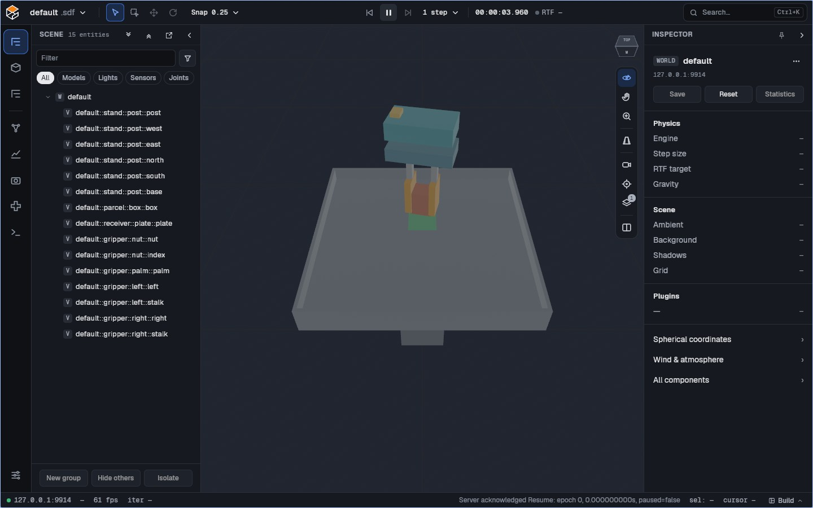

<!-- Copyright (C) 2026 Open Source Robotics Foundation -->
<!-- SPDX-License-Identifier: Apache-2.0 -->

# Parking a speed-limited gripper

The gripper picked up a 200 g parcel, raised it 126.60 mm, and placed it on a moving plate. It parked for 250 ms before pickup and 500 ms after placement. The continuously dynamic control and the switched robot touched the parcel at 1.274 s and finished with 1.962 N on the plate. [Switched replay](http://127.0.0.1:8082/?backend=primitive&ui=full&quality=low&replay=1&lifecycle=1&url=ws%3A%2F%2F127.0.0.1%3A9914%2F) · [Always-dynamic replay](http://127.0.0.1:8082/?backend=primitive&ui=full&quality=low&replay=1&lifecycle=1&url=ws%3A%2F%2F127.0.0.1%3A9915%2F)

| Measurement | Always dynamic | Switched |
|---|---:|---:|
| First left jaw impulse (N·s) | 0.09704573 | 0.09704558 |
| First right jaw impulse (N·s) | 0.10204184 | 0.10204196 |
| Ticks with bilateral contact and no support during the 1.05 s carry window | 1,050 | 1,050 |
| Plate impulse just before jaw opening (N·s) | 0.01110177 | 0.01110177 |

The screw and second universal-joint coordinate have SDF speed limits of 0.60 and 0.22 rad/s. At 1.251 s the retained Bevy jaw-force command woke the robot. During the carry, removing the command at the same boundary still left two physical jaw contacts blocking demotion. Restoring 12 N on each jaw and 2 N·m on the spindle preserved the loaded grasp. At 9.501 s a single wrist torque woke the unloaded robot.

Positive speed limits use private rotating bodies. Parking now suspends their signed spins together with the public links. A wake advances the moving-bearing references through the elapsed native time, restores the signed rates, and keeps the existing joint limits, rows, masses and handles.

An incoming-body test revealed that Rapier can integrate disconnected bodies in one solver batch. Parking the high-iteration robot during free flight changed the later contact impulse even when the robot woke before collision. An early implementation recorded 0.1261 N·s against 0.1080 N·s at the same tick in an oblique strike. Parking a capped robot now requires other bodies with colliders to remain stationary within the admission tolerances of 0.25 mm/s and 0.001 rad/s. Existing neighboring pairs may stay while their admitted poses hold. A trial solve which wakes the robot, introduces a candidate pair, or starts appreciable external motion is discarded and repeated from the original native state. The implementation defers a request made during flight and restores the speed limits when a previously stationary projectile starts moving. In the latter case both runs recorded 0.0571752810271112 N·s at 263 ms. Another test drops a previously stationary body under gravity and checks that the retry advances time and momentum exactly once.

## Accuracy and cost

Peak speeds while both jaws alone carried the parcel were 0.60000324 rad/s at the spindle and 0.22000029 rad/s at the wrist for both runs. The largest position difference among the robot links and parcel was 4.80 µm. The largest difference among the two jaw and two support impulses was 0.802 µN·s.

Three pinned release pairs reproduced each archive byte for byte. Each timing covers one Bevy step, excluding diagnostic reads and recording. The p95 during the parking windows ranged from 828 to 1,341 µs for the dynamic control and 41 to 48 µs for the switched robot. Whole-cycle p95 ranged from 803 to 1,313 µs and 852 to 1,272 µs, respectively. With builds sharing this host, two paired whole-cycle timings were slower and one was faster. The median paired increase was 6.1%.

The native WebGPU viewer checked all 251 frames and 3,765 visual poses and shapes in each branch and rewound both to zero. The release run passed 163 Rapier library tests, 13 mounted-robot tests and four example regressions. Two unrelated library tests were marked ignored. Strict Clippy passed. Across the changed production code, matching each LLVM profile to its own binary covered **248/252 mapped lines** and **469/474 mapped regions**. The JSON records the individual object hashes and counts.

## Reproduce

From the integration checkout, select a fresh output directory. The frontend runs on port 8082.

~~~sh
RUSTC_WRAPPER= cargo run --release --locked --no-default-features -p gz-sim-cli \
  --example parked_spindle -- target/capped-spindle --capped
RUSTC_WRAPPER= cargo run --release --locked --no-default-features -p gz-sim-cli \
  --bin gz-sim-rs -- --server --replay --web-viewer 9914 target/capped-spindle/switched
~~~

Use the sibling dynamic archive on port 9915 to play the control. [Ordinary SDF scene](../../../examples/worlds/local_robot_capped_spindle.sdf) · [Numerical results](capped-spindle.json)
