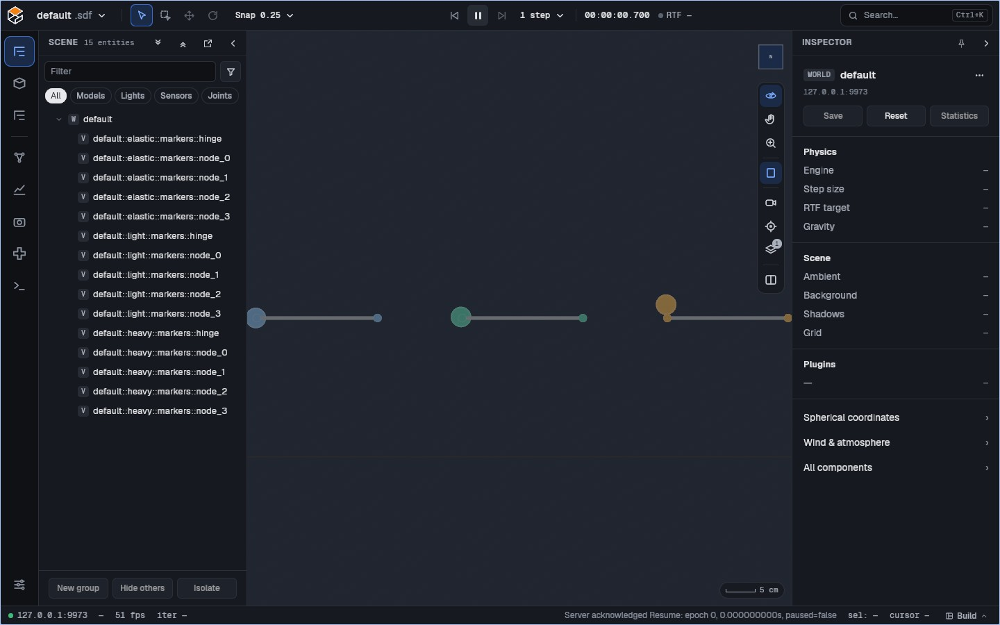

<!-- Copyright (C) 2026 Open Source Robotics Foundation -->
<!-- SPDX-License-Identifier: Apache-2.0 -->

# How quickly a vibrating cloth fold settles

Three identical cloth folds each began with 0.98 J of kinetic energy. The orange fold had no added hinge damping. Between 700 and 900 ms its corner still moved up to 40.99 mm from rest. The green fold reached 9.34 mm and the blue fold 0.14 mm in the same interval. All twelve particles reproduced their positions exactly at all 901 times after reset. The WebGPU visualizer checked 181 frames and 2,172 material positions. [Watch the three folds](http://127.0.0.1:8082/?backend=primitive&ui=full&quality=low&replay=1&lifecycle=1&url=ws%3A%2F%2F127.0.0.1%3A9973%2F) · [Measurements](cloth-bending-damping.json)



| Hinge damping (N·m·s/rad) | Maximum displacement in the first 200 ms | Maximum displacement in the final 200 ms | Energy at 900 ms |
|---:|---:|---:|---:|
| 0 | 44.91 mm | 40.99 mm | 0.794875 J |
| 0.08 | 40.82 mm | 9.34 mm | 0.028658 J |
| 0.30 | 32.38 mm | 0.14 mm | 0.005817 J |

The SDF cloth attribute `bend_damping` gives the viscous moment per hinge for one radian per second of relative rotation. The Rust XPBD solver applies a passive, implicit impulse at each native material substep. A zero coefficient preserves the original cloth equations and checkpoint representation. The analytic regression checks convergence toward the damped oscillator solution under four timestep refinements. Separate checks cover rigid motion, linear and angular momentum, prescribed-node reactions and restoring a moving cloth from a cold checkpoint. The oscillator uses a 1 kg corner, three pinned nodes, zero gravity and four material steps per millisecond. A coefficient calibrated per hinge must be rechecked for another mesh. [Authored SDF](../../../examples/worlds/local_damped_cloth.sdf) · [Solver regressions](../../../crates/gz-physics-xpbd/tests/private/bending_damping.rs)

The changed production code reached 219/224 executable lines (97.77%) and 390/405 regions (96.30%). The frozen build passed 61 material library tests and 81 robot example tests, with one pre-existing opt-in test omitted in each group. Three additional hinge checks exercised invalid inputs and incomplete archives.

For the 8.4 g folded sheet, we held the controller at 1 ms and tested seven combinations of physical damping and solver rate. All completed the 3.4 s pickup and release. With damping of 0.001 N·m·s/rad, the left and right fingers averaged 47.9 and 34.5 mN upward at 64 exchanges per millisecond. At 250 the means approached half the sheet weight, but each finger briefly registered zero compression during the hold. The stiff, lightweight grasp still falls outside the qualified range. All trial forces, minimum pressures and shared-host p95 timings are in the measurement file. [Gripper at 64 exchanges](http://127.0.0.1:8082/?backend=primitive&ui=full&quality=low&replay=1&lifecycle=1&url=ws%3A%2F%2F127.0.0.1%3A9974%2F) · [Gripper at 250 exchanges](http://127.0.0.1:8082/?backend=primitive&ui=full&quality=low&replay=1&lifecycle=1&url=ws%3A%2F%2F127.0.0.1%3A9976%2F)

```sh
export RUSTC_WRAPPER=
cargo run --release --locked --no-default-features -p gz-sim-cli --example local_robot_foundations -- \
  hinge-damping artifacts/my-cloth-damping
cargo run --release --locked -p gz-sim-cli --bin gz-sim-rs -- \
  --server --replay --web-viewer 9973 artifacts/my-cloth-damping/replay
```

For the gripper use `sheet-jaws artifacts/my-damped-grip --jaw-mass-scale 0.015625 --pad-compliance 0.000015625 --substeps 1 --exchanges-per-ms 250 --tune-damping --bend-damping 0.001 --panel-balance`. The force overlay is in `artifacts/my-damped-grip/force-replay`.
