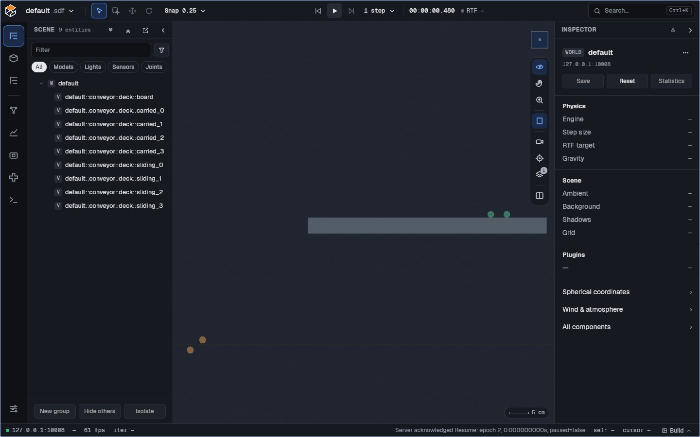

# Cloth on a translating finite deck

A 600 × 360 × 40 mm deck moved at 0.4 m/s for 480 ms. It carried the green cloth the full 192 mm. The orange cloth started 1.25 m/s faster than the deck and slid off. Each cloth weighed 100 g. The visible spheres mark the eight actual material particles. [Open the measured replay in gz-web-rs](http://127.0.0.1:8082/?backend=primitive&ui=full&quality=low&replay=1&lifecycle=1&url=ws%3A%2F%2F127.0.0.1%3A10008%2F)



## Physical results

| Quantity | Measured | Reference |
|---|---:|---:|
| Downward force on deck from each sheet at 100 ms | 0.981 N | 0.981 N from gravity |
| Forward force on deck from sliding sheet at 100 ms | 0.0981 N | 0.0981 N from kinetic friction |
| Forward force from co-moving sheet at 100 ms | < 10⁻²⁷ N | 0 N |
| Max sliding position error in the first 150 ms | 0.0368 mm | Analytic constant deceleration of 0.981 m/s² |
| Last tick carrying sliding-sheet load | 230 ms | First unloaded tick at 232 ms |
| Largest particle position difference vs stationary deck | 2.15 × 10⁻¹³ m | Galilean translation over all 240 ticks |
| Largest particle velocity difference vs stationary deck | 1.48 × 10⁻¹² m/s | Same frame transformation |
| Largest fully supported signed force error | 1.39 × 10⁻¹² N | Weight and Coulomb friction |
| Largest fully supported roll/yaw moment error | 6.64 × 10⁻¹⁶ N m | Verified about the start-of-tick collision center |

The ordinary SDF world uses a 2 ms public clock and four material substeps. The deck's collision lies 60 mm forward of the origin and 300 mm above it. Re-authoring the link at the collision center produced the same sheet states and deck reactions within 10⁻⁹ SI. The stationary control subtracts 0.4 m/s from the deck and all material particles. An additional XPBD check exercises a moving corner that intersects a triangle interior and an oblique box edge that crosses a cloth edge. It compares their signed linear and angular reactions with the cloth's change in momentum. The in-air sheet accelerated under gravity with zero deck impulse.

The native engine keeps the authored deck motion and reports signed impulses on the deck. Its swept particle, face and edge tests use the relative motion during each material substep. This qualification covers fixed orientation and constant velocity within each public tick. The public velocity command can change the translation between ticks. Rotating decks, prescribed curved paths and a moving deck in a multi-exchange articulated-pad world remain outside the admitted configurations.

## Reproduce

From the repository root, run the physical comparisons and reopen the checked-in recording with the standard CLI. The playback port in this example is 9002.

```sh
RUSTC_WRAPPER= cargo test --locked --release -p gz-sim-scene --test cloth_conveyor
RUSTC_WRAPPER= cargo test --locked --release -p gz-physics-xpbd \
  --features one-way-checkpoint,prescribed-translation \
  --test box_edge_cloth --test box_face_interior --test plane_friction_checkpoint
RUSTC_WRAPPER= cargo run --locked --release -p gz-sim-cli --bin gz-sim-rs -- \
  docs/measurements/local-manipulation/cloth-conveyor-replay --server --replay --web-viewer 9002
```

With gz-web-rs running on port 8082, open the viewer and press Play. Side view shows the height change as the orange particles clear the deck. [Open custom-port playback](http://127.0.0.1:8082/?backend=primitive&ui=full&quality=low&replay=1&lifecycle=1&url=ws%3A%2F%2F127.0.0.1%3A9002%2F)

To record a fresh trial, run the ordinary SDF file with a fresh archive directory.

```sh
RUSTC_WRAPPER= cargo run --locked --release -p gz-sim-cli --bin gz-sim-rs -- \
  examples/worlds/local_cloth_conveyor.sdf --physics-engine multifidelity --server --run \
  --web-viewer 9002 --web-lifecycle --record-scene target/conveyor-recording --iterations 240
```

## Verification

The public reset repeated every particle and signed impulse exactly at the initial state and all 240 subsequent endpoints. A rejected angular command while paused preserved the previously queued translation. Bypassing that API with a raw angular mutation faulted the next step before advancing public time. Reopening the material from its cold construction and a mid-run state reproduced another 25 loaded steps bit-for-bit. The original v1 seed retained its historical identity and four golden trajectories on static supports.

The native WebGPU client checked all 16 archive frames, including the last loaded tick at 230 ms. It compared 144 visual poses against independent per-tick state and checked their shapes, lifecycle catalogs and replay reset. The recorded archive, coverage by file, ELF build identities and separate solver measurements are available here. [Native archive manifest](cloth-conveyor-replay/manifest.json) · [Measurement receipt](cloth-conveyor.json) · [SDF world](../../../examples/worlds/local_cloth_conveyor.sdf)

The release-mode coverage run exercised 448 tests in 12 independently matched objects. One pre-existing opt-in 737 ms folded-sheet benchmark was ignored by the regular unit harness. Each production percentage below counts mapped changed source lines and distinct changed source regions on the frozen base. Expanded tests and complete workspace coverage have separate denominators. The eligible targets also passed strict Clippy.

| Crate | Production lines | Production regions | Lines including tests | Regions including tests |
|---|---:|---:|---:|---:|
| gz-physics-xpbd | 66/67 (98.51%) | 123/125 (98.40%) | 167/169 (98.82%) | 360/363 (99.17%) |
| gz-sim-scene | 61/61 (100%) | 94/95 (98.95%) | 283/283 (100%) | 529/531 (99.62%) |
