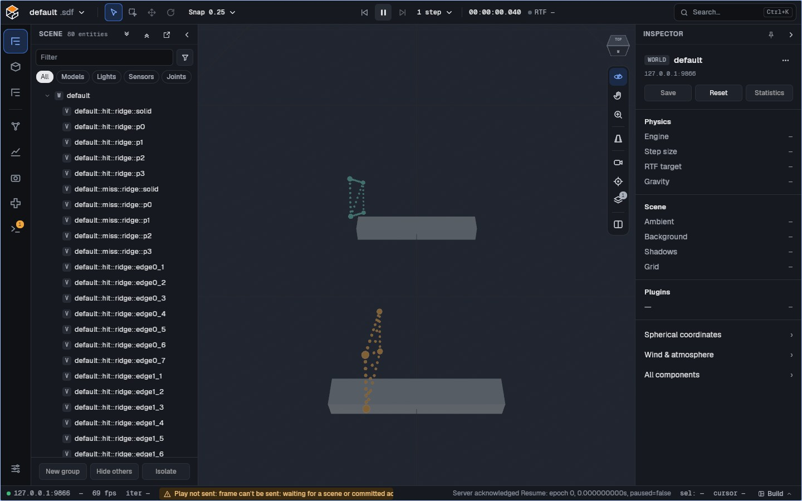

# A cloth edge grazing a finite box ridge

The orange sheet struck the ridge at 40 ms. The turquoise sheet, launched at the same speed and angle, passed the end of its ridge with 50 µm of clearance. It received zero impulse and followed its free-flight trajectory for all 90 steps. [Play both in gz-web-rs](http://127.0.0.1:8082/?backend=primitive&ui=full&quality=low&replay=1&lifecycle=1&url=ws%3A%2F%2F127.0.0.1%3A9866%2F)



Each SDF sheet has four 25 g nodes, two triangular faces and 6 mm of skin. Its leading edge crosses the box ridge at right angles while the sheet travels along the ridge at 2 m/s and closes on it at 0.35 m/s. At first impact every particle skin was at least 81.7 mm clear of the box, and every box corner was at least 74 mm clear of the cloth skin. Only the finite edge pair touched. The extra colored dots in the viewer trace the five moving material edges by interpolation.

| Measurement | Glancing hit | Offset control |
| --- | ---: | ---: |
| First normal impulse | 17.500 mN·s at 40 ms | 0 |
| First tangential impulse | 4.375 mN·s | 0 |
| Ticks with impulse above 0.1 nN·s | 2 | 0 |
| Closest clearance in free flight | First contact at 40 ms | 50.000 µm at 40.116 ms |

The measured friction impulse reaches the specified Coulomb limit of one quarter of the normal impulse. The control's closest whole-tick sample was 54.575 µm clear. The smaller 50 µm distance comes from minimizing the distance to the actual ridge endpoint between samples. Momentum was independently recomputed from the four nodes and compared to the static receiver impulse about its own center. Across both runs the largest one-step imbalance was 1.11 × 10⁻¹⁶ N·s in translation and 1.65 × 10⁻¹⁷ N·m·s in rotation.

The native WebGPU viewer checked 7,280 poses in 91 frames at 1 ms intervals, including all particle and edge-sample positions, and rewound to the measured starting frame. Solver checks also rotate the fixture, catch a 40 m/s crossing within one step, and check a 100 g sheet supported by a long ridge under gravity. The implemented boundary is a fixed box. Exact coincident parallel edges with overlapping positive skins and no geometric normal return a solver error.

The folded gripper’s receiving-bench, misplaced-bench and plane regressions reproduced the original particle trajectories, bench impulses and native replay bytes. LLVM exercised all 163 changed solver lines and 295/298 regions (98.99%), plus all 88 recorder lines and 203/212 regions (95.75%).

## Reproduce

```sh
RUSTC_WRAPPER= cargo test --release --locked -p gz-physics-xpbd --test box_edge_cloth
RUSTC_WRAPPER= cargo run --release --locked -p gz-sim-cli --example cloth_edge_strike -- target/cloth-edge/qualified
GZ_CLOTH_EDGE_AUDIT="$PWD/target/cloth-edge" RUSTC_WRAPPER= cargo test --release --locked -p gz-sim-scene --test cloth_edge_strike -- --nocapture
RUSTC_WRAPPER= cargo run --release --locked -p gz-sim-cli --bin gz-sim-rs -- --server --replay --web-viewer 9866 target/cloth-edge/qualified/replay
```

The recorder requires a fresh output directory. Use a free viewer port for a second server. The ordinary SDF fixture is in [local_cloth_edge_strike.sdf](../../../examples/worlds/local_cloth_edge_strike.sdf).
