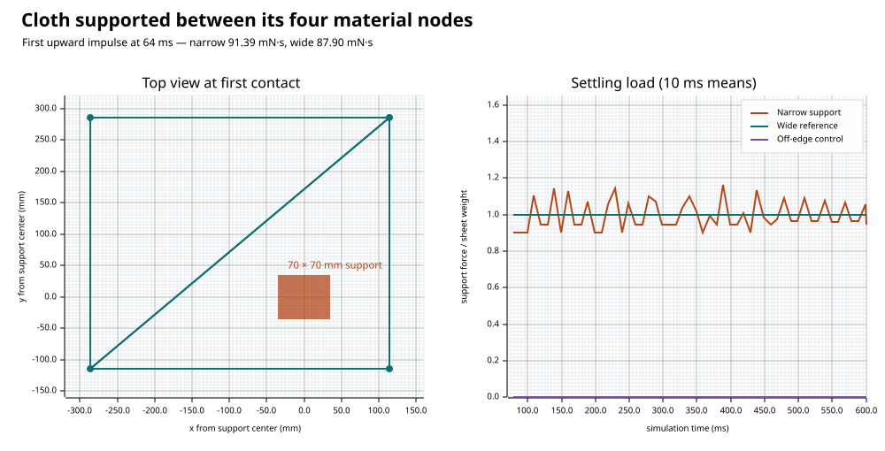

# A narrow support under the interior of a cloth triangle

A 70 × 70 mm box supported a 140 g sheet even though the closest material node stayed 106.1 mm clear of its footprint, including the node's skin. The box lid stayed inside the same triangle for all 601 public states. The smallest barycentric weight among its four corners was 0.198. [Open the three measured sheets in gz-web-rs](http://127.0.0.1:8082/?backend=primitive&ui=full&quality=low&replay=1&lifecycle=1&url=ws%3A%2F%2F127.0.0.1%3A9864%2F)



Each colored group of four spheres in the replay marks the actual material nodes of a 400 × 400 mm sheet. Orange rests on the narrow box, teal rests on the large box, and purple falls beside its box. The finite supports use ordinary static SDF collisions. The sheet uses a 6 mm skin and a shared 1 ms public clock with four solver substeps.

| 600 ms measurement | Interior support | Wide reference | Off-edge miss |
| --- | ---: | ---: | ---: |
| First contact | 64 ms | 64 ms | None |
| First upward impulse | 91.394 mN·s | 87.898 mN·s | 0 |
| Total upward impulse | 824.294 mN·s | 824.040 mN·s | 0 |
| Mean upward force over final 50 ms | 1.37697 N | 1.37340 N | 0 |
| Final center of mass height | 6.024 mm | 6.000 mm | −1,740.536 mm |

Both supports meet the sheet on the same tick. The smaller footprint gives a 3.98% larger first impulse and a 0.031% larger total impulse. The chart shows 10 ms averages of the settling force. gz-web-rs verified all 285 visual poses and shapes across 19 stored frames and rewound to the initial scene.

The solver sweeps box corners against the moving triangle and distributes the unilateral impulse through the material coordinates of each witness. Friction uses the velocity at the cloth skin and a Coulomb limit based on that corner's normal impulse. Tests cover a rotated setup, gravity on pinned and zero-thickness cloth, an underside strike, a true miss and an 80 m/s impact. With structural angular momentum conservation enabled, that fast strike balances the measured angular impulse to within 10⁻¹⁰ N·m·s both with and without friction. The folded-gripper pickup, receiving-bench, and miss controls reproduced identical physics traces and native archive bytes. Strict Clippy passed for the solver, scene tests, and figure generator. LLVM exercised 193/202 changed solver lines and 381/392 regions, plus 141/142 plotting lines and 249/262 regions. A separate study verifies [glancing contact between a box ridge and a cloth edge](cloth-edge-strike.md).

## Reproduce

The first command runs the solver checks. The second records all public material observations. The third regenerates the figure from those observations.

```sh
RUSTC_WRAPPER= cargo test --release --locked -p gz-physics-xpbd --test box_face_interior
GZ_CLOTH_FACE_OUTPUT="$PWD/target/cloth-face" RUSTC_WRAPPER= \
  cargo test --release --locked -p gz-sim-scene --test cloth_face_support
RUSTC_WRAPPER= cargo run --release --locked --manifest-path tools/physics-audit/numerics/Cargo.toml \
  --bin cloth_face_support -- target/cloth-face target/cloth-face/response.svg
```

To record a new native replay, run the ordinary simulator for 600 iterations with `examples/worlds/local_cloth_face_support.sdf`, `--physics-engine multifidelity --server --run --web-lifecycle --web-viewer 9870 --iterations 600 --record-scene target/cloth-face/replay`. The resulting directory can be served with `gz-sim-rs --server --replay --web-viewer 9870 target/cloth-face/replay`.
