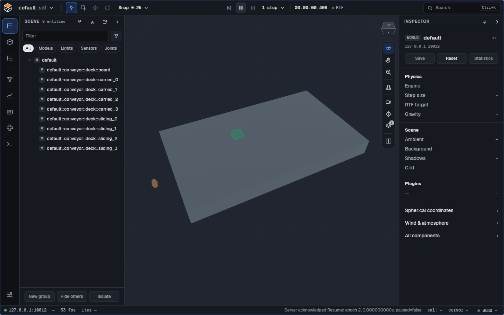

# Cloth on a translating turntable

A rigid 450 × 270 mm deck turns at 5 rad/s while its axis travels forward at 0.18 m/s. Two loose 100 g cloth patches start at their local deck speeds. Static friction holds the green patch at a radius of 60 mm. The orange patch starts at 190 mm, beyond the 157 mm radius at which static friction can provide the required centripetal force. Its final measured support comes at 160 ms and it falls under gravity. [Play the recorded experiment in gz-web-rs](http://127.0.0.1:8082/?backend=primitive&ui=full&quality=low&replay=1&lifecycle=1&url=ws%3A%2F%2F127.0.0.1%3A10012%2F)



## Physics

The native rigid pose supplies both angular endpoints of each 2 ms public step. The material solver uses the resulting arc and the velocity of the surface at its actual contact point. On the broad faces the solver checks whether the static cone can provide the tangential impulse needed to stay on the turning surface. Sliding uses the kinetic coefficient. Each patch has four particles, two material triangles, a static coefficient of 0.40 and a kinetic coefficient of 0.12. The scene runs for 600 ms.

| Quantity | Result |
|---|---:|
| Green patch, maximum particle displacement from its native deck location | 4.92 × 10⁻¹⁴ m |
| Green patch, maximum speed error against commanded rigid surface motion | 1.79 × 10⁻⁷ m/s |
| Green patch, maximum force error against analytical weight and centripetal acceleration | 7.87 × 10⁻⁶ N |
| Green patch, maximum moment error about the initial collision center for each tick | 5.00 × 10⁻⁵ N m |
| Orange patch, center-of-mass error versus an independent Coulomb sliding integration through 120 ms | 0.0178 mm |
| Last loaded tick with 8 and 32 material substeps | 160 ms for both |
| Orange patch, maximum position / speed difference after fourfold material refinement | 0.0595 mm / 0.966 mm/s |
| Signed vertical impulse on deck from orange patch, 8 / 32 material substeps | −0.149955 / −0.149859 N s |
| Largest linear / angular impulse balance residual across both patches | 3.41 × 10⁻¹⁶ N s / 1.31 × 10⁻⁹ N m s |

At 100 ms, the sliding patch exerted **[0.11668, 0.01563, −0.98100] N** and **[−0.10387, 0.17835, −0.00951] N m** on the deck in world axes. Its first fully unloaded tick was 162 ms. The angular balance includes gravity about the collision center at the start of each public tick. It estimates the gravity lever across the eight substeps by interpolating the material endpoints. Point particles carry orbital angular momentum, and interior triangle and edge rows distribute tangential traction over their material vertices. [Physical measurements, per-target coverage and native browser checks](cloth-turntable.json)

## Contact and operating bounds

The scene requests a prescribed one-way box with `motion="turntable"`. The link translates along a straight path within each step and spins around the collision's local Z axis through the native center of mass. Both signs of the rotation are supported. Axial collision offsets are supported. A tilted spin command is refused before replacing an already queued twist. A half-turn or larger per native public step exceeds the admitted angular interval. The prescribed deck can report the full reaction while its motion remains externally driven. Tilt-changing decks and freely recoiling supports have different dynamics. [Authored world](../../../examples/worlds/local_cloth_turntable.sdf)

Rounded particle-to-box sweeps resolve a short crossing at the first time of impact. The regression with a rotating narrow bar checks the analytical hit time, ensuing displacement and signed impulse for both a smooth and frictional strike with clear initial and final particle positions on the undisturbed trajectory. Corner-to-triangle and edge-to-edge sweeps work in the rotating frame and expand the candidate search by a bound on the curved material trajectory's deviation from its straight chord. The actual endpoint skin sets the final constraint. If that bound exceeds the smaller of 1 µm and 0.1% of particle radius, the solver returns an unresolved step and preserves committed material state. A disjoint sheet clears the broad-phase check without requiring refinement.

A second Bevy scene removes the deck translation and applies the same velocity shift to all eight particles. Across the full run, the transformed positions agreed within 1.81 × 10⁻¹³ m. Moving the link origin along the axis to the collision center reproduced the particle paths and moments. Pausing preserved the last valid command, a fresh scene reset repeated every measured endpoint, and a mid-run material checkpoint on a reverse-spinning deck reproduced the subsequent 30 loaded steps bit-for-bit.

## Replay and repeat

From the repository root, start the checked-in native replay on an available port and open gz-web-rs. These commands use port 9002 and the local viewer on 8082.

```sh
RUSTC_WRAPPER= cargo run --locked --release -p gz-sim-cli --bin gz-sim-rs -- \
  docs/measurements/local-manipulation/cloth-turntable-replay --server --replay --web-viewer 9002
```

Press Play to watch the outward slide. The WebGPU audit compared all 171 visual poses in 19 frames to the sampled solver and native rigid states, verified shapes and lifecycle records, and returned the recording to its initial frame. [Open replay on port 9002](http://127.0.0.1:8082/?backend=primitive&ui=full&quality=low&replay=1&lifecycle=1&url=ws%3A%2F%2F127.0.0.1%3A9002%2F)

To generate another native recording or repeat the physical regressions, run the ordinary SDF and crate tests.

```sh
RUSTC_WRAPPER= cargo run --locked --release -p gz-sim-cli --bin gz-sim-rs -- \
  examples/worlds/local_cloth_turntable.sdf --physics-engine multifidelity \
  --server --run --web-lifecycle --web-viewer 9002 --iterations 300 \
  --record-scene target/turntable-recording
RUSTC_WRAPPER= cargo test --locked --release -p gz-sim-scene --test cloth_turntable
RUSTC_WRAPPER= cargo test --locked --release -p gz-physics-xpbd \
  --features one-way-checkpoint,prescribed-translation --test box_face_interior \
  --test box_edge_cloth --test plane_friction_checkpoint
```

The frozen source passed 458 release-mode tests in 13 instrumented executables. One pre-existing opt-in folded-sheet benchmark was ignored by its unit harness. Each raw profile matched its own executable build ID. The table reports mapped changed ranges in each crate, with test-source denominators shown separately. The touched test targets and libraries also passed strict Clippy.

| Crate | Production lines | Production regions | Lines with tests | Regions with tests |
|---|---:|---:|---:|---:|
| gz-physics-xpbd | 224/224 (100%) | 475/483 (98.34%) | 411/412 (99.76%) | 827/836 (98.92%) |
| gz-sim-scene | 121/123 (98.37%) | 171/176 (97.16%) | 491/493 (99.59%) | 954/964 (98.96%) |
