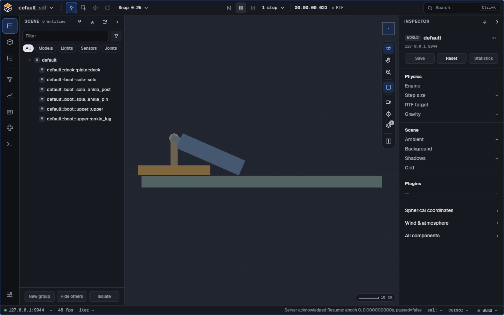

<!-- Copyright (C) 2026 Open Source Robotics Foundation -->
<!-- SPDX-License-Identifier: Apache-2.0 -->

# A moving ankle crosses a finite support edge

The toe moved 28.89 mm beyond the deck while the foot continued carrying weight. The freely rotating blue shank hit the deck at 32.375 ms, within 55 µs of an independently calculated impact. Shortening the blue collision box produced a clear miss with zero rigid impulse. [Play the edge strike](http://127.0.0.1:8082/?backend=primitive&ui=full&quality=low&replay=1&lifecycle=1&url=ws%3A%2F%2F127.0.0.1%3A9944%2F) · [Play the short-shank miss](http://127.0.0.1:8082/?backend=primitive&ui=full&quality=low&replay=1&lifecycle=1&url=ws%3A%2F%2F127.0.0.1%3A9945%2F) · [Play the wide-deck control](http://127.0.0.1:8082/?backend=primitive&ui=full&quality=low&replay=1&lifecycle=1&url=ws%3A%2F%2F127.0.0.1%3A9946%2F)

The 1 kg foot and 1 kg shank started at 0.75 m/s. A free revolute joint connects them 160 mm above the foot center. The sole started compressed by 0.227 mm with its toe 5 mm behind the edge. A −0.45 N·m moment acted on the shank from 16 to 50 ms. The SDF, mass properties, joint-frame transforms, gravity and actuator inputs matched across cases. The miss shortened the shank box from 340 to 120 mm while keeping its mass distribution unchanged. The wide-deck control translated the original deck 415 mm. The pin, post and lug are visual representations of the mechanical joint. [Ordinary SDF](../../../examples/worlds/local_compliant_ankle_edge.sdf)

| Measured at 62.5 µs, with 0.5 ms public ticks | Edge strike | Short-shank miss | Wide deck |
|---|---:|---:|---:|
| Actual maximum toe overhang | 28.89 mm | 27.91 mm | 0 |
| First loaded shank interval ends | 32.375 ms | — | 32.375 ms |
| First loaded public shank impulse | 0.207564 N·s | 0 | 0.206908 N·s |
| Reference impulse over the same public tick | 0.207938 N·s | 0 | 0.207799 N·s |
| Total rigid shank impulse over 50 ms | 0.357237 N·s | 0 | 0.358096 N·s |
| Independent total rigid shank impulse | 0.357250 N·s | 0 | 0.358154 N·s |
| Normal impulse from the plantar coating | 0.671723 N·s | 0.561600 N·s | 0.661971 N·s |
| Signed plantar shear impulse along travel | −0.214898 N·s | −0.179664 N·s | −0.211778 N·s |
| Final ankle angle | −1.52517° | −3.25501° | −1.46428° |
| Maximum ankle angle error | 0.00271° | 0.00438° | 0.00271° |
| Maximum joint speed error | 0.00208 rad/s | 0.00032 rad/s | 0.00523 rad/s |
| Maximum shank center error | 8.23 µm | 13.31 µm | 8.24 µm |
| Maximum per-tick whole-robot momentum imbalance | 28.30 µN·s | 0.0343 µN·s | 27.67 µN·s |

The shank strike and miss shared their sole reaction and motion up to first impact. In the edge strike the coating carried at least 7.93 N during every public tick with a positive shank reaction. The two native rigid contact points delivered a combined 0.04993 N·m·s about the shank center’s pitch axis. The short shank kept more than 36.5 mm clearance throughout. At 11 ms the native loaded patch measured 0.07141 m² over the edge and 0.07200 m² on the wide deck.

## Geometry and time refinement

The plantar pressure and sliding traction integrate over the clipped finite sole patch. The coating owns only the lower foot/deck pair. Rapier owns the independent frictionless shank/deck contact and the reduced-coordinate revolute joint. The rigid pair uses fresh intersecting witnesses, rigid constraint coefficients and eight velocity and stabilization iterations per solve. This holds the contact clock fixed while iterating the two simultaneous contact rows. A reported shank impulse requires a reachable finite top with matching native contact normal and physical contact at an interval endpoint to within 1 nm.

The separate planar reference integrates both pitch angles, both inertias, the coupled translational mass and the pressure distribution with RK4 at 7.8125 µs. Bisection locates the lowest shank edge hitting the finite top. The contact Jacobian supplies an inelastic impulse and a subsequent unilateral supporting force. The instantaneous reference impulse was 0.206722 N·s. Its integral over the first loaded 0.5 ms tick also includes the remaining support force. Halving the reference step changed cumulative hard impulse by at most 2.6 × 10⁻¹² N·s. [Independent reference implementation](../../../crates/gz-sim-cli/examples/compliant_ankle_edge/reference.rs)

| Native interval | Peak shank-center error | Peak ankle-angle error | Peak cumulative shank impulse error at public boundaries |
|---:|---:|---:|---:|
| 250 µs | 32.90 µm | 0.01084° | 1.945 mN·s |
| 125 µs | 16.46 µm | 0.00542° | 2.036 mN·s |
| 62.5 µs | 8.23 µm | 0.00271° | 0.375 mN·s |
| 31.25 µs | 4.11 µm | 0.00135° | 0.172 mN·s |
| 15.625 µs | 2.06 µm | 0.00068° | 1.218 mN·s |

Trajectory and momentum residual decreased with each halving. The peak cumulative hard impulse error increased at the finest setting, so these runs establish trajectory convergence and a separate measured impulse bound. In the displayed run the maximum cumulative plantar normal and shear errors were 0.136 and 0.043 mN·s.

## Supported domain and lifecycle

An ordinary DampedSole SDF enables this mode with `native_ankle` and `ankle_positive_x_edge`. It admits outward toe motion over the local +X edge of one static box while keeping the rigid substrate, rear rim, two side rims and links clear. A hard shank contact must lie fully inside the top face. The shank and deck must be frictionless when that contact can occur. Inward crossings, self-contact, shank contact at a rim, and frictional upper strikes remain outside this domain.

A late frictional-contact refusal preserved both native link states, the clock, the last plantar reaction and queued joint effort. An overhanging shank at the rear rim also refused the step. Reset cleared published reactions and reproduced the entire edge strike bit for bit. The 135 scoped release tests and strict Clippy passed. Changed production coverage reached 598/620 mapped lines and 992/1031 mapped regions. Chromium checked every timestamp, all six visual shapes and poses across 101 frames per replay, and a rewind to zero. [Measurements, replay hashes and changed-source coverage](compliant-ankle-edge.json)

## Reproduce

~~~sh
RUSTC_WRAPPER= cargo run --release --locked --no-default-features -p gz-sim-cli \
  --example compliant_ankle_edge -- target/compliant-ankle-edge
RUSTC_WRAPPER= cargo run --release --locked --no-default-features -p gz-sim-cli \
  --bin gz-sim-rs -- --server --replay --web-viewer 9944 target/compliant-ankle-edge/strike
~~~

Use a fresh output directory. Serve the `miss` and `full` archives on 9945 and 9946 for the controls.
