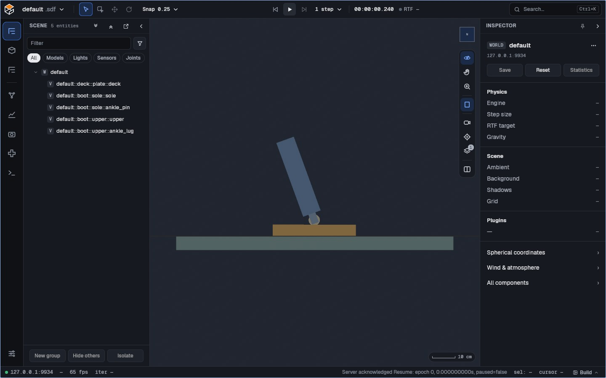

<!-- Copyright (C) 2026 Open Source Robotics Foundation -->
<!-- SPDX-License-Identifier: Apache-2.0 -->

# A native ankle carrying load through a planted sole

The ankle bent 19.973° over 240 ms as the two-kilogram robot slid on its compliant foot. A fixed joint held 0° under the same applied moment. The sole stayed loaded in both cases. [Play the free ankle](http://127.0.0.1:8082/?backend=primitive&ui=full&quality=low&replay=1&lifecycle=1&url=ws%3A%2F%2F127.0.0.1%3A9934%2F) · [Play the locked ankle](http://127.0.0.1:8082/?backend=primitive&ui=full&quality=low&replay=1&lifecycle=1&url=ws%3A%2F%2F127.0.0.1%3A9935%2F)

Both links started moving horizontally at 0.18 m/s with zero spin. The 360 × 200 mm sole started compressed by 0.2271 mm under a 1 kg foot and a 1 kg shank. The public Bevy wrench input applied 0.55 N·m to the shank from 40 to 100 ms. With the same sliding start and no external moment, the free ankle still rotated 12.237° as friction slowed the foot. Each public tick was 0.5 ms with eight native integration intervals in the visualized runs. Orange pin and blue lug visuals show the actual hinge location. [Ordinary SDF fixture](../../../examples/worlds/local_compliant_ankle.sdf)

| Measured over 240 ms | Free revolute | Fixed joint |
|---|---:|---:|
| Reference final ankle angle | 19.96849° | 0° |
| Maximum ankle angle error | 0.00498° | 0° |
| Maximum foot center error | 6.84 µm | 6.61 µm |
| Ground normal impulse | 4.534139 N·s | 4.709526 N·s |
| Signed ground shear impulse | +0.111166 N·s | −0.360375 N·s |
| Frictional work | −0.021286 J | −0.031708 J |
| Minimum mean vertical ground force | 17.434 N | 18.273 N |
| Peak mean upward force transmitted to shank | 9.816 N | 10.606 N |
| Maximum per-tick transmitted impulse error | 1.328 µN·s | 1.723 µN·s |
| Peak whole-robot linear momentum residual per tick | 0.054 µN·s | 0.00016 µN·s |

The slip speed at the pressure centroid ranged from +0.1772 to −0.00765 m/s for the free joint. The shear reversed as the sole reversed direction, while friction continued to dissipate energy. Each tick’s tangential impulse stayed within the 0.32 Coulomb bound. Both geometries cleared the finite deck edges by at least 249 mm. The shank collision box stayed at least 84 mm above the deck throughout the free run.

## Independent comparison

The reference integrates foot COM translation and the absolute pitch angles of both links using a planar mass matrix, gravity, both rotational inertias and the actual ankle offsets. Locking the joint removes its independent angular coordinate. A material-coordinate quadrature integrates pressure and regularized Coulomb traction across the loaded sole strip. RK4 advances all coordinates and the force integrals together on a separate 7.8125 µs grid. Halving the reference interval changed the cumulative ground impulse by less than 4 × 10⁻¹³ N·s. [Independent Rust dynamics](../../../crates/gz-sim-cli/examples/compliant_ankle/reference.rs)

The joint impulse on the shank comes from its change in measured native COM momentum after subtracting gravity. The applied external wrench is a pure couple. This gives an independent force-transfer check at every public boundary and includes both horizontal and vertical components. Each row below gives maximum absolute errors over the full free-ankle trajectory.

| Internal interval | Joint impulse per public tick | Cumulative normal impulse | Cumulative shear impulse |
|---:|---:|---:|---:|
| 500 µs | 11.536 µN·s | 388.80 µN·s | 564.07 µN·s |
| 250 µs | 5.502 µN·s | 193.66 µN·s | 278.59 µN·s |
| 125 µs | 2.687 µN·s | 96.65 µN·s | 138.47 µN·s |
| 62.5 µs | 1.328 µN·s | 48.28 µN·s | 69.03 µN·s |
| 31.25 µs | 0.660 µN·s | 24.13 µN·s | 34.47 µN·s |

## Ownership and lifecycle

The `native_ankle` DampedSole setting enrolls one floating lower-rooted revolute or fixed joint over one static box. Each material interval applies the current pressure and shear as a wrench at the lower link. Rapier advances the multibody with a pair filter for the coated foot and deck. The published native contact observations contained zero duplicate rigid impulse. Existing support consumers can read the committed load via `panel_steps`. The new `ankle_step` also exposes shank and deck-edge clearance.

Both links, joint coordinates, contact caches and pending commands are staged together. A post-step margin check discards a speculative interval that reaches the deck rim or a possible shank collision. A regression started 0.3 mm from the rim and verified unchanged clock, link states, previous reaction and queued joint effort at refusal. One 0.5 ms public command produced the same native velocities as eight explicitly commanded 62.5 µs steps. Reset cleared queued inputs and reproduced the loaded trajectory. Rigid frictional multi-point shank contact, multiple joints, and unilateral support at a deck edge remain open.

The 150 scoped release tests passed, including the native Rapier library, existing interval and coating regressions, and the independent comparison. Strict Clippy passed. Changed production coverage reached 697/715 mapped lines and 1,327/1,390 mapped regions. Chromium checked all 121 frames and 605 visual poses and shapes per branch against the native recording, then rewound each to zero. [Numerical measurements, executable hashes and replay checks](compliant-ankle.json)

## Reproduce

~~~sh
RUSTC_WRAPPER= cargo run --release --locked --no-default-features -p gz-sim-cli \
  --example compliant_ankle -- target/compliant-ankle
RUSTC_WRAPPER= cargo run --release --locked --no-default-features -p gz-sim-cli \
  --bin gz-sim-rs -- --server --replay --web-viewer 9934 target/compliant-ankle/free
~~~

Use a fresh output directory. Serve `target/compliant-ankle/locked` on port 9935 for the fixed-joint control.
