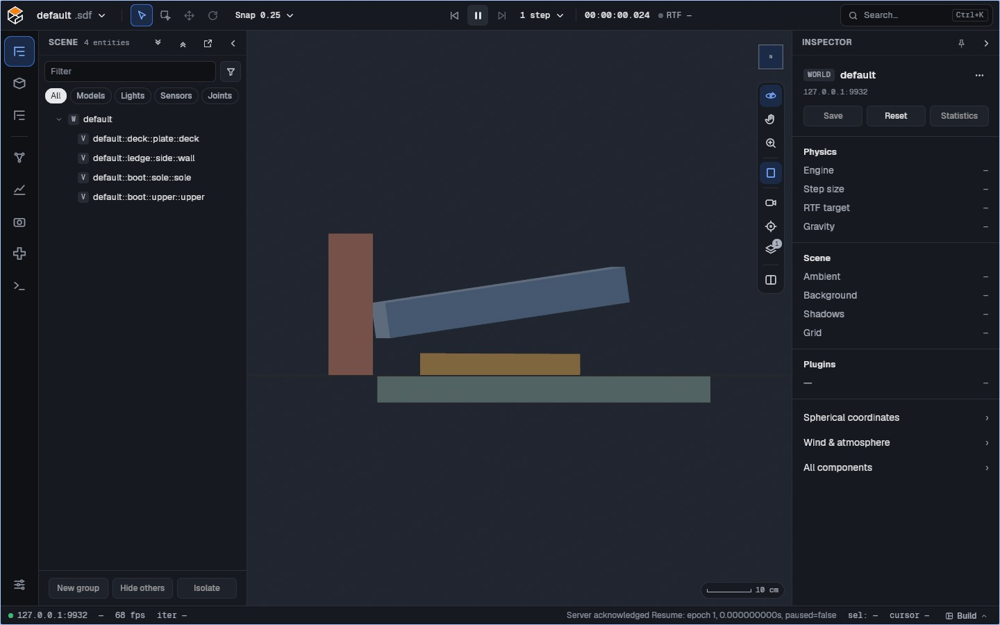

<!-- Copyright (C) 2026 Open Source Robotics Foundation -->
<!-- SPDX-License-Identifier: Apache-2.0 -->

# A welded foot striking a ledge while its sole carries weight

The blue upper link struck the red ledge obliquely and rebounded. The orange sole kept at least 19.62 N of mean vertical load during every strike tick. Moving the finite ledge 650 mm sideways produced zero upper impulse, and the sole continued to carry the foot’s full weight. [Play the strike](http://127.0.0.1:8082/?backend=primitive&ui=full&quality=low&replay=1&lifecycle=1&url=ws%3A%2F%2F127.0.0.1%3A9932%2F) · [Play the miss](http://127.0.0.1:8082/?backend=primitive&ui=full&quality=low&replay=1&lifecycle=1&url=ws%3A%2F%2F127.0.0.1%3A9933%2F)

Both incoming trajectories start with the same two-kilogram aggregate at rest vertically, moving at 0.65 m/s toward the ledge and 0.20 m/s along it. The finite sole is preloaded by 0.22708 mm. Its force comes from integrating pressure over the loaded area. The upper material is a frictionless, unilateral linear spring of 40 kN/m at the one penetrating box corner. The two materials act on the same floating fixed assembly. Each reports its own impulse and moment about the moving center of mass. At the authored eight internal steps the first positive upper reaction was recorded at 13.5 ms, the peak was 171.577 N and the last positive tick ended at 34.5 ms. The counterpart on the ledge has equal magnitude and opposite direction.

## Independent physical reference

A separate Rust integrator advances the aggregate’s position, quaternion, linear momentum and angular momentum together with classical RK4. It computes the lower force by integrating strips in sole material coordinates. It computes the upper reaction from the world positions of all eight vertices and the finite ledge extents. It shares no collision, integration or reaction code with the scene solver. Each reference sample corresponds to the same 0.5 ms public boundary as the recorded foot. Changing its internal interval from 7.8125 to 3.90625 µs changed the largest cumulative upper impulse by 0.0351 µN·s and the center trajectory by 0.00047 µm. [Reference integrator](../../../crates/gz-sim-cli/examples/compliant_upper/reference.rs)

| Internal interval | Maximum cumulative upper impulse error | Maximum cumulative sole impulse error | Maximum center error |
|---:|---:|---:|---:|
| 500 µs | 753.84 µN·s | 580.12 µN·s | 3.554 µm |
| 250 µs | 159.69 µN·s | 122.82 µN·s | 0.888 µm |
| 125 µs | 50.48 µN·s | 30.67 µN·s | 0.226 µm |
| 62.5 µs | 8.79 µN·s | 7.15 µN·s | 0.159 µm |
| 31.25 µs | 1.76 µN·s | 1.89 µN·s | 0.014 µm |

At 62.5 µs the total upper and lower impulses were 2.30263364 N·s and 1.42988017 N·s. The reference measured 2.30262485 N·s and 1.42988318 N·s. Per-tick linear and angular momentum changes were checked independently from both native link states, gravity and the two materials’ impulses. The largest residuals were 6.11 × 10⁻¹⁶ N·s and 5.44 × 10⁻¹⁶ N·m·s. Translating both supports and the foot together preserved the relative trajectory. The moving ledge’s work matched its signed impulse times its velocity.

## Admission and continuity

The ordinary DampedSole plugin accepts an optional enrolled panel name in `upper_negative_x_support` and a positive `upper_corner_stiffness` in N/m. Start the upper geometry clear of the panels. During the step, the upper body can compress the target’s local −X face with one corner. The candidate must stay inside its finite face, clear of the other box features. Bounds on each accepted drift protect the lower box from a side strike and the upper box from every other panel. Spring motion requires a sufficiently fine fixed temporal grid. A swept but unsampled tangent with unresolved direction, a possible second corner, and an ambiguous rim strike each refuse the transaction, retaining both links, all panel states, the previous loads and the pending wrench.

Reset reproduced the two-contact trajectory. Removing the ledge retired its receipt and preserved sole contact with the floor. General upper friction, rigid multi-point contact, rotating side panels and freely jointed feet remain open. The 25 scoped release tests passed, including the previously qualified coating and lifecycle cases. Strict Clippy passed for the scene test and recording example. Changed production coverage reached 509/518 mapped lines and 1,026/1,055 mapped regions. Chromium’s WebGPU renderer checked all 121 native frames and 484 visual poses and shapes per branch, and rewound both recordings. [Numerical receipt, coverage and replay hashes](compliant-upper.json)

## Reproduce

~~~sh
RUSTC_WRAPPER= cargo run --release --locked --no-default-features -p gz-sim-cli \
  --example compliant_upper -- target/compliant-upper
RUSTC_WRAPPER= cargo run --release --locked --no-default-features -p gz-sim-cli \
  --bin gz-sim-rs -- --server --replay --web-viewer 9932 target/compliant-upper/strike
~~~

Use a fresh output directory. To serve the miss, repeat the replay command with port 9933 and the `miss` directory. Pause and step to 24 ms for the loaded side view. [Ordinary SDF scene](../../../examples/worlds/local_compliant_upper.sdf)
