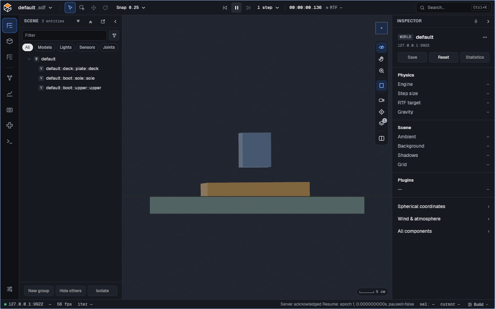

<!-- Copyright (C) 2026 Open Source Robotics Foundation -->
<!-- SPDX-License-Identifier: Apache-2.0 -->

# Landing a welded foot on a compliant sole

A 2 kg foot fell onto a finite deck with a 0.5 ms public clock and eight internal material steps per tick. The blue upper and orange lower are separate bodies connected by a fixed joint. The control uses both collision boxes on one body with the same mass, center and inertia. Both received matching forces during flight and again during contact. [Play the welded foot](http://127.0.0.1:8082/?backend=primitive&ui=full&quality=low&replay=1&lifecycle=1&url=ws%3A%2F%2F127.0.0.1%3A9922%2F) · [Play the compound control](http://127.0.0.1:8082/?backend=primitive&ui=full&quality=low&replay=1&lifecycle=1&url=ws%3A%2F%2F127.0.0.1%3A9923%2F)

| Measured over 720 public ticks | Welded | Compound |
|---|---:|---:|
| First positive contact | 114.5 ms | 114.5 ms |
| First impulse above 0.01 N·s | 0.01035571 N·s at 117.5 ms | 0.01035571 N·s at 117.5 ms |
| Peak material force | 264.26622 N | 264.26622 N |
| Total normal impulse | 7.14440672 N·s | 7.14440672 N·s |
| Maximum per-tick linear momentum residual | 1.65 × 10⁻¹⁵ N·s | 1.65 × 10⁻¹⁵ N·s |
| Maximum per-tick angular momentum residual | 9.17 × 10⁻¹⁶ N·m·s | 1.21 × 10⁻¹⁵ N·m·s |

The largest difference between branches was 4.97 × 10⁻¹⁵ m in center of mass, 3.82 × 10⁻¹⁴ rad in orientation, and 8.20 × 10⁻¹⁴ N·s in contact impulse. The momentum check independently sums the two native link states, including the angular momentum of each moving center about the assembly COM. It subtracts gravity, commanded wrenches and the coating impulse at every tick. A wrench on the upper link of the weld has a moment arm of 70 mm from the assembly COM. The control applies the corresponding moment at its own COM.

## Finite upper-box contact

The lower face owns the coating reaction. Before publishing either foot or deck, the scene checks that the upper box stays clear of every enrolled panel. It bounds the translation and rotation of the upper box and the panel across the full accepted interval using the initial momenta, applied loads and peak normal force at the material integration stages. Regularized friction bounds tangential force. A possible upper-box strike rejects the entire tick. Both link states, all support states, the prior reaction, and pending native loads survive a refusal.

An edge test started the upper collider 5 mm outside the finite deck and moved it 10 mm horizontally in one tick. The crossing was refused at time zero, retaining the commanded 10 N. The same motion displaced sideways by 400 mm advanced freely with zero load. For this milestone the aggregate principal moments must align with the coated link frame. A robot with unconstrained joints or unregistered colliders still requires a shared contact solve.

## Verification

The two native branches also agreed on individual support impulses and work during experiments with a rotating deck and two independently registered translating panels. Reversing the native parent and child preserved the solution. Reset reproduced each link state and the coating reaction exactly. Removing the only support handed the links and their generalized velocity back to ordinary free motion.

The release checks passed 100 Rapier library tests, three native ownership tests, 19 scene and lifecycle tests, and two example regressions. Strict Clippy passed for the changed targets. Each WebGPU replay was checked against all 181 native frames and 543 visual poses and shapes, then rewound to zero. Production coverage was **519/523 changed mapped lines** and **1034/1066 changed mapped regions**. The numerical receipt includes the matching object hashes.

## Reproduce

Run from the integration checkout with the gz-web-rs frontend on port 8082 and a fresh recording directory.

~~~sh
RUSTC_WRAPPER= cargo run --release --locked --no-default-features -p gz-sim-cli \
  --example compliant_weld -- target/compliant-weld
RUSTC_WRAPPER= cargo run --release --locked --no-default-features -p gz-sim-cli \
  --bin gz-sim-rs -- --server --replay --web-viewer 9922 target/compliant-weld/welded
~~~

Serve the compound directory on 9923 to play the control. [Welded SDF](../../../examples/worlds/local_compliant_weld.sdf) · [Compound SDF](../../../examples/worlds/local_compliant_compound.sdf) · [Numerical receipt](compliant-weld.json)
