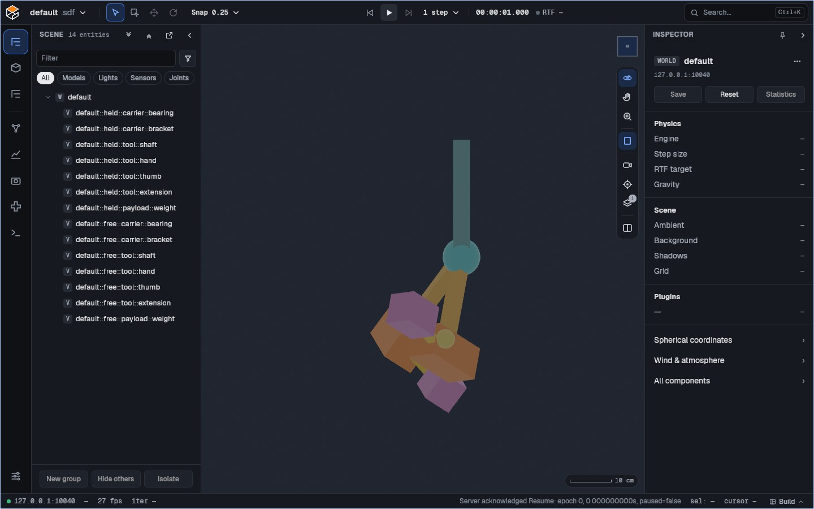

<!-- Copyright (C) 2026 Open Source Robotics Foundation -->
<!-- SPDX-License-Identifier: Apache-2.0 -->

# Turning an unevenly loaded wrist

Two identical 3 kg wrist assemblies turned about the same oblique axis under gravity. Each contained a 2 kg tool welded to a 1 kg eccentric payload. The reference accelerated at 6 rad/s² for 400 ms, braked for 400 ms and then held a 55.00° target for 200 ms. Each wrist received its calculated gravity and acceleration torques at 1 ms intervals, without position feedback. [SDF model](../../../examples/worlds/gravity_wrist.sdf)

| Measurement | Full inertia tensor | Diagonal-only control |
|---|---:|---:|
| Peak orientation error | 0.7075° | 77.18° |
| Residual angular speed at 1 s | 0.02124 rad/s | 1.497 rad/s |
| Repeated steps after reset | 1,000/1,000 | 1,000/1,000 |

The public scene query sums only the links on the child side of the joint. It rotates each link's native inertia into the authored joint frame and shifts it from the mass center to the joint pivot. An independent calculation from authored link masses and public link poses agreed within 2.23 × 10⁻¹⁶ kg·m² over the entire motion. This measures the rigid inertia for the current configuration. A descendant joint free to accelerate requires articulated dynamics. Branch, sibling, ownership, invalid topology, overflow and missing joint checks ran alongside the loaded robot trials.

All 112 native solver unit tests, two scene tests and six example tests passed. Scoped changed-line/region coverage was 47/47 and 91/91 in native physics, 6/6 and 6/6 in multifidelity, 36/36 and 62/64 in scene and 154/157 and 304/319 in the CLI example. The WebGPU browser checked 101 frames and 1,414 displayed poses and shapes, then rewound to zero. [Watch in gz-web-rs](http://127.0.0.1:8082/?backend=primitive&ui=full&quality=low&replay=1&lifecycle=1&url=ws%3A%2F%2F127.0.0.1%3A10040%2F) · [Native measurements and coverage](composite-wrist-inertia.json) · [Portable recording](composite-wrist-inertia.tar.xz)



From the physics checkout, use a fresh output directory.

```sh
RUSTC_WRAPPER= cargo run --locked --release --no-default-features -p gz-sim-cli --example gravity_wrist -- --accelerate wrist-inertia
RUSTC_WRAPPER= cargo run --locked --release --no-default-features -p gz-sim-cli --bin gz-sim-rs -- --server --replay --web-viewer 10040 wrist-inertia/replay
```
