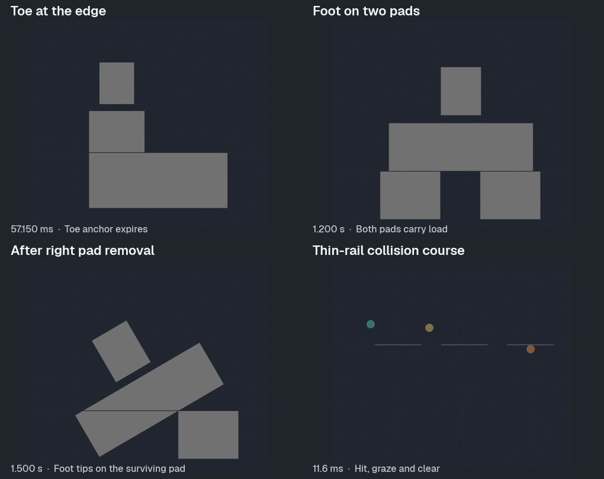

# Watch the contact and collision course

The course has three interactive gz-web-rs recordings. Press **Play** in the top toolbar. Use **Reset** to replay from the start, or **Step** while paused to inspect successive recorded frames.

| Recording | What to look for |
|---|---|
| [Foot at the ledge](http://127.0.0.1:8082/?backend=primitive&ui=full&quality=low&replay=1&lifecycle=1&url=ws%3A%2F%2F127.0.0.1%3A11560%2F) | At 57.150 ms the toe reaches the end of the support and its cached contact expires. The motion is tens of micrometres at this camera scale. Frame 19 captures the crossing. |
| [Two supports, then one](http://127.0.0.1:8082/?backend=primitive&ui=full&quality=low&replay=1&lifecycle=1&url=ws%3A%2F%2F127.0.0.1%3A11561%2F) | Frame 121 shows both pads. Frame 122 shows the surviving pad at the same 1.200 s simulation clock. The foot tips around it over the next 0.30 s. |
| [Three fast links and a thin rail](http://127.0.0.1:8082/?backend=primitive&ui=full&quality=low&replay=1&lifecycle=1&url=ws%3A%2F%2F127.0.0.1%3A11562%2F) | The orange tip hits head-on, the yellow tip clips the corner, and the green tip passes the end of the rail. Select the top view to inspect the three paths. |

Move the pointer over the viewport and press **3** for the side view of the foot, or **7** for the top view of the rails. Each web endpoint serves the original physics clock. The course film slows the obstacle run so the 20 ms crossing can be seen. [Watch the film](contact-course-view.mp4) · [Download all three replay archives](contact-course-view.tar.xz)

[](contact-course-view.mp4)

## Run the recordings on another machine

From the simulator checkout, build the CLI, extract the recordings and serve one of them. Change the final directory to `paused` or `fast` to see the other runs on the same port.

```sh
RUSTC_WRAPPER= cargo build --release --locked --no-default-features -p gz-sim-cli \
  --bin gz-sim-rs --bin gz-sim-local-replay
mkdir -p target/contact-course
tar -xJf docs/measurements/local-manipulation/contact-course-view.tar.xz -C target/contact-course
target/release/gz-sim-rs --server --replay --web-viewer 11560 target/contact-course/contact-course-view/edge
```

Serve the gz-web-rs frontend on port 8082, then use the port-11560 link above. These worlds all use the standard `default` name. [Build the browser frontend](../../LOCAL_CPU_MVP.md#watch-the-recordings)

## Record and verify the course

Run this Bash block from the simulator checkout, using fresh output directories. The second execution changes the Bevy pool size, verifies the entire first run, and then emits an independent pose trace for the browser checks. The scenes have one visual aligned with each measured link.

```bash
set -eu
out="$PWD/target/contact-course"
bin="$PWD/target/release/gz-sim-local-replay"
mkdir -p "$out"
for name in edge paused fast; do
  case "$name" in
    edge) world=examples/multifidelity_rocking_foot.sdf; input=course_foot_edge; every=127 ;;
    paused) world=examples/multifidelity_two_support_foot.sdf; input=course_paused_support; every=20 ;;
    fast) world=examples/worlds/local_fast_obstacle.sdf; input=local_fast_obstacle; every=2 ;;
  esac
  journal="examples/replay/$input.json"
  "$bin" "$world" "$journal" --threads 1 --record-every "$every" \
    --record "$out/$name" --trace "$out/$name-first.jsonl"
  "$bin" "$world" "$journal" --threads 8 --verify "$out/$name-first.jsonl"
  "$bin" "$world" "$journal" --threads 8 --trace "$out/$name-second.jsonl"
  diff -rq "$out/$name/epoch-0" "$out/contact-course-view/$name"
done
```

With the server and frontend running, the Rust verifier opens Chromium with WebGPU, plays through every recorded frame, checks the visual IDs, poses, shapes and lifecycle catalog, then resets. It matches the visual poses to the second journal by simulation time and link identity, so it distinguishes the two states at 1.200 s. This command checks the ledge recording on port 11560. Use `paused` and port 11561 or `fast` and port 11562 for separately running servers.

```bash
RUSTC_WRAPPER= cargo run --release --locked --manifest-path tools/physics-audit/browser/Cargo.toml -- \
  target/contact-course/contact-course-view/edge target/contact-course/contact-course-view/checks/edge.json \
  target/contact-course/checked-edge 11560
```

Chromium played and reset all three recordings. At each ordinal the local UI received the complete pose, shape and model catalog for that frame. A separate eight-thread run reproduced the one-thread physics trace byte for byte. The browser verifier matched every visual pose to that separate run, including the retired pad at the paused edit.

| Scene | Recorded frames | Visual poses checked | Model catalogs checked |
|---|---:|---:|---:|
| Toe crossing | 45 | 135 | 45 |
| Paused removal | 152 | 577 | 152 |
| Fast links | 101 | 606 | 101 |

The 11.67-second film uses Chromium frames from those recordings. The frictionless grazing tip changes orientation by at most 2.3 × 10⁻¹⁵ rad in the archived run. Each chapter displays simulation time, and the support-removal chapter samples more frequently after the edit. The portable archive’s SHA-256 is `cd2acfc167a86aafc026467475db6b6086608018b308bac1f7c03d33ab042302`. [Support measurements](contact-course-support.md)

## Physics checks

The native tests covered the first contact after losing a pad, both insertion orders for the thin obstacle, a gravity-loaded control, two simultaneous contacts in zero gravity, and the earlier compound-collision cases. The focused LLVM run also exercised the installed journal command’s paused edit, rejection and reset paths. Against the previous review revision `be3bf37`, the CLI covered 8/8 changed executable lines and 20/20 changed regions. Scene covered 1/1 and 2/2. The native collision library covered 147/152 lines (96.7%) and 241/246 regions (98.0%). The full repository still has an open release gate. [Contact forces and trajectories](contact-course-support.md) · [Fast obstacle and timing](fast-obstacle-course.md) · [Repository release criteria](../../PHYSICS_RELEASE_ROADMAP.md)

## Installed preview

A clean checkout of published source `0ac52d2843d697006bb01937521ae189bdc62c0a` built the Linux x86-64 preview with SHA-256 `5d7c10677cd61b2b1337e81f0d73ae7167e4126878ec9141f9a2c36f31010265`. An unprivileged Ubuntu 24.04 container with networking disabled checked the package manifest and ran all three courses. One and eight Bevy threads agreed on all 8,699 journal records. The installed binary reproduced the three bundled course recordings and the earlier differential-drive and double-pendulum recordings byte for byte. The installed rotor also completed its 610-record journal. [Build the preview](../../LOCAL_CPU_MVP.md#build-the-installable-preview) · [Hosted source checks](https://github.com/gazebosim-rs/gz-sim-rs/actions/runs/45552607113)
