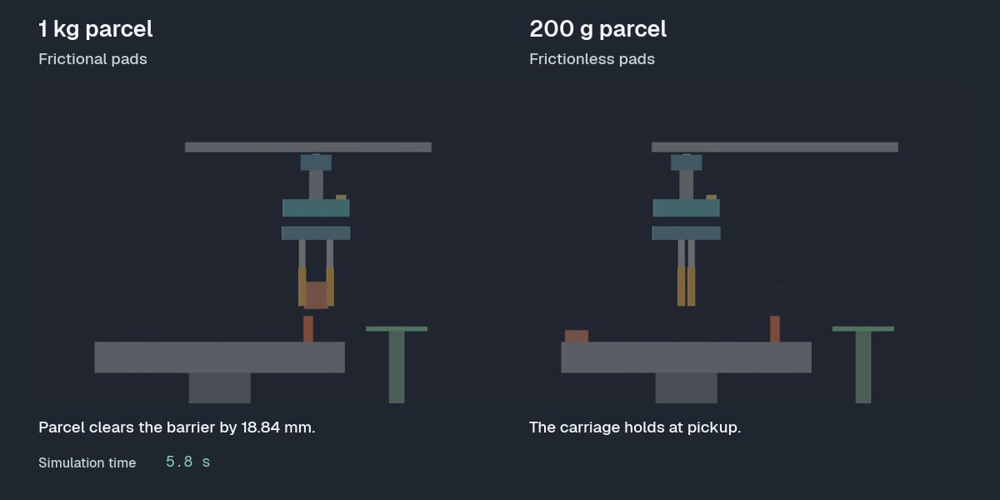

<!-- Copyright (C) 2026 Open Source Robotics Foundation -->
<!-- SPDX-License-Identifier: Apache-2.0 -->

# Watch the controlled arm and gripper

The gripper lifted a 1 kg parcel, cleared the red barrier by 18.84 mm and set it on the green shelf. With frictionless pads, the 200 g parcel slipped to the rim of the pickup tray. The controller detected the missing grip at 3.700 s and held the carriage at pickup. The film shows the two runs on the same clock, followed by the stock Gazebo joint moving through its three commanded angles. [Watch the film](controlled-arm-view.mp4) · [Download the recordings](controlled-arm-view.tar.xz)

[](controlled-arm-view.mp4)

| Interactive recording | What to look for |
|---|---|
| [Successful placement in gz-web-rs](http://127.0.0.1:8082/?backend=primitive&ui=full&quality=low&replay=1&lifecycle=1&url=ws%3A%2F%2F127.0.0.1%3A11563%2F) | The two orange fingers carry the parcel over the barrier. At 9.195 s the controller opens the fingers after measuring 30 ms of sustained shelf support. The shelf carries 9.81 N at the end. |
| [Failed grasp in gz-web-rs](http://127.0.0.1:8082/?backend=primitive&ui=full&quality=low&replay=1&lifecycle=1&url=ws%3A%2F%2F127.0.0.1%3A11564%2F) | The fingers rise without the parcel. The parcel stays on the pickup tray, which carries its full 1.962 N at the end. |
| [Stock joint position controller in gz-web-rs](http://127.0.0.1:8082/?backend=primitive&ui=full&quality=low&replay=1&lifecycle=1&url=ws%3A%2F%2F127.0.0.1%3A11565%2F) | The square rotor follows targets of +1.0, −0.5 and +0.25 radians. Its last measured angle is +0.24999976 radians. |

For the gripper, move the pointer into the viewport and press **1**, then **F** for a side view. For the stock scene, select the third visual in the scene tree, **default::joint_position_controller_test::rotor::visual**. Move the pointer into the viewport and press **7**, then **F**. Scroll down to leave room for the square to rotate. Press **Play** in the top toolbar. Use **Reset** to watch again. [Arm and parcel measurements](arm-placement-course.md) · [Stock controller measurements](upstream-joint-position.md)

## Run on another machine

From the simulator checkout, run these commands to serve the successful placement with the Rust replay server. Serve the gz-web-rs frontend on port 8082 and open the first link above. To serve the other recordings, use `failed` with port 11564 or `stock` with port 11565. [Build and serve the frontend](../../LOCAL_CPU_MVP.md#watch-the-recordings)

```sh
mkdir -p target/arm-course
tar -xJf docs/measurements/local-manipulation/controlled-arm-view.tar.xz -C target/arm-course
(cd target/arm-course/controlled-arm-view && sha256sum --quiet -c SHA256SUMS)
RUSTC_WRAPPER= cargo run --release --locked --no-default-features -p gz-sim-cli --bin gz-sim-rs -- \
  --server --replay --web-viewer 11563 target/arm-course/controlled-arm-view/placed
```

The package also includes all three recordings under `share/gz-sim/controlled-arm-view`. To regenerate the physical routes, run the installed `serial_transfer` twice, giving each run a fresh output directory. The commands print the measured grip, travel, clearance and support forces in SI units except where the field name specifies millimetres.

```sh
./bin/serial_transfer clear-obstacle placed --parcel-kg 1 --grip-friction 0.85 >placed.json
./bin/serial_transfer clear-obstacle failed --parcel-kg 0.2 --grip-friction 0 >failed.json
./bin/gz-sim-local-replay share/gz-sim/upstream_joint_position.sdf share/gz-sim/upstream_joint_position.json \
  --threads 1 --record stock --record-every 10 --trace stock.jsonl
./bin/gz-sim-local-replay share/gz-sim/upstream_joint_position.sdf share/gz-sim/upstream_joint_position.json \
  --threads 8 --verify stock.jsonl
```

## Playback checks

Chromium played every frame with WebGPU, compared each visual pose and shape with its archived state, and reset all three scenes to time zero. The arm recordings use a 40 ms cadence and include the exact release or rejected-grasp instant. Independent repeat runs of the installed serial runner reproduced the visual streams and the force and trajectory measurements byte for byte. The parcel and palm visual centers on each final frame matched the physical centers printed by that run.

| Scene | Recorded frames and catalogs | Visual poses and shapes checked |
|---|---:|---:|
| 1 kg placement | 452 | 9,492 |
| 200 g rejected grasp | 452 | 9,492 |
| Stock position controller | 126 | 378 |

For the stock controller, a second run with eight Bevy threads reproduced all 1,255 journal records from the one-thread run. The browser verifier matched the three displayed link poses at each recorded time to that second run. To repeat the browser checks, start the corresponding server, then run this command with the scene name and port. The archive includes the verifier inputs and the raw stock trace.

```sh
RUSTC_WRAPPER= cargo run --release --locked --manifest-path tools/physics-audit/browser/Cargo.toml -- \
  target/arm-course/controlled-arm-view/stock target/arm-course/controlled-arm-view/checks/stock.json \
  target/arm-course/checked-stock 11565
```

The portable archive has SHA-256 `240bf7577cce13041547952dd9ee3f6f31b221154f2a3da80ad9fa6da5eca88d`.

## Installed preview and coverage

A clean checkout of published source `656e29383603bcdee50ad3cf3532d522a0f6d8cb` produced the Linux x86-64 archive with SHA-256 `2afde90ad13ea1c68bccf4df983ff3db9b3353b8a8595474b0290388ae76e2a3`. An unprivileged, network-disabled Ubuntu 24.04 installation verified its manifest, ran both gripper commands, and reproduced both packaged frame streams and both measurement reports byte for byte. The packaged rotor reproduced all 1,255 journal records across one and eight threads and its visual recording matched the archive. Comparing its installed trajectory with native Gazebo reproduced the published error values exactly. The six-joint measurements and earlier fast-obstacle replay also matched their published results. [Build the preview](../../LOCAL_CPU_MVP.md#build-the-installable-preview) · [Hosted checks for the source](https://github.com/gazebosim-rs/gz-sim-rs/actions/runs/45556491748)

The focused LLVM checks compared executable code with the previous review revision, `66906d3`. The scene library covered all 116 changed executable lines and all 202 changed regions. The installed gripper command covered 81/81 lines and 221/222 regions. The installed six-joint check covered 127/133 lines (95.5%) and 256/266 regions (96.2%). LLVM reported eight functions with mismatched profile data in the combined scene export. The whole-repository release gate remains open. [Controller checks](upstream-joint-position.md) · [Gripper checks](arm-placement-course.md) · [Joint checks](loaded-joint-chain.md) · [Release criteria](../../PHYSICS_RELEASE_ROADMAP.md)
