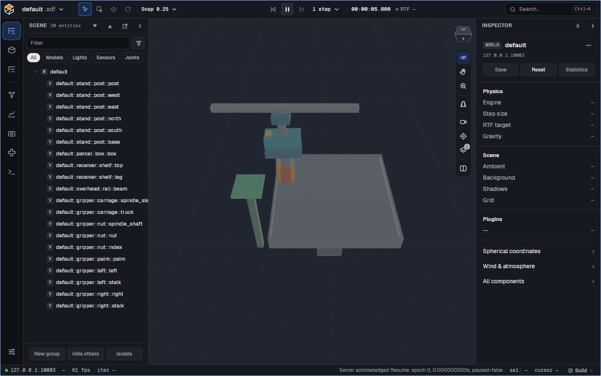

# Reading the CPU gripper while it carries a parcel

The local CPU robot publishes six coordinates across five joints at 100 Hz on `/world/default/model/gripper/joint_state`. The rail and two jaws report displacement in metres. The screw spindle and both wrist axes report angle in radians. Each includes its measured velocity at the same time. A Zenoh subscriber compared the standard Gazebo packet with native physics measurements, including after reloading the world. The screw angle predicted nut travel to within 20 µm with a 0.50 m/revolution pitch. [Source workcell](../../../examples/worlds/local_robot_serial_transfer.sdf) · [Measurements](cpu-gripper-joint-state.json)



The robot lifted its 200 g parcel 126.07 mm, carried it 462.44 mm and placed it on the receiving shelf. The shelf then carried 1.962 N. All 451 visual frames were byte-identical to the earlier transfer without the publisher. gz-web-rs checked 9,020 displayed poses and shapes and rewound to the initial state. The release-mode CPU tests covered filtering, IDs, positive-rate publication, motion and loaded-world reset. The GPU multi-owner regression ran on the RTX 5090. The first rail and jaw phase covered 21/21 changed production lines and 41/42 regions. Adding the spindle and both wrist axes covered 58/58 lines and 120/123 regions in the scene and 19/19 lines and 25/25 regions in the server. All 32 server joint-state tests passed, including rejection of stale and incomplete wrist samples. [Watch the transfer in gz-web-rs](http://127.0.0.1:8082/?backend=primitive&ui=full&quality=low&replay=1&lifecycle=1&url=ws%3A%2F%2F127.0.0.1%3A10003%2F)

To reproduce the transfer from the physics checkout, choose a fresh archive directory.

```sh
RUSTC_WRAPPER= cargo run --release --locked --no-default-features -p gz-sim-cli --example serial_transfer -- transfer artifacts/my-observed-transfer
RUSTC_WRAPPER= cargo run --release --locked --no-default-features -p gz-sim-cli --bin gz-sim-rs -- --server --replay --web-viewer 10003 artifacts/my-observed-transfer
```

The live packet regression runs the actual server, subscribes to the robot topic, drives the rail and compares the resulting wire measurements with the independently accessible joint samples.

```sh
RUSTC_WRAPPER= cargo test --release --locked --no-default-features -p gz-sim-server --lib the_live_cpu_transfer_robot
```
