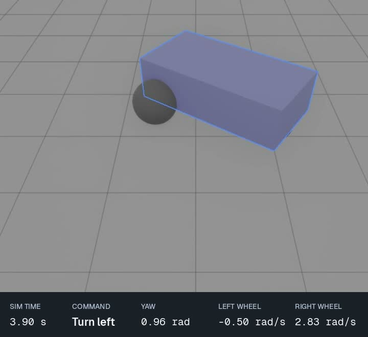

# Drive the stock Gazebo vehicle

The vehicle accelerates from rest, drives straight for two seconds, turns left for two seconds, and brakes. The blue box, two powered wheels, and free ball caster are the original visuals from Gazebo's `test/worlds/diff_drive.sdf`. The wheels are spheres with uniform material, so their rotation is easiest to see in the encoders. [Watch the 5.5-second clip](drive-view.mp4) · [Open the local gz-web-rs replay](http://127.0.0.1:8082/drive/?backend=primitive&ui=full&quality=high&replay=1&lifecycle=1&url=ws%3A%2F%2F127.0.0.1%3A11559%2F)

In the scene tree, select the second visual beneath **diff_drive**, **diff_drive::vehicle::chassis::visual**. Move the pointer over the viewport and press **F** to frame it. Scroll down to leave room for the turn, then press **Play** in the toolbar. The first half-second lets the chassis settle under gravity. [Portable replay archive](drive-view.tar.xz)

[](drive-view.mp4)

## Wheel traction

All four runs used the same 1 ms clock and body-velocity commands. In the straight phase, the chassis moved 0.875 m on the stock surface. Lowering friction or lifting the wheels preserved rotation while changing how far the body traveled. The encoder columns give the measured joint positions at 2.5 s. [Stock SDF](../../../examples/worlds/upstream_diff_drive.sdf) · [Command journal](../../../examples/replay/upstream_diff_drive.json) · [Measured controls](drive-controls.json)

| Contact condition | Straight chassis travel | Left wheel | Right wheel |
| --- | ---: | ---: | ---: |
| Stock, SDF default μ = 1 | 0.874557 m | 2.91553 rad | 2.91410 rad |
| Low friction, μ = 0.001 | 0.010340 m | 2.91570 rad | 2.91440 rad |
| Zero friction | 0.000005 m | 2.91571 rad | 2.91441 rad |
| Chassis supported on a stand | 0.000146 m | 2.90363 rad | 2.91321 rad |

The stand held the bottoms of both wheels at least 0.19898 m above the ground throughout the run. Both wheel–ground normal impulse sums were zero. On stock ground their sums were 122.23 and 125.08 N·s. Gazebo/DART and the Rust simulation both took 0.39 s to stop after the zero command. Over 551 paired samples the maximum horizontal chassis error was 0.316 mm and the maximum yaw error was 0.000403 rad. At 5.5 s the stock chassis was at (1.96796, −0.26241) m in the horizontal world plane with yaw 1.59952 rad. The driven axle midpoint was at (1.94769, 0.44301) m. The chassis origin lies behind the axle. [Native Gazebo/DART comparison](../../../tools/physics-audit/drive-native/README.md)

## Reproduce the simulation and controls

Run from the simulator checkout. The Rust harness invokes the journal CLI for each physical run. It creates output paths exclusively, checks the one-thread trace against an independent eight-thread run, resets while the turn command is active, and compares every replayed state with the original. The recording uses the viewer's lighting. The Gazebo sun remains in the simulation.

```sh
cargo build --release --locked --no-default-features -p gz-sim-cli \
  --bin gz-sim-local-replay --bin gz-sim-rs
cargo run --release --locked --manifest-path tools/physics-audit/numerics/Cargo.toml \
  --bin wheel_drive -- target/release/gz-sim-local-replay target/drive-measurement
```

The output directory contains 551-sample CSVs, the four full physics traces, a reset trace, the controlled SDF variants, and the stock recording. The one- and eight-thread runs agreed byte for byte on all 5,505 trace lines. After reset the simulator reproduced all 5,504 physical observations, including the zero-command settle interval.

To run only the stock recording, use the original SDF directly. The friction flag selects the SDF default for collisions whose surface coefficient is omitted.

```sh
target/release/gz-sim-local-replay examples/worlds/upstream_diff_drive.sdf \
  examples/replay/upstream_diff_drive.json --sdf-default-friction --threads 1 \
  --record target/stock-drive --record-every 50 --viewer-lighting \
  --trace target/stock-drive.jsonl
target/release/gz-sim-rs --server --replay --web-viewer 11559 target/stock-drive/epoch-0
```

To play the portable archive instead, extract it and pass the extracted `drive-view` directory to the replay server. The archive SHA-256 is `90c311d4d64d450c69f887edc674b399ba7e2f288f1267c6deb8eaa033fd16d1`.

## Build the browser viewer

The read-only recording contains the SDF world name `diff_drive` and its scoped model and visual names. The companion patch enables named scenes in the gz-web-rs primitive backend and checks that their visuals belong to the declared world. Apply it to the published recovery UI revision from a fresh checkout. [Viewer patch](gzweb-named-world.patch)

```sh
patch="$PWD/docs/measurements/local-manipulation/gzweb-named-world.patch"
git clone --branch review/physics-worker-recovery-ui https://github.com/gazebosim-rs/gzweb-rs.git ../drive-gzweb
(cd ../drive-gzweb && git checkout a5edcb20bdbe378391b92a414e890ac018eaecbf && \
  git apply "$patch" && ./build.sh && python3 -m http.server 8082 --bind 127.0.0.1)
```

Chromium played all 111 frames with WebGPU, matched 555 visual poses and shapes and 111 model catalogs to the archive, and rewound to time zero. The development host mounts the patched frontend at `/drive/`. When serving it at the root with the command above, use this endpoint. [Open the standalone viewer](http://127.0.0.1:8082/?backend=primitive&ui=full&quality=high&replay=1&lifecycle=1&url=ws%3A%2F%2F127.0.0.1%3A11559%2F)
