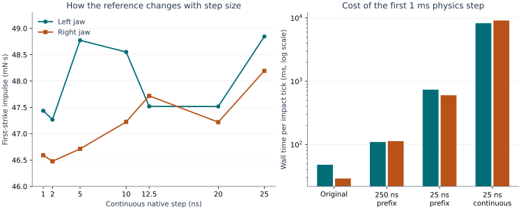

<!-- Copyright (C) 2026 Open Source Robotics Foundation -->
<!-- SPDX-License-Identifier: Apache-2.0 -->

# The first impact on each gripper finger

A free 200 g parcel approaches one outer finger of the serial gripper across a 50 µm gap. With 64 native steps per millisecond, the solver combined two hits on the left and spread the right hit over too much time. The new setting starts the impact millisecond from the same state as the continuous fine run, uses small steps until 93.75 µs, and returns to the previous grid. The actuator still receives one command every millisecond.

In gz-web-rs, watch the cyan ball beside the gripper. Its rise shows the total impulse delivered so far, with 2 cm of rise for every 10 mN·s. Use the step button to see the first and second rises on the left. Each recorded pose and gauge reading came from the native solver at the displayed frame. The physical timestamps are in the measurement file at nanosecond resolution. [Original left](http://127.0.0.1:8082/?backend=primitive&ui=full&quality=low&replay=1&lifecycle=1&url=ws%3A%2F%2F127.0.0.1%3A10086%2F) · [Continuous 25 ns left](http://127.0.0.1:8082/?backend=primitive&ui=full&quality=low&replay=1&lifecycle=1&url=ws%3A%2F%2F127.0.0.1%3A10087%2F) · [Refined left](http://127.0.0.1:8082/?backend=primitive&ui=full&quality=low&replay=1&lifecycle=1&url=ws%3A%2F%2F127.0.0.1%3A10088%2F) · [Refined right](http://127.0.0.1:8082/?backend=primitive&ui=full&quality=low&replay=1&lifecycle=1&url=ws%3A%2F%2F127.0.0.1%3A10089%2F)

## Accuracy and cost

The continuous 25 ns reference delivered 34.785 and 14.060 mN·s to the left finger in separate pulses. On the right it delivered 48.195 mN·s in a single pulse. The selective 25 ns setting reproduced each pulse on both sides, down to the first and last loaded native step. Over the following 24 ms the maximum position difference among the five moving links and the parcel fell from **1.299 to 0.164 mm** on the left and **1.622 to 0.183 mm** on the right. Maximum rotation differences fell from 2.843° and 2.140° to 0.098° and 0.110°.

| First impact setting | Native calls in first ms | Left / right impulse error vs continuous 25 ns | Left / right p95 wall time |
|---|---:|---:|---:|
| Original | 64 | 10.01% / 8.70% | 47.8 / 29.0 ms |
| First 93.75 µs at 250 ns | 433 | 1.54% / 0.86% | 109 / 113 ms |
| First 93.75 µs at 25 ns | 3,808 | 0% / 0% | 736 / 601 ms |
| Continuous 25 ns | 40,000 | reference | 8,293 / 9,142 ms |

Each p95 is the nearest rank over 15 fresh worlds on the same logical CPU of a shared host. The timer surrounds the first public physics step, excluding world loading, warmup, body checks and recording. The median for the original setting was 15–16 ms. The selective 25 ns setting cost 489–571 ms at the median. All six body states and the integer call count matched the untimed runs. The finer settings are opt-in. [Raw timings and pulse histories](early-jaw.json)



The continuous reference itself changes as the clock gets finer. At a 1 ns step, the left jaw saw three pulses totaling 47.436 mN·s and the right saw two totaling 46.591 mN·s. The 25 ns totals were 2.97% and 3.44% higher. Selecting a 1 ns prefix with a 100,000-step budget reproduced every recorded pulse field of both continuous 1 ns runs using 93,808 native calls instead of one million in the first tick. The 25 ns trajectory comparisons above extend to 24 ms. The 1 ns comparison covers the first millisecond. A separate frictionless collision of the free parcel and jaw matched the closed-form impulse to within 2 × 10⁻¹³ N·s. The jointed gripper still needs an independent impact calculation. [Free-jaw analytical control](free-jaw-impact.md) [Left at 1 ns](http://127.0.0.1:8082/?backend=primitive&ui=full&quality=low&replay=1&lifecycle=1&url=ws%3A%2F%2F127.0.0.1%3A10091%2F) · [Right at 1 ns](http://127.0.0.1:8082/?backend=primitive&ui=full&quality=low&replay=1&lifecycle=1&url=ws%3A%2F%2F127.0.0.1%3A10092%2F)

A second pair of runs at a 35 µm gap also reproduced the 25 ns reference impulse on both fingers. Both missed strikes, touching approaches and the 175, 350 and 1,200 µm gaps retained their original public samples with the 4,096-step fine budget. A shorter fine window roughly halved median cost at 50 µm but changed the left and right impulses by 0.26% and 0.16% against the continuous 25 ns control. The runtime keeps the prefix anchored at the public incoming state. [Holdouts and shorter-window experiment](early-jaw.json)

## Grasp, carry and release

For a separate end-to-end test, the same policy watched the inward-facing surfaces during an ordinary two-finger pickup. The robot held its 200 g parcel on both pads for all 4,001 traverse ticks, moved it 462 mm, then transferred its 1.962 N weight to the shelf. After opening, the maximum drop was 0.019 mm. Across an 18 s transfer, enabling the fine window produced identical result and frame bytes to the otherwise identical policy with the window disabled. This held with both the original rail and the 100 kHz rail. Two negative controls on the 100 kHz rail also retained identical frames. With the jaws open, the robot left the parcel on its source tray. With the receiving shelf out of reach, it kept its grip and withheld release. [Watch the full transfer](http://127.0.0.1:8082/?backend=primitive&ui=full&quality=low&replay=1&lifecycle=1&url=ws%3A%2F%2F127.0.0.1%3A10090%2F)

## Reproduce

From the gz-sim-rs review checkout, choose a fresh output directory and run

```sh
export RUSTC_WRAPPER=
cargo run --locked --release --no-default-features -p gz-sim-cli --example serial_impact_inertia -- \
  --divisor 1.75 --gap-um 50 --guide-hz 100000 --automatic --substeps 64 \
  --impact-iterations 8 --impact-pgs 8 --early-face-step-ns 25 --early-face-max-steps 4096 \
  --audit-first-strike --write-world target/early-jaw.sdf --replay target/early-jaw-view
cargo run --locked --release --no-default-features -p gz-sim-cli --bin gz-sim-rs -- \
  --server --replay --web-viewer 10188 target/early-jaw-view
```

Add `--right` for the reflected strike. Omit `--audit-first-strike` to record the ordinary 24 ms trajectory. The continuous first-tick reference uses `--divisor 1.75 --gap-um 50 --guide-hz 100000 --substeps 40000 --ticks 1 --impact-pulses`. To measure cost, replace the audit and replay flags with `--ticks 1 --timing-runs 15`. The portable archive includes the inward-facing transfer world for `serial_transfer transfer OUTPUT --world WORLD`. [Open the reproduced recording](http://127.0.0.1:8082/?backend=primitive&ui=full&quality=low&replay=1&lifecycle=1&url=ws%3A%2F%2F127.0.0.1%3A10188%2F) · [Portable recordings and SDF worlds](early-jaw-replays.tar.xz)

The early window requires one eligible approaching pair with parallel faces, negligible transverse speed, zero initial spin and no pre-existing native contacts. The authored budget must fit the predicted arrival and one additional ordinary cell. A missing or duplicate configuration field is rejected at load. Coverage of changed executable Rust, with test definitions excluded, was 101/101 lines and 164/164 regions in the scene crate and 171/174 lines and 339/355 regions in the serial-impact CLI example. [Coverage and exact-binary evidence](early-jaw.json)
