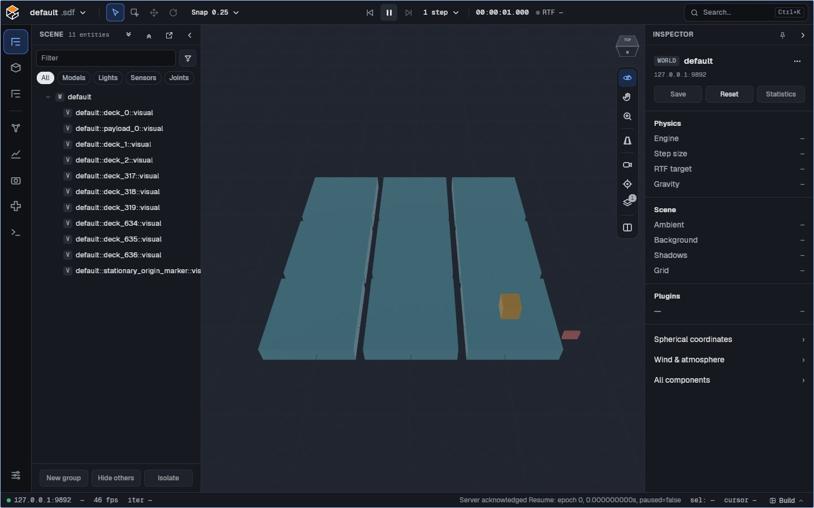

<!-- Copyright (C) 2026 Open Source Robotics Foundation -->
<!-- SPDX-License-Identifier: Apache-2.0 -->

# Publishing model poses from their canonical links

In the fully observed scene with 100,000 moving decks and 1,000 payloads, the median time to publish the canonical link poses fell from 2.870 to 1.174 ms. In alternating ticks of one process, complete-step p95 fell from 16.297 to 13.816 ms. Separate release executables consistently lowered median step time when they advanced matched blocks, while their p95 varied. Both programs produced identical public poses, velocities and IMU readings on every tested tick. [Measurements](fleet-canonical.json) · [Open the CPU fleet in gz-web-rs](http://127.0.0.1:8082/?backend=primitive&ui=full&quality=low&replay=1&lifecycle=1&url=ws%3A%2F%2F127.0.0.1%3A9892%2F)

| Ordinary scene | Before, model p50 / p95 | After, model p50 / p95 | Before, complete tick p50 / p95 | After, complete tick p50 / p95 |
|---|---:|---:|---:|---:|
| 100,000 decks, 1,000 payloads | 2.870 / 4.870 ms | 1.174 / 1.983 ms | 11.667 / 16.297 ms | 10.254 / 13.816 ms |
| 100,000 sparse decks, zero payloads | 2.050 / 5.181 ms | 0.737 / 2.075 ms | 5.740 / 13.576 ms | 4.377 / 10.339 ms |
| 256 decks, three payloads, serial publication | 4.52 / 4.98 µs | 4.16 / 4.77 µs | 26.38 / 31.00 µs | 26.01 / 32.81 µs |

Model publication reads neighboring immutable public IDs and world poses from Bevy component tables in blocks of 64. It checks the public ID of each source against the model's canonical link. An unmatched model gets the pose of its current owner from the ordinary public-ID lookup. All model transforms still pass through the same rotation and translation composition. The search borrows the current tables for one publication stage, so an entity restored under a new Bevy generation can supply the next observation.

## Timing and correctness

Four release processes per layout ran with fixed affinity on CPUs 24–31. To control for the shared workstation's changing load, each process executed both publication implementations in an alternating ABBA sequence, with a different starting position in each trial. The other physics, hierarchy and sensor systems followed the ordinary schedule. Each run discarded 20 warmup ticks and measured 100 at a fixed simulated 10 ms per tick. The table pools 200 wall-clock observations per implementation and layout. Median and p95 are nearest-rank percentiles. All four large-scene runs individually improved complete-tick p95. The small serial control had a 1.81 µs higher complete-tick p95. The fully observed 100× real-time target remains open.

A separate accuracy run compared independently built baseline and candidate executables. For every one of 120 steps in each large layout, the audit hashed every public entity ID, local and world pose, link velocity, and the active IMU's timestamp, epoch, orientation, angular velocity and specific force. All 240 SHA-256 digests matched. This checked 96,480,480 pairs of world and local poses, including the world roots, and 24,120,000 link twists. The mixed scene reported 1,000 loaded contacts and a maximum commanded-deck position error of 6.54 × 10⁻¹² m. The sparse scene reported zero displacement error and passed its paused edit and velocity reset checks.

The regression reordered and replaced 3,000 of 9,000 rotated links under their stable public IDs and checked every transformed model frame after a commit and reset. The existing hierarchy, spawn and world-edit suites passed 20 tests, and the restored IMU observer and archive audit passed. Strict Clippy passed. The changed runtime code covered 32/32 lines and 102/103 regions.

## Independent release executables

Two additional checks compared independently compiled baseline and candidate programs on the same CPUs. The first ran the ordinary, uninstrumented fleet benchmark in four alternating process pairs per layout, each measuring 100 ticks. The second gave each executable its own fully loaded world. After 20 warmup ticks the programs took turns stepping matching blocks, with five warm ticks followed by 40 measured ticks in each block. Block order and process startup order alternated. Each layout supplied 1,280 samples per version from four trials, eight blocks per trial. Physics and ECS code in these separate executables used their ordinary release settings.

| Process comparison | Before p50 / p95 | After p50 / p95 |
|---|---:|---:|
| Mixed, matched blocks | 5.186 / 6.270 ms | 4.656 / 6.556 ms |
| Mixed, separate full runs | 5.324 / 6.784 ms | 5.793 / 7.606 ms |
| Sparse, matched blocks | 2.749 / 4.839 ms | 2.322 / 3.678 ms |
| Sparse, separate full runs | 2.796 / 3.537 ms | 2.324 / 3.775 ms |

Each matched-block trial reduced median complete-step time for both layouts. Independent complete-step p95 varied across trials and methods. The repeatable gains in model publication and median complete-step time motivated keeping the change.

## Native playback

The candidate's recording shows nine decks, one payload and a fixed red reference marker drawn from the ordinary 100,000-deck simulation. The archive audit checked the recorded motion against the public observations and the closed-form deck motion. The gz-web-rs WebGPU renderer checked all 561 displayed poses and shapes across 51 frames and rewound to 0 ms. The blue deck carries the orange payload 0.494 m in two seconds. [Playback](http://127.0.0.1:8082/?backend=primitive&ui=full&quality=low&replay=1&lifecycle=1&url=ws%3A%2F%2F127.0.0.1%3A9892%2F)



To repeat the ordinary production benchmark, run the following commands in each checkout. The first case includes contact and the second case exercises the sparse control. The checked-in fleet replay example and audit accept the same input as the earlier [playback instructions](fleet-publication-view.md).

```sh
export RUSTC_WRAPPER=
export CARGO_TARGET_DIR="${CARGO_TARGET_DIR:-$PWD/target}"
cargo build --release --locked --no-default-features -p gz-sim-scene --example fleet_observation
taskset -c 24-31 "$CARGO_TARGET_DIR/release/examples/fleet_observation" 100000 mixed-auto
taskset -c 24-31 "$CARGO_TARGET_DIR/release/examples/fleet_observation" 100000
```
