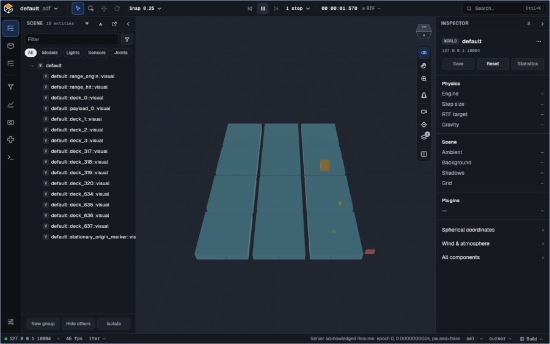

<!-- Copyright (C) 2026 Open Source Robotics Foundation -->
<!-- SPDX-License-Identifier: Apache-2.0 -->

# Publishing a fleet's models and links together

A local Bevy world with 100,000 moving decks now publishes each canonical model pose and the corresponding parent-relative model and link poses in one pass when their rows align. In the sensor-free world this lowered complete-step p95 from **7.09 to 5.15 ms** and p99 from **14.60 to 7.27 ms**. With 1,000 free loads, every public pose observed, a scheduled IMU and one range reading, p95 fell from **31.35 to 22.31 ms**, and p99 from **44.32 to 28.48 ms**. Every measured public pose, twist, sensor observation and contact impulse matched the previous implementation. [Measured trials and coverage](fleet-flat-hierarchy.json) · [View the loaded fleet in gz-web-rs](http://127.0.0.1:8082/?backend=primitive&ui=full&quality=low&replay=1&lifecycle=1&url=ws%3A%2F%2F127.0.0.1%3A10004%2F)

## Timing the public step

Both executables used the [previous phase's SDF layouts, 10 ms clock and consumer densities](fleet-range-publication.md). All 100,000 decks travel at 0.25 m/s. The prescribed layout has no sensor or payloads. It commits 400,001 world/local pose pairs and 100,000 link twists. The loaded layout has one free 1 kg box per 100 decks on a 1.1 m grid. It commits 404,002 world/local pose pairs including the IMU and world root, and 101,000 link twists. Its in-process consumer reads every public ID, world/local pose and twist, three probe links and the IMU, and casts an actual downward ray. The steady native check found 1,000 manifolds with 4,000 contact points.

| Complete step, held-out processes | Median before → after | p95 before → after | p99 before → after | Real-time factor before → after |
|---|---:|---:|---:|---:|
| Prescribed, sensor-free | 3.27 → 2.78 ms | 7.09 → 5.15 ms | 14.60 → 7.27 ms | 2.60× → 3.23× |
| Loaded, fully observed | 12.47 → 12.02 ms | 31.35 → 22.31 ms | 44.32 → 28.48 ms | 0.68× → 0.76× |

Four independent process pairs per layout ran on CPUs 24–31 of a shared Ryzen 9 9950X3D with rustc 1.97.1. Each world warmed for 20 steps. Each pair then alternated eight equal-time blocks of 40 measured steps, reversing execution order across blocks and trials. The table pools 1,280 steps per variant and layout. Percentiles use nearest rank. Real-time factor divides simulated time by total measured wall time. An earlier three-pair campaign also lowered p95 in both layouts, from 6.51 to 5.54 ms prescribed and 21.99 to 17.73 ms loaded.

An independent profile alternated the two publication methods in one world on CPUs 16–23, changing the starting variant across four trials. Each method measured 240 ticks per layout. In the prescribed world, model and relative-pose publication dropped from **4.41 to 2.42 ms** at median. In the loaded world it dropped from **0.805 to 0.589 ms**. The remaining loaded median included 1.83 ms in the native step, 1.28 ms reading the public data, 0.43 ms propagating attached poses and 0.16 ms in the ray. These are stage measurements on a shared workstation. The receipt records each distribution independently.

The 100× target allows 0.10 ms per complete tick. The loaded native step alone took over 18 times that budget in the alternating profile. The full consumer also requests 53.33 MB of logical CPU values per tick across IDs, poses and twists, equivalent to 533 GB/s at the target clock. Cache reuse affects actual memory traffic. The next measurement can distinguish cache-resident from streamed reads in the full consumer and attached-pose stage.

## What the fast path admits

The normal large local multi-fidelity scene tries joint publication after the native body update. Each model must be directly parented to the single current root, and every participating link must name the matching model as its parent. The native owner's stable public link ID must equal the model's canonical link. The matched model and link tables must account for every applicable relative-pose destination.

Each task reads the live link world pose once, composes the canonical offset, and writes the model's world pose and both relative poses with the existing quaternion and translation routines. Bevy marks each destination changed. The ordinary attached collision, visual and sensor stages observe the resulting hierarchy. A failed check runs the original complete publication before the next stage. The temporary pass only writes derived destinations, so all original link world poses are available for this recomputation. Each commit and reset checks the current ECS rows. No persistent layout cache or native handle translation is required.

A separate trial carried the last parent-table cursor across 64-row blocks. Compared to joint publication alone it lowered loaded p95 from 9.04 to 8.31 ms but raised sensor-free p95 from 3.81 to 3.86 ms. That optional change remains outside the production path.

## Reset, rotation and physical continuity

A real SDF scene rotated 8,193 prescribed bodies with offset link and visual frames. Every model, link, collision and visual matched the normal transform equations. The native angular velocities, the ECS change notifications and every stable link identity survived reset. Further regressions split and restored tables, attached a model below another model, changed a link's parent and canonical owner, and added an extra root or unmatched local frame. They exercised normal and single-CPU scheduling. All 334 scene library tests passed, along with strict release Clippy. LLVM covered 83/84 changed production lines and 141/142 regions. The single uncovered line handles Bevy declining contiguous iteration for these table-backed queries.

Two independent 100,000-deck executables matched all 340 per-tick fingerprints through 120 purely prescribed and 220 loaded steps, including a real launch and subsequent landing on another deck. The comparison included **136,880,680 pose pairs, 34,220,000 twists, 1,020 rays and 879,760 contact points**, plus all IMU observations, clocks and stable IDs.

| Cold observation | Prescribed before → after | Loaded before → after |
|---|---:|---:|
| SDF load | 5.45 → 5.51 s | 5.00 → 6.95 s |
| First public step after loading | 10.13 → 14.33 ms | 133.47 → 122.08 ms |
| Reset operation | 2.76 → 3.71 s | 3.19 → 2.80 s |
| First public step after reset | 4.61 → 4.52 ms | 101.03 → 93.04 ms |
| Peak process RSS including SDF construction | 4.373 → 4.376 GiB | 4.419 → 4.421 GiB |

These are single cold runs per binary and layout, on CPUs 16–23. In each world the first two public observations matched their restored counterparts exactly, including native impulses, measured ranges and public IDs. The new IMU samples carried the incremented epoch.

The 101-frame native replay displays 12 decks and one cargo body from the fully observed loaded world. The yellow marker follows the beam origin. The green marker marks its actual return from the deck or moving cargo. The independently calculated hit agreed within 5.8 × 10⁻¹⁵ m. The native archive is byte-identical to the previous fleet recording. The WebGPU renderer checked all 1,616 displayed poses and shapes and rewound to zero. [Play the freshly recorded run](http://127.0.0.1:8082/?backend=primitive&ui=full&quality=low&replay=1&lifecycle=1&url=ws%3A%2F%2F127.0.0.1%3A10004%2F)



## Reproduce

```sh
export RUSTC_WRAPPER=
cargo build --locked --release --no-default-features -p gz-sim-scene --example fleet_consumers
taskset -c 24-31 target/release/examples/fleet_consumers 100000 prescribed bare 100
taskset -c 24-31 target/release/examples/fleet_consumers 100000 loaded full 100
cargo test --locked --release --no-default-features -p gz-sim-scene --lib flat_publication::
for layout in prescribed loaded; do
  GZ_FLEET_RESET_LAYOUT="$layout" cargo test --locked --release --no-default-features \
    -p gz-sim-scene --test fleet_publication_reset -- --ignored --nocapture
done
cargo run --locked --release -p gz-physics-distributed --example fleet_publication_replay -- \
  --decks 100000 --launch --range target/fleet-flat-hierarchy
cargo run --locked --release -p gz-sim-cli --bin gz-sim-rs -- \
  --server --replay --web-viewer 10004 target/fleet-flat-hierarchy/replay
```

The replay writer uses a single local Bevy simulation. Both publication variants in the timed builds used the same numerical dependencies and the same public-step executable code outside the scene hierarchy.
