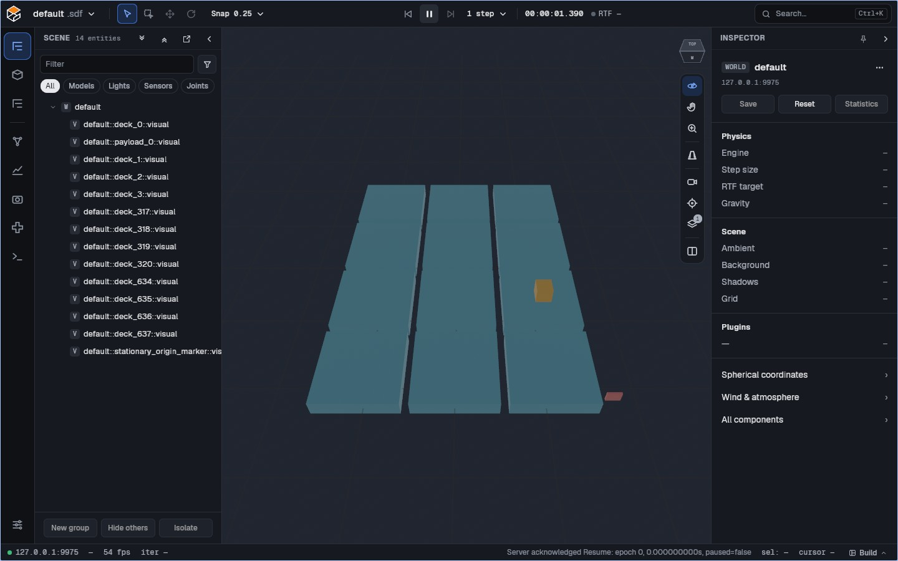

<!-- Copyright (C) 2026 Open Source Robotics Foundation -->
<!-- SPDX-License-Identifier: Apache-2.0 -->

# Steady cargo and the first contact after a launch

All 1,000 payloads appeared to rest on their moving decks at 0.800 s. Their greatest speed relative to the decks was **0.096 µm/s**, yet forcibly putting them to sleep stopped their horizontal motion. A different experiment assigned steady contacts to two native solver threads. It reproduced every observed physical result and improved steady throughput, but the first landing and subsequent rolling contacts had higher p95 latency. The ordinary solver remains the production choice. [Measured runs](fleet-loaded-rest.json) · [Watch the launch and landing in gz-web-rs](http://127.0.0.1:8082/?backend=primitive&ui=full&quality=low&replay=1&lifecycle=1&url=ws%3A%2F%2F127.0.0.1%3A9975%2F)

## What happened to a sleeping load

The local SDF simulation contained 100,000 prescribed decks moving at 0.25 m/s, one free 1 kg box on every hundredth deck, and a live IMU. Each public tick was 10 ms. All models, links, collisions and visuals received their ordinary pose updates.

- On the ordinary solver we tried predicting one tick from each matched incoming observation. The predictor carried the box by its deck's measured displacement and retained the last orientation, twist and support impulse. Across 40,000 uninterrupted loaded pair-ticks from 0.810 to 1.200 s, **zero** matched any of the three complete observations exactly. The largest component errors were 9.18 µm in position, 0.272 mm/s in linear velocity, 0.00271 rad/s in angular velocity and 0.237 mN·s in support impulse. The reaction errors matter independently of the visible trajectory.
- A separate native trial called Rapier's actual sleep operation once on every load-bearing payload immediately after the 0.800 s solve. The next endpoint placed the first box 2.500 mm behind its ordinary position. Its downward velocity was 0.0981 m/s. The reported support impulse was 0.08113 N·s against the ordinary 0.09810 N·s, and became zero at 1.020 s. A control using the same 80-tick prefix kept moving with its deck. The checked-in native regression exercises the first divergent solve directly.
- A 510 N forward, 185 N upward wrench on the first box acted during the 1.200–1.210 s step. It immediately unloaded the original deck and first loaded deck 2 at **1.570 s** with **1.121786 N·s** of normal impulse. The sham stayed on deck 0. On the forced-sleep branch the box had already fallen below the decks and missed this landing. The other 999 boxes received no wrench.

## Batching normal contact solves

The candidate used Rapier's existing parallel solver with the same four native solver iterations. A sweep of one, two, four and eight native threads compared each candidate to an independently built ordinary executable. A separate candidate used two threads only when every payload had positive native support, zero applied wrench, relative linear speed at most 1 mm/s and angular speed at most 0.01 rad/s. These thresholds only controlled thread scheduling. The guard selected two threads at 0.080 s and one thread before the 1.200 s force and throughout the subsequent landing and rolling contacts.

All three batched configurations checked in detail (two, four and guarded two) matched the ordinary solver bit for bit across 120 loaded, 120 sparse and 220 disturbed ticks. Each comparison covered 185,360,920 world/local pose pairs, 46,340,000 twists, 460 IMU samples and 1,359,760 native contact points. The per-tick fingerprints include the active manifold body IDs, world-space normals, both anchor levers, normal impulses and available tangent impulses. The sparse control had zero contacts.

| Comparison | Ordinary p95 | Batched p95 | Ordinary → batched throughput |
|---|---:|---:|---:|
| Two threads, steady 1,000 payloads | 5.27 ms | 4.63 ms | 2.32× → 2.76× |
| Two threads, sparse | 2.78 ms | 2.58 ms | 4.59× → 4.70× |
| Two threads, launch through first landing | 13.18 ms | 29.01 ms | 1.57× → 1.27× |
| Four threads, launch through first landing | 8.12 ms | 10.79 ms | 1.74× → 1.90× |
| Guarded two threads, steady 1,000 payloads | 9.17 ms | 6.40 ms | 1.80× → 2.31× |
| Guarded build, sparse | 12.31 ms | 10.22 ms | 1.98× → 2.29× |
| Guarded two threads, launch through first landing | 7.31 ms | 7.57 ms | 1.84× → 1.83× |
| Guarded two threads, after first landing | 8.37 ms | 8.95 ms | 1.73× → 1.74× |
| Guarded two threads, complete disturbance trial | 8.57 ms | 8.43 ms | 1.76× → 1.93× |

For a steady two-thread run, the process used 14.02 ms of CPU per tick against 13.89 ms for the ordinary build, summed over all threads. The wall-time improvement came from concurrent work. In the separate CPU-instrumented guarded trial, mean CPU cost was 7.80 ms against 7.38 ms and whole-tick p95 rose from 6.84 to 9.51 ms. The best two-thread loaded holdout still needed a 36.3-fold throughput improvement to meet the fully observed 100× target.

Both sides ran on CPUs 24–31 of the same Ryzen 9 9950X3D workstation. The steady holdouts used four process pairs for fixed threads and three for the guarded policy. Each pair alternated eight matched blocks of 40 measured ticks after five warm ticks. Disturbed trials used four process pairs and alternated eight-tick blocks through the same 200 measured ticks from 0.210 to 2.200 s. This preserved the exact launch and landing tick. The landing-window p95 uses 148 observations per variant. The source receipt includes medians, per-trial percentiles, the sparse guarded control and the four-thread steady campaigns at differing host loads.

## Repeat the physics checks

```sh
export RUSTC_WRAPPER=
cargo run --release --locked --no-default-features -p gz-sim-scene \
  --example fleet_observation -- 100000 loaded-rest
cargo run --release --locked --no-default-features -p gz-sim-scene \
  --example fleet_observation -- 100000 loaded-rest-pulse
cargo test --release --locked --no-default-features -p gz-physics-rapier --lib \
  loaded_rest_tests -- --nocapture
cargo test --release --locked --no-default-features -p gz-sim-scene \
  --example fleet_observation
cargo run --release --locked -p gz-physics-distributed \
  --example fleet_publication_replay -- --decks 100000 --launch target/fleet-loaded-replay
```

The last command runs one local Bevy world and writes its native recording. The launch recording follows 12 decks and the first payload. The independent browser check compared all 1,414 displayed poses and shapes across 101 frames, verified the lifecycle catalog and rewound to zero. It compared the payload to the independently executed trajectory, all visible decks to their analytic motion, and the fixed reference to its authored position. The original steady recording remains byte-identical. [Native replay](http://127.0.0.1:8082/?backend=primitive&ui=full&quality=low&replay=1&lifecycle=1&url=ws%3A%2F%2F127.0.0.1%3A9975%2F)



All 101 native library tests and both new scene-example regressions passed, as did strict release Clippy on the touched targets. The changed executable qualification and replay code covered 172/173 lines (99.42%) and 353/358 LLVM regions (98.60%). Including the regression code gave 289/290 lines and 561/567 regions.
