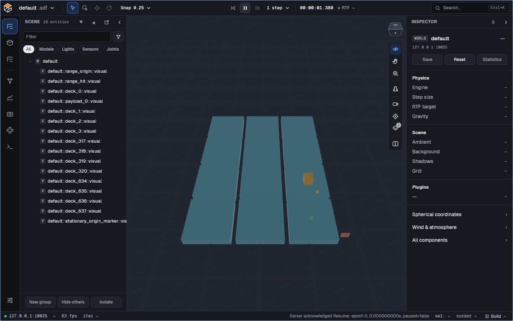

<!-- Copyright (C) 2026 Open Source Robotics Foundation -->
<!-- SPDX-License-Identifier: Apache-2.0 -->

# Where the loaded CPU fleet spends its time

The local simulation advances 100,000 decks at 0.25 m/s and solves 1,000 free payloads on a 10 ms clock. Its most expensive native operation was resolving contact forces. The change qualified here speeds up the actual downward range sensor. With both implementations looking at the exact same 640 physical states, median query time fell from **0.218 to 0.028 ms** and p95 from **0.742 to 0.091 ms**. Every pair returned exactly the same distance. [Numerical results](fleet-native-cost.json) · [Watch the cargo launch and land in gz-web-rs](http://127.0.0.1:8082/?backend=primitive&ui=full&quality=low&replay=1&lifecycle=1&url=ws%3A%2F%2F127.0.0.1%3A10025%2F)

## The native and public costs

The hardware, layouts, 20 warm-up steps, 10 ms public clock and consumer match the earlier hierarchy benchmark. The fully observed consumer reads 404,002 world/local pose pairs, 101,000 twists, three link witnesses, a scheduled IMU and a native ray per tick. Every steady tick has 1,000 manifolds and 4,000 contact points. The workstation was shared. The instrumented baseline on CPUs 16–23 measured 120 loaded ticks. Each row is the distribution of that stage, and indented details in parentheses are already included in their enclosing row. [Earlier measurement setup](fleet-flat-hierarchy.md)

| Loaded public step | Median (ms) | p95 (ms) |
|---|---:|---:|
| Whole native advance | 1.390 | 1.869 |
| Survey and activate reachable decks | 0.016 | 0.489 |
| Shared kinematic coordinate update (inside survey) | 0.002 | 0.003 |
| Selective native Rapier step | 1.356 | 1.574 |
| Body update (inside Rapier) | 0.134 | 0.159 |
| Narrow phase (inside Rapier) | 0.098 | 0.129 |
| Contact solver (inside Rapier) | 1.052 | 1.141 |
| Public Bevy poses and twists, including attached shapes | 0.739 | 1.120 |
| Reading public poses and twists | 1.034 | 1.169 |
| Native range measurement | 0.118 | 0.148 |
| Complete observed tick | 3.334 | 4.111 |

On the unloaded prescribed control, advancing the native shared translation clock took 0.000030 ms at median. Publishing all 100,000 bodies in Bevy took 0.595 ms. A separate attempt to optimize the loaded contact loop compiled the pinned Rapier crate as one LLVM code-generation unit. It reproduced all 220 ticks through a launch and landing. It raised selective native p95 from 2.12 to 2.86 ms in repeat profiling and full-step p95 from 12.07 to 12.28 ms in four paired processes, so the ordinary compiler settings remain in use.

## Reducing native range-query work

An isolated fleet has one centered box per body. The new native query uses each live payload's center and the radius that encloses its box. For decks it uses the largest enrolled deck radius. If a box could reach the roundoff-padded beam envelope, Rapier performs the existing exact surface test. A moving or rotating box can approach from any direction. Invalid poses still reach the ordinary error path, and the existing index covers distant prescribed decks. The filter only runs while observing an eligible fleet.

Each of four held-out process pairs alternated eight 40-tick blocks on CPUs 24–31, reversing order between blocks and trials. Both executables reached the same clock and contact counts after every block. Results pool 1,280 ticks per binary per layout. Real-time factor divides total simulated time by total wall time.

| Layout | Median full tick (ms) | p95 full tick (ms) | Mean real-time factor |
|---|---:|---:|---:|
| Loaded, every observation | 7.41 → 7.46 | 13.85 → 12.81 | 1.23× → 1.24× |
| Prescribed, sensor-free control | 3.13 → 3.36 | 6.15 → 6.44 | 2.77× → 2.70× |

In the loaded two-process trial, range p95 fell from 0.711 to 0.149 ms. Alternating the implementations inside one physical world also lowered range p95 from 0.835 to 0.147 ms, while complete-step p95 moved from 14.98 to 15.29 ms. The paired same-state measurement alternated query order on successive ticks. The filtered query was faster in 639 of 640 trials. The reliable improvement is the sensor latency. A general reduction in whole-step p95 remains unproven. The held-out loaded throughput is about 80 times short of the 100× target, which allows 0.10 ms for the entire public tick.

## Reset, altered motion and native playback

Across 120 prescribed and 220 loaded ticks, the baseline and revised executables matched 136,880,680 world/local pose pairs, 34,220,000 twists, all IMU readings, 1,020 rays and 879,760 native contact points bit for bit. A commanded wrench launched one payload off its support and onto a different moving deck. Both full-size layouts matched at the first two solves before and after reset, including stable IDs, twists, ranges and contact impulses. A focused regression aimed the beam at the far tip of a rotated long box and checked the error behavior of an invalid distant body.

All 110 native library tests passed. LLVM covered 21/21 changed production lines and 41/42 regions. Strict release Clippy passed for the native library and tests. The sole uncovered region is the failure arm of a zero-offset beam bounds check following the same successful check with a nonzero offset.

The display is a 12-deck crop of the real 100,000-deck world. The cube is the launched payload, the yellow marker is the range origin and the green marker follows the first surface hit. Independent oriented-box geometry and the separately measured payload trajectory agreed to 5.78 × 10⁻¹⁵ m, with 33 cargo and 68 deck returns. The renderer checked all 1,616 displayed poses and shapes in 101 frames, then rewound to zero. [Portable native replay, raw timings and comparison inputs](fleet-native-cost-evidence.tar.xz)



## Reproduce

Run the regular, fully observed release example from the workspace root.

```sh
export RUSTC_WRAPPER=
cargo build --release --locked --no-default-features -p gz-sim-scene --example fleet_consumers
taskset -c 24-31 target/release/examples/fleet_consumers 100000 loaded full 120
cargo test --release --locked --no-default-features -p gz-physics-rapier --lib ray::fleet_tests
```

The evidence archive contains the timed native pipeline instrumentation against the measured base, the Rust block and fingerprint examples, per-step data and the original playable replay directory. To serve that recording, extract the archive in a new directory and use its replay subdirectory.

```sh
mkdir -p artifacts/measured-fleet
tar -xJf docs/measurements/local-manipulation/fleet-native-cost-evidence.tar.xz -C artifacts/measured-fleet
cargo run --release --locked --no-default-features -p gz-sim-cli --bin gz-sim-rs -- \
  --server --replay --web-viewer 10125 artifacts/measured-fleet/replay
```
