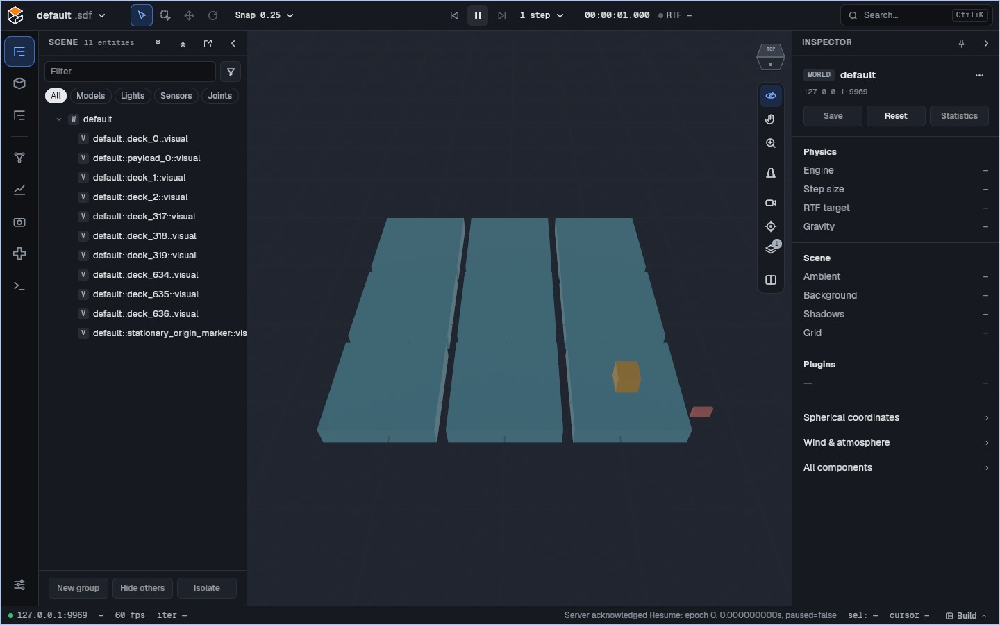

<!-- Copyright (C) 2026 Open Source Robotics Foundation -->
<!-- SPDX-License-Identifier: Apache-2.0 -->

# Publishing the moving CPU fleet's hierarchy

The ordinary local fleet advances 100,000 prescribed decks and 1,000 loose payloads, updates all 404,001 named model, link, collision and visual poses, and samples the first deck's IMU every 10 ms. In alternating ticks of the same Bevy world, the change lowered complete-tick p95 from **8.00 to 7.22 ms** and raised throughput from **1.83× to 1.97× real time**. Two independent matched-process campaigns also lowered p95, from 16.89 to 16.28 ms and from 6.52 to 5.41 ms. The faster campaign reached **2.36× real time**, which still requires a 42.4-fold throughput increase to reach the 100× target. [Measurements](fleet-parent-poses.json) · [Watch the loaded fleet in gz-web-rs](http://127.0.0.1:8082/?backend=primitive&ui=full&quality=low&replay=1&lifecycle=1&url=ws%3A%2F%2F127.0.0.1%3A9969%2F)

## Locating the cost

Three baseline runs at commit `627f82a` timed the native solver, the fleet contact guard, four Bevy pose stages and the IMU in the normal scene. The native step was the largest individual stage, with median times of 2.84, 4.09 and 5.56 ms. In each run the time spent publishing the four kinds of pose exceeded the native solve. Updating parent-relative poses and propagating links to their collision and visual children took the largest share of the publication time.

The change reads each parent entity and its pose from the same live Bevy table. A batch can use a common parent or adjacent parents after checking each complete entity ID, including its generation. A miss uses the current parent relation. Every requested target still receives its usual translation and quaternion composition and an ECS change notification. The scalar path handles small and noncontiguous queries. Native solver settings and the sensor schedule stay at their normal production values.

A separate native profile on CPUs 0–7 timed velocity constraint resolution at 1.218 ms median and 1.608 ms p95. Total native solver time was 1.250 / 1.668 ms and collision detection was 0.244 / 0.481 ms. These counters identify the constraint iterations on persistent payload contacts as the next native CPU cost to investigate.

A separate experiment enabled Rapier's optional parallel solver. Across 320 mixed ticks per build, its p95 increased from 10.43 to 11.55 ms and throughput fell from 1.53× to 1.49×. Its 120-tick pose and point-impulse trace matched the serial solver. This experiment explains the decision to retain the ordinary native solve.

## Complete-tick timing

Four release processes per layout alternated the original and candidate hierarchy publication code every tick in an ABBA order, rotating the starting phase across runs. Each ran 20 warmup ticks and then 100 measured ticks. A second method compiled the baseline and candidate separately, warmed their worlds and alternated matched 40-tick blocks. Each matched-block campaign supplied four trials of eight blocks per layout, with five untimed settling ticks before each block. The full campaign ran twice in separate periods of host load. All comparisons used the same eight logical CPUs, 24–31, on a shared Ryzen 9 9950X3D. Real-time factor divides elapsed simulated time by the total measured wall time, and percentiles use nearest rank.

| Layout and timing method | Before p50 / p95 | After p50 / p95 | Before → after real-time factor |
|---|---:|---:|---:|
| 1,000 payloads, alternating ticks | 5.006 / 7.997 ms | 4.752 / 7.218 ms | 1.832× → 1.966× |
| Zero payloads, alternating ticks | 2.665 / 3.989 ms | 2.363 / 3.443 ms | 3.473× → 3.923× |
| 1,000 payloads, independent matched blocks | 7.644 / 16.888 ms | 7.518 / 16.283 ms | 1.144× → 1.182× |
| Zero payloads, independent matched blocks | 2.899 / 4.422 ms | 2.472 / 3.930 ms | 3.258× → 3.817× |
| 1,000 payloads, repeated matched blocks | 4.775 / 6.516 ms | 4.018 / 5.410 ms | 1.984× → 2.360× |
| Zero payloads, repeated matched blocks | 2.321 / 3.712 ms | 2.020 / 2.735 ms | 3.910× → 4.691× |

The 100× target allows 0.1 ms wall time for one complete 10 ms tick. The mixed candidate needed a further 50.9× throughput increase in the alternating-tick comparison and 84.6× in the first matched-block campaign. Mixed whole-tick p99 rose from 21.50 to 26.85 ms in the first campaign and fell from 8.26 to 7.32 ms in the repeat. In the alternating-tick mixed run, parent-relative p95 fell from 1.247 to 0.995 ms and collision/visual propagation fell from 1.607 to 1.315 ms. Sparse parent-relative p95 rose from 1.110 to 1.135 ms, while sparse collision/visual propagation fell from 1.557 to 1.015 ms. The differences between the methods reflect shared-host variation.

## Correctness and replay

- Each of the 120 mixed ticks and 120 sparse ticks matched the baseline bit for bit. Independent executables hashed 96,480,480 public world/local pose pairs including the world roots, 24,120,000 link twists, and every IMU's orientation, angular velocity, specific force, epoch and timestamp. They also hashed 120,000 loaded manifolds, their ordered body IDs, normals and all 480,000 native point anchors and impulses. The sparse scene produced zero contact patches. All sparse decks matched their analytic command exactly and the maximum mixed deck error was 6.54 × 10⁻¹² m.
- The new regression reparents visual children among 9,001 rotated links, checks all local and attached transforms and verifies that reset marks every published result changed. The existing scene tests also cover smaller, rotated and nested worlds, edits, restoration and sensor timing. All 323 scene library tests passed in debug and release. The plain test build also received the missing coated-tree argument in a pre-existing controller rejection test. Strict release Clippy passed. LLVM covered **82/82 changed production lines and 179/179 regions**.
- A fresh 200-tick mixed run produced the same native archive bytes as the earlier qualified fleet. The displayed patch selects nine decks, one genuine free payload, and a fixed reference from the complete scene. The independent trajectory audit found 0.493587 m of payload travel in two seconds and 6.413 mm of deck-relative lag. The gz-web-rs WebGPU check matched all 561 displayed poses and shapes across 51 frames and rewound to zero. [Native playback](http://127.0.0.1:8082/?backend=primitive&ui=full&quality=low&replay=1&lifecycle=1&url=ws%3A%2F%2F127.0.0.1%3A9969%2F)



## Reproduce

Build the ordinary benchmark in each checkout and use the same CPU affinity for both processes. The two layouts exercise the loaded contact solver and the sparse edit/pause/reset checks. [Native archive and viewer commands](fleet-publication-view.md)

```sh
export RUSTC_WRAPPER=
cargo build --locked --release --no-default-features -p gz-sim-scene --example fleet_observation
taskset -c 24-31 target/release/examples/fleet_observation 100000 mixed-auto
taskset -c 24-31 target/release/examples/fleet_observation 100000
cargo test --locked --no-default-features -p gz-sim-scene --lib
```
