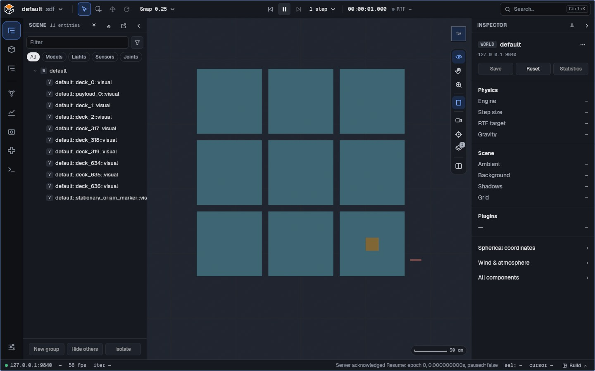

<!-- Copyright (C) 2026 Open Source Robotics Foundation -->
<!-- SPDX-License-Identifier: Apache-2.0 -->

# CPU fleet replay

The local simulation moved 100,000 decks and carried 1,000 payloads. This **finite display patch** follows nine decks and one payload for two simulated seconds. The blue squares are the decks, the orange cube is a freely moving payload, and the red bar is a fixed reference marker. [Open the live replay in gz-web-rs](http://127.0.0.1:8082/?backend=primitive&ui=full&quality=low&replay=1&lifecycle=1&url=ws%3A%2F%2F127.0.0.1%3A9840%2F)



Over two seconds the decks advanced 0.500 m. The payload advanced 0.494 m and finished 6.41 mm behind its starting position relative to the deck. The IMU mounted on the first deck reported zero horizontal specific force and 9.81 m/s² upwards at every sampled time after initialization.

The native recording uses a fixed horizontal display offset of 1.1 m in each direction. The audit adds this offset back and checks all 510 moving poses and orientations against the CPU observations, verifies the 51 stationary-marker poses, and compares all 459 deck positions against the commanded 0.25 m/s motion. It reads 50 IMU samples, one every 40 ms after the initial frame. The gz-web-rs WebGPU playback checker separately verified all 561 displayed poses and shapes, the 51 frame times, the lifecycle catalog and rewind to zero.

To regenerate the measurement and run its independent audit, use a fresh directory.

```sh
RUSTC_WRAPPER= cargo run --locked --release -p gz-physics-distributed \
  --example fleet_publication_replay -- --decks 100000 target/cpu-fleet-view
GZ_FLEET_PATCH="$PWD/target/cpu-fleet-view" RUSTC_WRAPPER= \
  cargo test --locked --release --manifest-path tools/physics-audit/numerics/Cargo.toml \
  --test fleet_view -- --ignored --nocapture
```

The example runs one local Bevy simulation.
