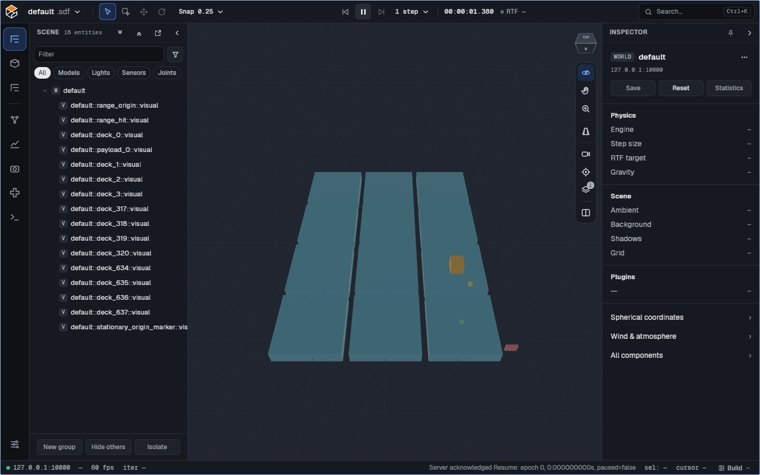

<!-- Copyright (C) 2026 Open Source Robotics Foundation -->
<!-- SPDX-License-Identifier: Apache-2.0 -->

# Range sensing and the cost of committing a moving CPU fleet

With 100,000 moving decks and 1,000 loose loads, the median cost of one downward range reading fell from **16.28 to 0.60 ms**. With a full public-pose reader, whole-tick p95 fell from **40.32 to 16.08 ms** and throughput rose from **0.35× to 0.89× real time**. TDD §8.2's 100× target allows **0.10 ms** for a complete 10 ms step. Even the sensor-free prescribed world took 3.09 ms for its median public commit. [Per-trial measurements, source revisions and coverage](fleet-range-publication.json) · [Watch the measured range in gz-web-rs](http://127.0.0.1:8082/?backend=primitive&ui=full&quality=low&replay=1&lifecycle=1&url=ws%3A%2F%2F127.0.0.1%3A10000%2F)

## What one public step costs

All 100,000 decks translate at 0.25 m/s with a 10 ms public clock. Both layouts include every authored collision and visual. The prescribed layout spaces deck centers 4 m apart and has zero contact pairs. The loaded layout uses a 1.1 m square grid with one 1 kg free box per hundred decks. At the end of every steady loaded benchmark there were 1,000 real manifolds and 4,000 native contact points. The four observation configurations use identical physical motion within each layout.

| Observation load | Prescribed, p50 / p95 before → after | Loaded, p50 / p95 before → after |
|---|---:|---:|
| Scheduled IMU, no added reader | 3.91 / 8.43 → 3.78 / 7.49 ms | 8.64 / 13.51 → 8.51 / 11.45 ms |
| IMU, three link readers, one solid ray | 18.66 / 29.21 → 4.09 / 13.39 ms | 25.27 / 32.86 → 8.38 / 12.81 ms |
| Same readings plus all world/local poses, public IDs and twists | 19.97 / 35.36 → 6.10 / 16.59 ms | 26.79 / 40.32 → 10.70 / 16.08 ms |

The scheduled IMU adds one pose. Its two worlds publish 400,002 and 404,002 world/local pose pairs, including the world root. The full reader consumes those pairs and all 100,000 or 101,000 link twists in process. This workload includes no network serialization. In the loaded full run the median time spent reading public data was 2.30 ms and the public commit itself took 7.58 ms. Stage medians refer to separate distributions.

A fourth authoring removes the IMU and has no per-tick readers. The ordinary Bevy scene still produces all 400,001 world/local pose pairs and 100,000 link twists. The candidate's sensor-free prescribed commit took **2.20 ms at its fastest, 3.09 ms at median and 4.41 ms at p95** across 300 steps. The loaded sensor-free median was 7.25 ms and its p95 was 10.08 ms. These cases never create the pure-fleet ray index. Their independently timed baseline and candidate processes show the extent of shared-host variation.

In a separate instrumented process on CPUs 16–23, the fastest ordinary prescribed public step was 1.26 ms. Median times for writing body poses/twists, canonical models, parent-relative poses and attached collision/visual poses were 0.70, 0.80, 1.02 and 1.28 ms respectively. An offline implementation checked an entire 64-child block for a common or contiguous parent before composing its poses. Across four runs it raised prescribed whole-tick p95 from 10.49 to 10.83 ms and loaded p95 from 20.10 to 20.45 ms. The existing hierarchy publisher remains in use. A next experiment can measure whether combining public-pose writes saves memory traffic while retaining Bevy change detection and the existing system ordering.

## Finding the solid surface

Previously a single ray reconstructed all 100,000 collider poses. Co-moving prescribed boxes now share a read-only spatial index in their starting frame. The first eligible range query builds it. Body changes and reset invalidate the index. A loaded fleet reuses its existing spatial index for analytically translated decks, then checks every participating native deck and every free payload at their actual current poses. An independently rerouted deck remains visible anywhere it moves. Offset and additional collision shapes follow the ordinary native path.

The candidate search uses the complete finite beam envelope with an outward roundoff allowance. Each candidate goes through the existing double-precision solid shape intersection, including parent-body exclusion, inside hits and inclusive maximum range. A nonuniform velocity, later motion epoch, unsupported shape or out-of-domain query retains the exhaustive search where required. Collider membership and manifold impulses change only in the normal physics solve.

For prescribed sparse observation, median ray time fell from 14.17 ms to **4.74 µs**. In six independent processes the first prescribed query cost **28.8–79.6 ms** to construct and query its index. The already-indexed loaded fleet took **0.38–0.71 ms** for its first measured query. A single occasional cast on a new pure fleet may therefore cost more. Peak process RSS including SDF construction was approximately 4.37 GiB prescribed and 4.42 GiB loaded for both binaries.

## Matching the physical record

Two separately built executables fingerprinted every public ID, world/local pose, twist, IMU time and epoch, three solid rays and every native manifold and ordered point impulse. All 120 prescribed ticks and 220 loaded ticks matched bit for bit, including a launch at 1.20 s, flight and renewed support on a different deck. The comparison covered **136,880,680 public pose pairs, 34,220,000 twists, 1,020 rays and 879,760 native contact points**. A normal SDF lidar independently measured the next deck at 0.60 m, a further deck at 1.70 m after a velocity edit and the original 0.60 m after reset. The edit stayed pending during pause, the original IDs survived and the restored reading had the new epoch.

The replay displays a finite patch of 12 decks and the free cargo. A yellow cube marks the beam origin above deck 0. The green cube marks the measured first solid hit. An independent oriented-box calculation used the previous ordinary cargo trajectory and analytic deck motion. Of the 101 frames, 33 returned the cargo and 68 returned the deck, with maximum coordinate difference 5.78 × 10⁻¹⁵ m. The gz-web-rs WebGPU renderer verified all **1,616** displayed poses and shapes and rewound to time zero. [Open the launch and range playback](http://127.0.0.1:8082/?backend=primitive&ui=full&quality=low&replay=1&lifecycle=1&url=ws%3A%2F%2F127.0.0.1%3A10000%2F)



## Reproduce

The main timing comparison ran ordinary Rust release executables on logical CPUs 24–31 of a shared Ryzen 9 9950X3D using rustc 1.97.1. Each process warmed its own world for 20 ticks. Three matched pairs per layout then alternated which binary stepped first across twelve 30-tick blocks, rotating the three consumer modes between trials. Each table entry pools 360 equal-time measurements. Six independent 100-tick processes per mode and layout provide the second timing method in the receipt. Percentiles use nearest rank. Throughput divides simulated time by total measured wall time, including the first ray's cost. Absolute latencies varied with other workstation tasks.

```sh
export RUSTC_WRAPPER=
cargo build --locked --release --no-default-features -p gz-sim-scene --example fleet_consumers
for layout in prescribed loaded; do
  for consumers in bare none sparse full; do
    taskset -c 24-31 target/release/examples/fleet_consumers 100000 "$layout" "$consumers" 100
  done
done
cargo test --locked --release -p gz-physics-rapier --lib
cargo test --locked --release -p gz-sim-scene --test fleet_observation
cargo run --locked --release -p gz-physics-distributed --example fleet_publication_replay -- \
  --decks 100000 --launch --range target/fleet-range
cargo run --locked --release -p gz-sim-cli --bin gz-sim-rs -- \
  --server --replay --web-viewer 10000 target/fleet-range/replay
```

The archive writer runs one local Bevy world. All 106 native library tests and all three ordinary SDF fleet tests passed. Strict release Clippy passed on the affected targets. LLVM covered **229/230 changed executable lines and 487/498 regions** across the runtime, measurement and replay sources, using each separately instrumented executable with its own profiles.
