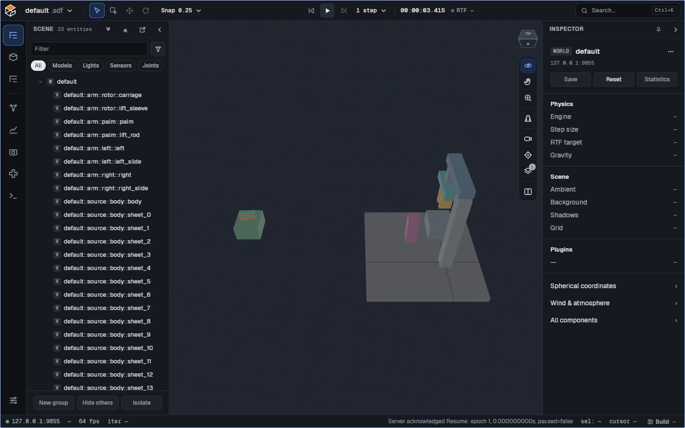

# A folded sheet lands on a finite receiver or passes beside it

The robot lifted an 8.4 g folded sheet from a 20 × 18 cm source bench. Each run started the same 1.25 N sideways pull after the fingers supported the sheet. Once the grip failed, a second 20 × 18 cm bench on the measured flight path registered a 1.903061 mN·s upward impact. Moving the receiver off the path let the sheet fall past tabletop height with zero support impulse.



| Physical support | Time after matched grip | Upward impulse | Result |
| --- | ---: | ---: | --- |
| Finite receiver centered at (0.32, 1.47, 0.06) m | 265 ms | 1.903061 mN·s | First contact with the receiver. [Replay](http://127.0.0.1:8082/?backend=primitive&ui=full&quality=low&replay=1&lifecycle=1&url=ws%3A%2F%2F127.0.0.1%3A9855%2F) |
| Finite receiver at its original (0, 0.32, 0.06) m | 318 ms | 0 | The whole sheet passed below both tabletops. [Replay](http://127.0.0.1:8082/?backend=primitive&ui=full&quality=low&replay=1&lifecycle=1&url=ws%3A%2F%2F127.0.0.1%3A9856%2F) |
| Original infinite plane at z = 0.12 m | 265 ms | 1.903061 mN·s | Plane impact occurred 1.009 m beyond the nearer visible bench footprint. [Replay](http://127.0.0.1:8082/?backend=primitive&ui=full&quality=low&replay=1&lifecycle=1&url=ws%3A%2F%2F127.0.0.1%3A9857%2F) |

The three grips loaded the jaws to 41.631 and 40.773 mN at 3.150 s with 149.613 mm of clearance above the tabletop. Directly before the receiving-bench impact, the finite runs had identical force and motion traces. On impact the lateral impulse on the sheet was −1.332143 mN·s. The largest residual momentum component in that public tick was 3.41 × 10⁻¹⁷ N·s. The impact runs stop on the first reaction, so they measure touchdown only. The miss stops after every particle and its skin has fallen at least 10 mm below tabletop height. The finite bench detects particle skins; a narrow obstacle could still pass through a cloth triangle between sampled particles.

The three gz-web-rs replays include 416 frames, 13,728 rendered poses and shapes, and 8,320 independently checked material positions. All displayed particle positions agreed with the saved solver positions. The repeat run reproduced every recorded pose, impulse, particle position, and archive byte. The 73 Rust example tests and strict Clippy passed. LLVM covered 165/168 changed executable lines and 365/381 regions. Native geometry checks found zero triangle crossings through a jaw core or the opposite panel.

## Reproduce

Use a fresh output directory for the recording.

```sh
RUSTC_WRAPPER= cargo run --locked --release -p gz-sim-cli --example local_robot_foundations -- \
  fold-bench target/local-fold-finite
GZ_FOLD_BENCH="$PWD/target/local-fold-finite" RUSTC_WRAPPER= cargo test --locked --release \
  -p gz-sim-scene --test fold_breakaway_replay only_a_bounded_receiver -- --ignored
```

Each branch contains the exact ordinary SDF world, all postgrip support impulses, sheet bounds, momentum balance, measured particle frames and a native replay archive. For the finite pair, each bench contributes a separate boundary impulse. [Finite box contact implementation and isolated tests](static-soft-bench.md)
