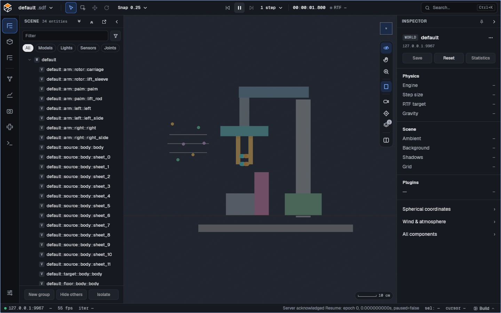

<!-- Copyright (C) 2026 Open Source Robotics Foundation -->
<!-- SPDX-License-Identifier: Apache-2.0 -->

# Where the load goes inside a folded sheet

At 64 native exchanges per millisecond, the left finger lifted with 113.66 mN while the right pushed down with 31.32 mN. Each panel weighs 41.202 mN. The fold transferred 72.53 mN downward on the left panel through bending and the same amount upward on the right. Sliding friction between the panels contributed only 1.80 mN. Independent force accounting closed within 3 × 10⁻¹⁵ N on each panel over the 300 ms hold in five trials. [Measurements, regression coverage and capture checks](fold-force-balance.json)



The live display places six dots beside the robot. For each finger the gold dot shows vertical jaw force, green shows bending force and purple shows self-contact friction. Up means positive. The middle line is zero. The other two lines mark the weight of one panel in either direction. Dot height uses a symmetric inverse-hyperbolic-sine scale so that transient peaks and small forces both stay visible. Each sample averages the preceding 25 ms of actual physics. The original playback is also available in each output directory. [64 exchanges in gz-web-rs](http://127.0.0.1:8082/?backend=primitive&ui=full&quality=low&replay=1&lifecycle=1&url=ws%3A%2F%2F127.0.0.1%3A9967%2F) · [125 exchanges](http://127.0.0.1:8082/?backend=primitive&ui=full&quality=low&replay=1&lifecycle=1&url=ws%3A%2F%2F127.0.0.1%3A9968%2F) · [Softer pad control](http://127.0.0.1:8082/?backend=primitive&ui=full&quality=low&replay=1&lifecycle=1&url=ws%3A%2F%2F127.0.0.1%3A9960%2F)

| Spring pad, exchanges/ms | Left jaw (mN) | Bending (mN) | Stretch and shear (mN) | Interpanel friction (mN) | Interpanel normal, vertical (mN) |
|---|---:|---:|---:|---:|---:|
| Stiff, 64 | 113.660 | −72.534 | 1.766 | −1.804 | 0.070 |
| Stiff, 125 | 42.891 | 0.142 | −1.831 | 0.000 | 0.000 |
| Stiff, 250 | 73.956 | −33.663 | 0.322 | 0.539 | 0.025 |
| Softer, 32 | 41.206 | −0.001 | 0.000 | 0.000 | 0.000 |
| Rigid, 64 | 41.207 | 0.000 | −0.001 | 0.000 | 0.000 |

The stiff pad compliance was 0.000015625 m/N and the softer control was 0.0000625 m/N. The other panel receives each internal force with the opposite sign. The bench carries zero during the hold. The force balance includes each panel's measured change in momentum. Turning on the observers reproduced the original recorded particle positions. Each recording passed 4,658 rendered pose and shape checks, 822 independent dot-position checks and rewind.

The material solver publishes each frictional and normal impulse on the node that actually receives it, including neighboring nodes affected by the torque at the skin. It separately totals the impulses delivered by bond and hinge projections. An independent query evaluates the negative gradient of stored elastic energy at the committed positions. At 250 exchanges the mean bending force sampled once per controller update was −72.449 mN. Sampling all 75,000 native endpoints during the same hold gave −33.665 mN, within 0.002 mN of the delivered impulse divided by time. The extreme pad's force split still varies with the exchange rate.

The frozen release passed 79 local robot example tests with one opt-in case omitted, as well as the XPBD suite and strict Clippy. The changed code for the complete force observations and browser replay covered 334/339 executable lines and 640/659 regions across the five changes. The individual runs and the uncovered error paths are recorded in the measurement file. These figures cover the changes in this study.

```sh
export RUSTC_WRAPPER=
cargo run --release --locked --no-default-features -p gz-sim-cli --example local_robot_foundations -- \
  sheet-jaws artifacts/panel-study --jaw-mass-scale 0.015625 --tune-damping \
  --pad-compliance 0.000015625 --substeps 1 --exchanges-per-ms 64 --panel-balance
cargo run --release --locked -p gz-sim-cli --bin gz-sim-rs -- \
  --server --replay --web-viewer 9967 artifacts/panel-study/force-replay
```
