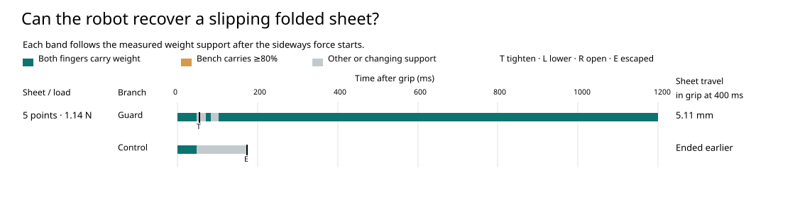

<!-- Copyright (C) 2026 Open Source Robotics Foundation -->
<!-- SPDX-License-Identifier: Apache-2.0 -->

# A 1.140 N pull with and without a grip correction

**[Play the guarded grasp in gz-web-rs](http://127.0.0.1:8082/?backend=primitive&ui=full&quality=low&replay=1&lifecycle=1&url=ws%3A%2F%2F127.0.0.1%3A9841%2F) · [Play the unguarded grasp](http://127.0.0.1:8082/?backend=primitive&ui=full&quality=low&replay=1&lifecycle=1&url=ws%3A%2F%2F127.0.0.1%3A9842%2F)**

The robot picked up an 8.4 g folded sheet on a five-column mesh. Both trials started the same sideways pull from identical positions, velocities and previous contact forces. The initial state and all 55 public ticks leading up to the guard’s tightening decision matched. Times below start at the onset of the pull.

| Measured outcome | Guarded | Unguarded |
|---|---:|---:|
| First 0.25 mm of movement at either finger | 57 ms | 57 ms |
| Tightening decision | 55 ms | None |
| First complete escape | Held through 1,200 ms | 173 ms |
| Weight supported by both fingers in the final 20 ticks | 20/20 | 0/20 |
| Larger of the two sheet displacements relative to the fingers at 400 ms | 5.112 mm | Episode ended at 173 ms |



At escape, the entire sheet cleared both finger edges by 10.78 mm. The independent replay check reconstructs each sheet particle’s skin and each moving finger’s geometry, including the extra off-stride frame at 173 ms. The per-tick force and clearance histories confirm four successive ticks with the sheet clear of both fingers, still in the air and under less than 1 nN of squeeze at either finger.

This two-branch comparison supplements the six standard trial pairs. To reproduce it in a fresh directory, run the local robot example and then its independent archive check.

```sh
RUSTC_WRAPPER= cargo run --release --locked --no-default-features -p gz-sim-cli \
  --example local_robot_foundations -- fold-recovery --columns 5 --load-mn 1140 target/local-sheet-rescue
GZ_FOLD_RECOVERY="$PWD/target/local-sheet-rescue" RUSTC_WRAPPER= \
  cargo test --release --locked --no-default-features -p gz-sim-scene \
  --test fold_breakaway_replay guarded_and_unguarded -- --ignored
```
