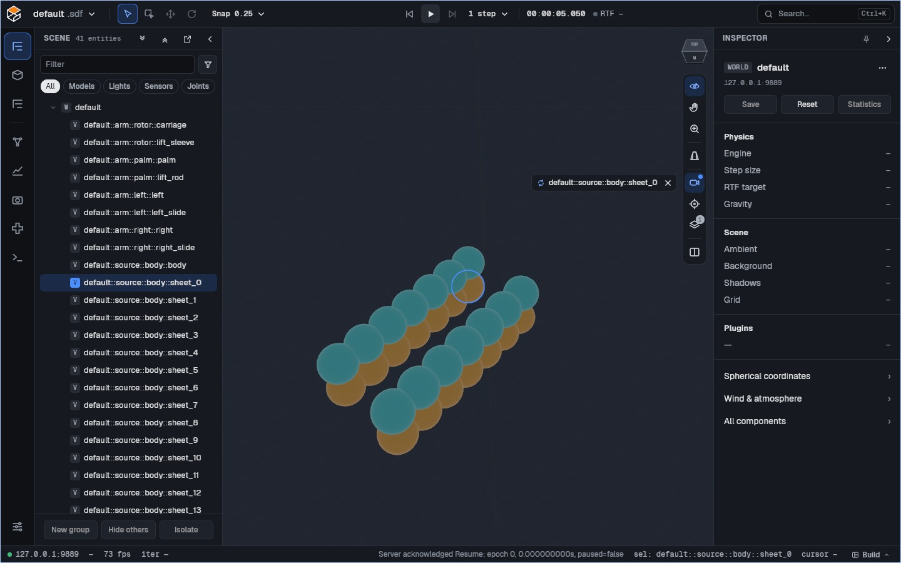

<!-- Copyright (C) 2026 Open Source Robotics Foundation -->
<!-- SPDX-License-Identifier: Apache-2.0 -->

# A dropped sheet sliding to rest

An 8.4 g folded sheet escaped a pair of loaded fingers during a lateral 1.25 N pull. The two five-column runs start at the same measured grasp. The guarded controller tightened and lowered the gripper. The control kept its original grip. Both sheets fell onto the infinite reference plane, slid beyond the visible bench, and came to rest. The finite bench has a separate catch-and-miss study. [Finite receiving bench](fold-finite-bench.md)

| Measurement after the matched grasp | Guarded | Control |
| --- | ---: | ---: |
| First plane impact | 272 ms | 265 ms |
| First upward impulse | 4.673 mN·s | 1.903 mN·s |
| Remaining lateral speed at 1.2 s | 2.258 m/s | 3.624 m/s |
| Mean deceleration from 1.10 to 1.20 s | 6.874 m/s² | 6.876 m/s² |
| End of first 50 consecutive milliseconds at rest | 1.588 s | 1.786 s |
| Fastest particle at the end | 1.81 × 10⁻⁸ m/s | 2.18 × 10⁻⁸ m/s |
| Native gz-web-rs replay | [Follow guarded sheet](http://127.0.0.1:8082/?backend=primitive&ui=full&quality=low&replay=1&lifecycle=1&url=ws%3A%2F%2F127.0.0.1%3A9877%2F) | [Follow control sheet](http://127.0.0.1:8082/?backend=primitive&ui=full&quality=low&replay=1&lifecycle=1&url=ws%3A%2F%2F127.0.0.1%3A9878%2F) |

The plane carried the full load throughout the last 100 ms of the 1.2 s comparison. A 0.70 friction coefficient predicts 6.867 m/s² of sliding deceleration. The rest detector required every particle to stay below 1 mm/s, the fingers to carry zero load, and the upward reaction to remain within 2.5% of the sheet's 0.082404 N weight. The independent Rust audit recomputed the speed from all three measured velocity components for every particle in the qualifying window. It also checked the first impact and its momentum balance. The native viewer verified 394 frames, 7,880 particle positions, and rewind. Its geometry audit found zero panel or jaw-core crossings in those frames.


The continuous-collision check can now certify clearance between moving material features using a separating direction that rotates during a substep. For linearly moving vertices and a linearly changing direction, the signed projection is a quadratic. All its Bernstein coefficients must clear the gap times an upper bound on the direction length, with a rounding allowance. A deterministic regression checks every accepted certificate against independently computed geometry at 65 instants. The original gap tolerances, contact budgets and 1 ms public clock remain in effect. The two five-column physical traces, all particle velocities and replay bytes repeated on the refined solver.

## The finer mesh

The seven-column sheet under a 1.30 N pull also settled in both trials. Its 28 particles reached the same 50 ms force-and-speed criterion at 1.588 s with the guard and 1.800 s without it. At the last tick their maximum speeds were 3.15 × 10⁻⁸ and 4.12 × 10⁻⁹ m/s respectively. The upward landing impulses remained 11.096 mN·s at 275 ms and 1.757 mN·s at 267 ms. The complete traces up to first impact and all 142 previously recorded particle frames per trial matched their references exactly. The independent geometry check found zero panel or jaw-core crossings in 401 rendered frames. gz-web-rs checked 16,441 visual poses and 11,228 particle positions, then rewound both archives. [Guarded run](http://127.0.0.1:8082/?backend=primitive&ui=full&quality=low&replay=1&lifecycle=1&url=ws%3A%2F%2F127.0.0.1%3A9888%2F) · [Control run](http://127.0.0.1:8082/?backend=primitive&ui=full&quality=low&replay=1&lifecycle=1&url=ws%3A%2F%2F127.0.0.1%3A9889%2F)

Previously the finer control refused its step at 682 ms. On a single material shell with prescribed jaws and plane support, the solver can now return to the original substep grid after exhausting uniform refinements. It bisects only an interval where contact remains unresolved and restores particles, receiver motion and accumulated reactions before retrying. The split children use the same integer clock and share the existing substep budget. The geometry solve processes impacts in time order. Once a path is clear, the final velocity solve gives priority to the contact closing fastest. An immovable overlap still refuses and preserves the published state. The previous solver and the refined solver produced the same 2,281 force and motion records up to and including the last previously accepted step at 681 ms. An instrumented second run reproduced both complete physical archives. All 180 XPBD tests passed. LLVM covered 130/132 changed executable lines and 172/174 regions, including all 51 lines and 63 regions of the local subdivision implementation. [First-impact measurements](fold-first-landing-view.md)

On one shared-host CPU pinned to core 5, the seven-column control recorded a median 28.3 ms and p95 51.6 ms for the 1,800 postgrip controller-and-solve intervals. At ticks 682 and 737 it spent 2.61 s and 18.53 s respectively. At the first interval, changing the terminal row order succeeded on the 32 base slices. At the second, 361 slices with a maximum bisection depth of ten were needed. The timed run reproduced the complete native particle, impulse and rest traces byte for byte. These costs measure offline simulation on this host.



## Reproduce

Use a fresh recording directory. For the finer sheet use `--columns 7 --load-mn 1300`. To inspect the 1.2 s comparison, replace the rest switch with `--follow-dropped`.

```sh
export RUSTC_WRAPPER=
cargo run --locked --release --no-default-features -p gz-sim-cli --example local_robot_foundations -- \
  fold-recovery --until-rest --columns 5 --load-mn 1250 target/my-fold-rest
GZ_FOLD_RECOVERY="$PWD/target/my-fold-rest" cargo test --locked --release -p gz-sim-scene \
  --test fold_breakaway_replay guarded_and_unguarded -- --ignored
cargo run --locked --release --no-default-features -p gz-sim-cli --bin gz-sim-rs -- \
  --server --replay --web-viewer 9877 target/my-fold-rest/mesh-5-1250-guard/replay
```

The output contains the authored SDF, contact and particle traces, a dedicated first-impact frame and vectors, the full terminal velocity window, and a native replay for each controller. In gz-web-rs expand the model tree, select a sheet particle, and press F then Shift+F over the scene to follow it.
