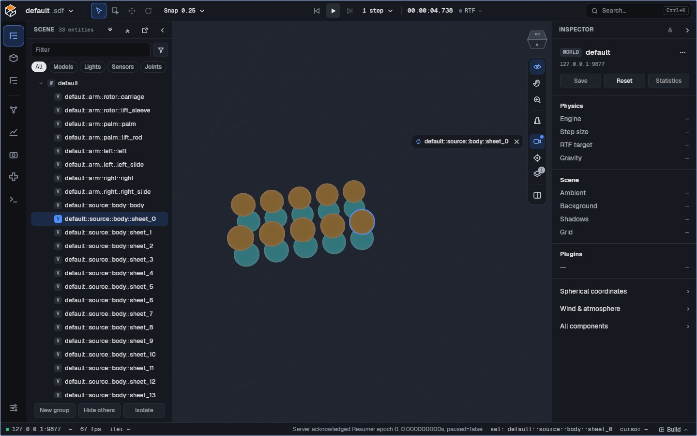

# A dropped sheet sliding to rest

An 8.4 g folded sheet escaped a pair of loaded fingers during a lateral 1.25 N pull. The two five-column runs start at the same measured grasp. The guarded controller tightened and lowered the gripper. The control kept its original grip. Both sheets fell onto the infinite reference plane, slid beyond the visible bench, and came to rest. The finite bench has a separate catch-and-miss study. [Finite receiving bench](fold-finite-bench.md)

| Measurement after the matched grasp | Guarded | Control |
| --- | ---: | ---: |
| First plane impact | 272 ms | 265 ms |
| First upward impulse | 4.673 mN·s | 1.903 mN·s |
| Remaining lateral speed at 1.2 s | 2.258 m/s | 3.624 m/s |
| Mean deceleration from 1.10 to 1.20 s | 6.874 m/s² | 6.876 m/s² |
| End of first 50 consecutive milliseconds at rest | 1.588 s | 1.786 s |
| Fastest particle at the end | 1.81 × 10⁻⁸ m/s | 2.18 × 10⁻⁸ m/s |
| Native gz-web-rs replay | [Follow guarded sheet](http://127.0.0.1:8082/?backend=primitive&ui=full&quality=low&replay=1&lifecycle=1&url=ws%3A%2F%2F127.0.0.1%3A9877%2F) | [Follow control sheet](http://127.0.0.1:8082/?backend=primitive&ui=full&quality=low&replay=1&lifecycle=1&url=ws%3A%2F%2F127.0.0.1%3A9878%2F) |

The plane carried the full load throughout the last 100 ms of the 1.2 s comparison. A 0.70 friction coefficient predicts 6.867 m/s² of sliding deceleration. The rest detector required every particle to stay below 1 mm/s, the fingers to carry zero load, and the upward reaction to remain within 2.5% of the sheet's 0.082404 N weight. The independent Rust audit recomputed the speed from all three measured velocity components for every particle in the qualifying window. It also checked the first impact and its momentum balance. The native viewer verified 394 frames, 7,880 particle positions, and rewind. Its geometry audit found zero panel or jaw-core crossings in those frames.



The continuous-collision check can now certify clearance between moving material features using a separating direction that rotates during a substep. For linearly moving vertices and a linearly changing direction, the signed projection is a quadratic. All its Bernstein coefficients must clear the gap times an upper bound on the direction length, with a rounding allowance. A deterministic regression checks every accepted certificate against independently computed geometry at 65 instants. The original gap tolerances, contact budgets and 1 ms public clock remain in effect.

The seven-column 1.30 N control reaches its first impact but still refuses a later step at 682 ms. The seven-column slide to rest remains open. [Both meshes at first landing](fold-first-landing-view.md)

## Reproduce

Use a fresh recording directory. To inspect the 1.2 s comparison, replace the rest switch with `--follow-dropped`.

```sh
export RUSTC_WRAPPER=
cargo run --locked --release --no-default-features -p gz-sim-cli --example local_robot_foundations -- \
  fold-recovery --until-rest --columns 5 --load-mn 1250 target/my-fold-rest
GZ_FOLD_RECOVERY="$PWD/target/my-fold-rest" cargo test --locked --release -p gz-sim-scene \
  --test fold_breakaway_replay guarded_and_unguarded -- --ignored
cargo run --locked --release --no-default-features -p gz-sim-cli --bin gz-sim-rs -- \
  --server --replay --web-viewer 9877 target/my-fold-rest/mesh-5-1250-guard/replay
```

The output contains the authored SDF, contact and particle traces, a dedicated first-impact frame and vectors, the full terminal velocity window, and a native replay for each controller. In gz-web-rs expand the model tree, select a sheet particle, and press F then Shift+F over the scene to follow it.
