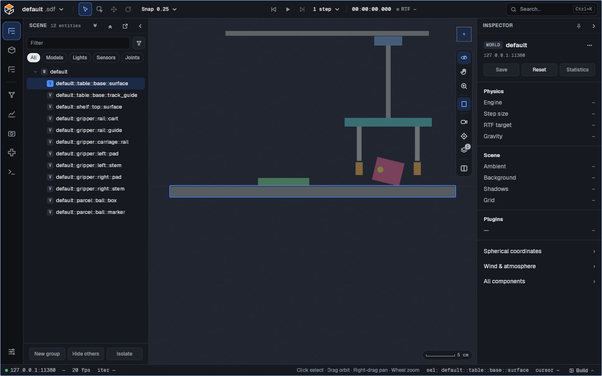
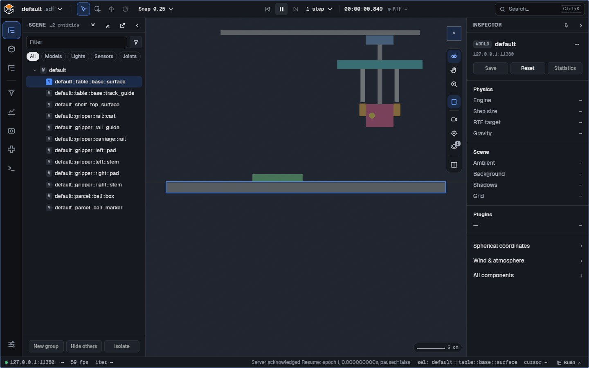

# A finite box in the GPU gripper

Two moving box fingers picked up an 80 g free cuboid measuring 48 × 24 × 40 mm. From a flat start it held **96.19 mm** above the table on the GPU, compared with **96.79 mm** in an independent, freely rotating 3D Rapier world. A low-friction pickup and a pickup commanded beside the parcel both left it on the table. A separate opening in midair returned the box to the table at **841 ms** in both solvers.

| Before the pinch | After the lift |
|---|---|
|  |  |

[Play the tilted pickup](http://127.0.0.1:8082/?backend=primitive&ui=full&quality=low&replay=1&lifecycle=1&url=ws%3A%2F%2F127.0.0.1%3A11380%2F) · [Play the slippery pickup](http://127.0.0.1:8082/?backend=primitive&ui=full&quality=low&replay=1&lifecycle=1&url=ws%3A%2F%2F127.0.0.1%3A11382%2F). Select the table surface in the scene tree and press **F** to fit the fixture in the viewport.

## What matched

| Case | GPU result | Unrestricted 3D Rapier result |
|---|---|---|
| Flat pickup | Both fingers touch at 26 ms. Clears 3 mm at 216 ms | 26 ms and 216 ms |
| Starts tilted +13.75° | Both fingers touch at 24 ms. Holds 97.07 mm clear | 24 ms and 99.87 mm |
| Starts tilted −13.75° | Holds 97.07 mm clear | 100.28 mm |
| Mass center shifted 5 mm right | Holds 96.19 mm clear | 96.40 mm |
| Low friction, coefficient 0.035 | Stays on the table | Brief lift below 0.74 mm, then rests on the table |
| Pickup misses by 105 mm | No finger impulse | No finger impulse |
| Open at 701 ms while airborne | Lands at 841 ms | Lands at 841 ms |

Clearance is the height of the lowest material point; held values average the last 200 ms. Every contact uses the authored cuboid. The planar device finds the separating face of the two rectangles and clips the other rectangle's edge to that face. Up to two finite witnesses enter each normal and friction solve with their own lever arms. The two fingers, floor and shelf report separate impulses. Both clipped endpoints on each finger carried impulse during 935 of 1,000 observed milliseconds of the flat pickup. All seven device trials repeated byte-for-byte after reset.

The ordinary SDF world also carried the cuboid onto the receiving shelf, opened after 24 advancing ticks of sustained support, and withdrew the gripper. Its opening command occurred at 1,416 ms. At 2,300 ms the box center was at X = 179.47 mm and Z = 34.00 mm, one half-height above the 14 mm shelf. The release policy accounts for the oriented footprint and bounds vertical material speed across its full width while tipping. Physical-adapter tests checked the settled shelf reaction and zero finger load.

## Where the planar result differs

The device advances four 250 µs substeps per public millisecond. Each independent 3D Rapier world takes sixteen 62.5 µs substeps using four native sliders and the same floor, shelf, three-dimensional finger pads, inertia and free cuboid. A second native run locks the payload's transverse translation and two out-of-plane rotations. Both native references use their own collisions and contact solver.

* During the tilted pickups the unrestricted 3D box first cleared 3 mm at **31 ms**, while the fingers were closing. The GPU and the planar-locked 3D control first cleared 3 mm during the commanded lift at **216 ms**. The maximum center-path difference for the tipped and reverse-tipped trials was 3.81 and 4.05 mm against free 3D motion, or 0.76 and 0.93 mm against the planar control.
* The unrestricted body tilted up to 4.44° out of the gripper plane during a pickup. The largest full orientation difference across the four successful held cases was 6.68°. Opening the fingers in midair produced 8.35 mm of transverse drift and a maximum 12.13 mm three-dimensional center-path difference. The planar scope excludes that drift.
* Net settled finger force matched the 0.785 N weight. Individual finger forces differed. For the flat box the GPU reported 0.393/0.392 N vertically, unrestricted Rapier reported 1.205/−0.420 N, and planar-locked Rapier reported 0.049/0.736 N. Face contact admits different internal force distributions. This qualification supports net weight, retained lift and release classification. Individual finger force and exact early tipping remain open.

The admitted box can translate and rotate in the X–Z plane with a transverse principal inertia axis. Its transverse width must fit on both fingers and the shelf. The GPU batch dispatch accepts one payload geometry at a time, with independent physical properties and actions per lane.

## Cost and reproduction

On the RTX 5090, driver 595.99.02, a single flat SDF pickup reached a median **791 observed steps/s** with **2.201 ms p95** and **4.648 ms p99**. The tipped pickup reached 763 steps/s and the low-friction pickup reached 802 steps/s. These medians span three release processes and two complete episodes per process on a shared host. Each 1,000-tick public episode read back 704,000 B, including the individual endpoint impulses, and uploaded 1,344 B. This single-world profile ran below a one-millisecond real-time budget.

The median p95 for stepping seven GPU lanes and fetching their state was 1.529 ms. Seven serial unrestricted 3D native worlds at the finer reference timestep had a median p95 of 3.294 ms on an AMD Ryzen 9 9950X3D. The timings use different internal timesteps.

```sh
export RUSTC_WRAPPER=
export GZ_GPU_ADAPTER='NVIDIA GeForce RTX 5090'
cargo run --locked --release -p gz-physics-gpu --example carry_gripper -- \
  "$GZ_GPU_ADAPTER" artifacts/box-reference box
cargo run --locked --release -p gz-sim-scene --features gpu-batch --example gpu_shelf_transfer -- \
  "$GZ_GPU_ADAPTER" artifacts/box-sdf box
cargo run --locked --release -p gz-sim-scene --features gpu-batch --example gpu_shelf_transfer -- \
  "$GZ_GPU_ADAPTER" artifacts/box-shelf box-place
cargo run --locked --release -p gz-sim-cli --features gpu-batch --bin gz-sim-rs -- \
  artifacts/box-sdf/tipped_box.sdf --physics-engine gpu-batch --gpu-adapter "$GZ_GPU_ADAPTER" \
  --server --run --iterations 1000 --web-lifecycle --web-viewer 11383 --record-scene artifacts/box-web
cargo run --locked --release -p gz-sim-cli --features gpu-batch --bin gz-sim-rs -- \
  artifacts/box-web --server --replay --web-viewer 11387
```

Use a fresh recording directory. Both native WebGPU replays verified 456 visual poses across 38 frames against independently captured device transforms to 10⁻¹² and rewound to zero. [Open a new recording on port 11387](http://127.0.0.1:8082/?backend=primitive&ui=full&quality=low&replay=1&lifecycle=1&url=ws%3A%2F%2F127.0.0.1%3A11387%2F)

The physical-adapter suite passed all 31 native tool SDF tests. Three scalar geometry tests covered finite face clipping, an isolated corner and 1,386 orientations and positions checked against independent polygon projections. Changed production coverage reached **377/377 executable lines (100.00%) and 789/789 regions (100.00%)**. [Reference data, repetitions, replay receipts and coverage hashes](gpu-box-pickup.json)
