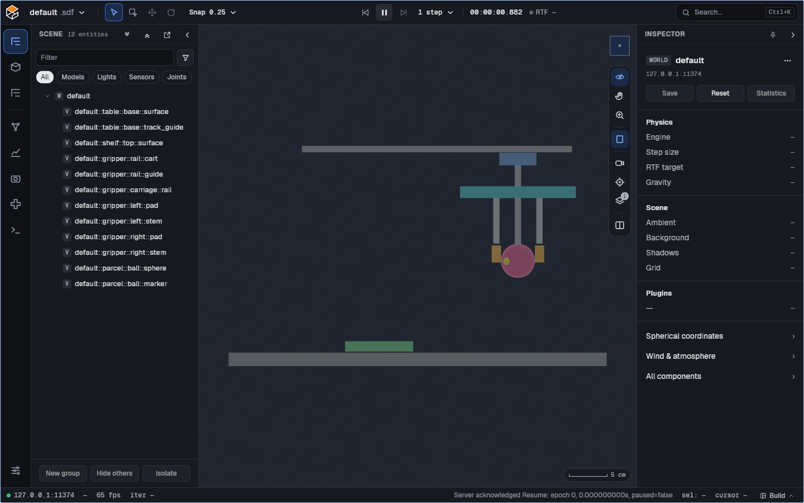

# Picking up a sphere with its mass off center

Two independent fingers lifted an 80 g sphere whose mass center sits 6 mm to the right of its geometric center. The right finger held 0.499 N and the left held 0.285 N. Independent Rapier dynamics measured 0.505 N and 0.280 N. Moving the mass to the left reversed the load. With friction reduced from 0.60 to 0.12 the sphere rose briefly, slid along the right finger, and returned to the table.



[Play the successful pickup](http://127.0.0.1:8082/?backend=primitive&ui=full&quality=low&replay=1&lifecycle=1&url=ws%3A%2F%2F127.0.0.1%3A11374%2F) · [Play the slipping pickup](http://127.0.0.1:8082/?backend=primitive&ui=full&quality=low&replay=1&lifecycle=1&url=ws%3A%2F%2F127.0.0.1%3A11376%2F)

## Loads, orientation and slip

| 80 g payload | Actual GPU outcome | Independent 3D Rapier result |
|---|---|---|
| Centered mass, friction 0.60 | Left/right load 0.392/0.392 N | 0.390/0.395 N |
| Mass 6 mm right, friction 0.60 | First grip at 29 ms, left/right load 0.285/0.499 N | 29 ms, 0.280/0.505 N |
| Mass 6 mm left, friction 0.60 | Left/right load 0.499/0.285 N | 0.499/0.285 N |
| Geometric center also starts 6 mm right | First grip at 30 ms, maximum clearance 97.54 mm | 30 ms, 97.87 mm |
| Same mass offset, central inertia reduced by 45% | Peak spin rises from 2.244 to 2.562 rad/s | 2.244 to 2.561 rad/s |
| Mass 6 mm right, friction 0.12 | Peaks 8.32 mm above the table and slides 17.80 mm along the right pad during lift | 7.05 mm and 16.64 mm |
| Frictionless fingers | Zero settled finger load, sphere remains on the table | Same outcome |

The mean loads cover the final 200 ms of a one-second episode. Each solver handles the same four independently driven sliders, finite finger boxes, floor, shelf, initially free 22 mm radius sphere, gravity and contact material. The GPU uses four 250 µs substeps per observed millisecond. Rapier advances a separate 3D multibody world with sixteen 62.5 µs substeps and its own contact solver. The reported native vertical pad loads sum the normal and friction impulses in the solver's contact basis on each substep. The slip measurement integrates tangential relative velocity at a loaded pad's nearest sphere witness during the lift, sampled once per public millisecond.

Throughout all high-friction pickups the geometric-center trajectory differed from Rapier by at most **1.08 mm**. Orientation differed by at most **0.53°** with the nominal inertia and **0.90°** with the smaller central inertia. Each frictionless and low-friction control from 0.00 through 0.12 ended on the table. During slip the largest path and angle differences were **4.76 mm and 10.97°**, both at friction 0.11. The critical friction coefficient between 0.12 and 0.60 remains unmeasured.

## What the solver represents

The ordinary SDF loader resolves the authored inertial and link frames. The GPU integrates the mass center, applies contact impulses at their actual lever arms, then publishes the geometric link origin, its velocity and the body's rotation through Bevy. An entirely free rotating control followed the analytic mass-center parabola for one second within 2.4 × 10⁻¹³ m, with a velocity error below 2.2 × 10⁻¹³ m/s. Rotating the authored frames while preserving the same world mass distribution also reproduced the pickup. All 13 device lanes repeated byte-for-byte after reset.

The admitted outer shape is spherical. The mass center must lie in the gripper's X–Z plane, the transverse axis must be a principal inertia axis, and the authored inertia must fit within the shell. Off-plane mass and incompatible inertia fail at load. A tipped non-spherical payload or transverse angular response needs a separate collision and motion model.

## Reproduce

```sh
export RUSTC_WRAPPER=
export GZ_GPU_ADAPTER='NVIDIA GeForce RTX 5090'
cargo run --locked --release -p gz-physics-gpu --example carry_gripper -- \
  "$GZ_GPU_ADAPTER" artifacts/uneven-payload-device eccentric
cargo run --locked --release -p gz-sim-scene --features gpu-batch --example gpu_shelf_transfer -- \
  "$GZ_GPU_ADAPTER" artifacts/uneven-payload-scene eccentric
cargo run --locked --release -p gz-sim-cli --features gpu-batch --bin gz-sim-rs -- \
  examples/gpu_eccentric_gripper.sdf --physics-engine gpu-batch --gpu-adapter "$GZ_GPU_ADAPTER" \
  --server --run --iterations 1000 --web-lifecycle --web-viewer 11375 --record-scene artifacts/uneven-payload-replay
cargo run --locked --release -p gz-sim-cli --features gpu-batch --bin gz-sim-rs -- \
  artifacts/uneven-payload-replay --server --replay --web-viewer 11379
```

Recording requires a fresh output directory. The two archived CLI runs each contain 32 frames. A native gz-web-rs WebGPU session validated all 384 visual poses in each archive against independent device poses to 10⁻¹² and rewound both to time zero. [Open a new recording on port 11379](http://127.0.0.1:8082/?backend=primitive&ui=full&quality=low&replay=1&lifecycle=1&url=ws%3A%2F%2F127.0.0.1%3A11379%2F)

## End-to-end cost and coverage

On the RTX 5090 with driver 595.99.02, an ordinary SDF pickup reached a median **1,639 observed steps/s**, with 0.747 ms p95 and 1.655 ms p99 public-step time. The slipping control reached 1,514 steps/s with 0.868 ms p95 and 1.635 ms p99. Timing includes Bevy, four-joint publication and the dense device readback. Each 1,000-tick episode uploaded 1,168 bytes and read back 616,000 bytes. The medians cover three separate release processes and two complete episodes per process.

Across 13 simultaneous device lanes the three batch-step p95 measurements ranged from 1.273 to 3.921 ms, with a median of 1.690 ms. Thirteen independent native worlds at the finer reference timestep had a median p95 of 8.267 ms on an AMD Ryzen 9 9950X3D. The shared host also ran integration work during these measurements. The two timing series use different substeps and report different accuracy.

All 28 native SDF tool tests passed on the named device. Changed production coverage measured **140/141 lines (99.29%) and 269/271 regions (99.26%)**, with all five coverage objects matched to their saved profiles. [Case measurements, timing samples, visual checks and coverage hashes](gpu-eccentric-payload.json)
