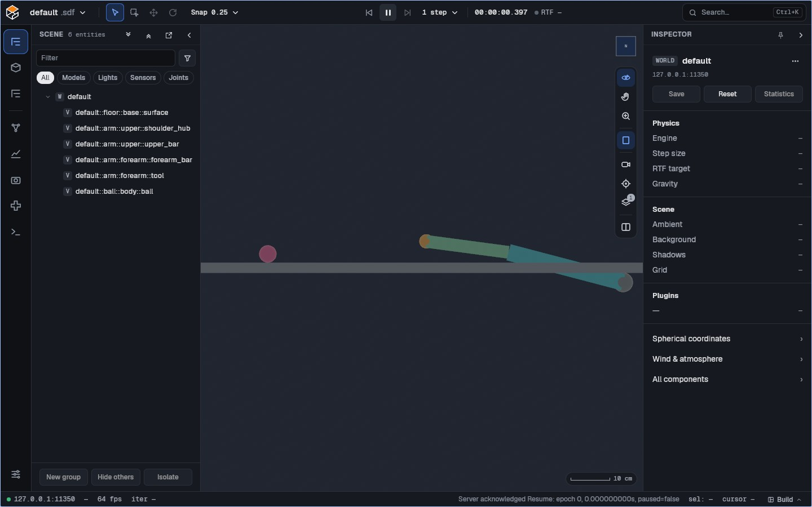

# A GPU robot pushes a free sphere

The two-joint arm struck an 80 g sphere resting on a table and sent it 400.1 mm along the surface in 400 ms. A 250 g sphere under the same drive travelled 344.9 mm. A sphere placed beyond reach stayed at its original horizontal position. The regular SDF loader, GPU backend and gz-web-rs recorder produced the playback below. [Open the recorded motion](http://127.0.0.1:8082/?backend=primitive&ui=full&quality=low&replay=1&lifecycle=1&url=ws%3A%2F%2F127.0.0.1%3A11350%2F) · [Numerical results](gpu-free-object.json) · [SDF fixture](../../../examples/gpu_planar_free_object.sdf)



## Independent comparison

| Sphere | First contact, GPU / Rapier | Accumulated tool impulse, GPU / Rapier | Largest sphere position difference | Largest tool position difference |
|---|---:|---:|---:|---:|
| 80 g | 21 / 21 ms | 0.142648 / 0.143013 N·s | 0.564 mm | 0.165 mm |
| 250 g | 21 / 21 ms | 0.381546 / 0.382100 N·s | 0.177 mm | 0.139 mm |
| 80 g, beyond reach | No contact in either | 0 / 0 N·s | 0.024 mm | 0.145 mm |

The Rust device kernel solves the spherical tool against the table, the free sphere against the table, and the two spheres against one another. The contact impulse acts on both the moving object and the articulated arm. The two floor rows share no moving body. Eliminating their reactions gives four possible combinations of loaded floor contacts and one scalar equation for the sphere-to-tool impulse. A separate position correction uses the same mass matrix. Across all 1,200 public steps the largest discrepancy between the sphere's momentum change and the sum of its gravity, tool and floor impulses was 3.13 × 10⁻¹⁷ N·s.

The comparison ran on an NVIDIA GeForce RTX 5090, Vulkan, driver 595.99.02. The arm uses torque-limited servos. Its two joints, free sphere and three contact constraints update in f64 at 250 µs intervals inside the 1 ms Bevy clock. The native reference uses a separate 3D f64 Rapier multibody, a freely moving rigid sphere, two actual spherical colliders and a fixed table. Its controller reads its own joint positions and speeds at 31.25 µs intervals. Both receive the same target change at 301 ms. Reset reproduced all 72 f64 values in all three device lanes at every public step.

Rapier 0.36.1 defaults to a 50 mm contact-recycling distance at metre scale. In an initial sensitivity run, the old contact normal persisted as the tool moved away, and the 80 g sphere's trajectory differed by 381 mm. The comparison above disables manifold recycling, speculative prediction distance and allowed linear error so Rapier rebuilds the round contact from its current geometry. The measured 0.26% and 0.15% impulse differences use that refreshed reference.

## Supported scene and limits

The SDF profile accepts one coplanar solid sphere initially at rest, one fixed-base arm with two unlimited revolute hinges and a spherical tool, and one horizontal static plane. The floor, tool and object specify zero friction. Central forces leave the object's orientation fixed. The public Rust API reports total normal impulse, the XZ tool impulse vector on the object, and its distinct upward floor impulse. Ordinary joint-controller commands and authored target sequences both work. Contact detection samples each 250 µs substep. Fast impacts that pass entirely between these samples, tangential contact, spin from friction, retention between jaws, sliding resistance and general 3D object manipulation remain open.

## Run and view

From the checkout, record 400 ms to a fresh directory, then serve it on a local WebSocket. Choose an installed Vulkan GPU with shader f64 and pass its name explicitly.

```sh
RUSTC_WRAPPER= cargo run --release --locked -p gz-sim-cli --features gpu-batch --bin gz-sim-rs -- \
  examples/gpu_planar_free_object.sdf --physics-engine gpu-batch --gpu-adapter 'NVIDIA GeForce RTX 5090' \
  --server --run --iterations 400 --web-viewer 11351 --web-lifecycle --record-scene artifacts/gpu-sphere-replay
RUSTC_WRAPPER= cargo run --release --locked -p gz-sim-cli --features gpu-batch --bin gz-sim-rs -- \
  artifacts/gpu-sphere-replay --server --replay --web-viewer 11352
```

With gz-web-rs running on port 8082, open the fresh replay and press Play. Chromium verified the measured recording's six visuals at all 14 frames, including the start and final 400 ms pose. All 84 displayed poses matched forward kinematics from an independent device run within 10⁻¹², and rewind returned to zero. [View the fresh replay](http://127.0.0.1:8082/?backend=primitive&ui=full&quality=low&replay=1&lifecycle=1&url=ws%3A%2F%2F127.0.0.1%3A11352%2F)

```sh
RUSTC_WRAPPER= cargo run --release --locked -p gz-physics-gpu --example planar_free_object -- \
  'NVIDIA GeForce RTX 5090' artifacts/gpu-sphere-reference
GZ_GPU_ADAPTER='NVIDIA GeForce RTX 5090' RUSTC_WRAPPER= cargo test --release --locked \
  -p gz-sim-scene --features gpu-batch --test gpu_sdf_tool -- --include-ignored --test-threads=1
```

The 2026-11-23 qualification passed 15 ordinary planar-tool scene cases, four other GPU SDF cases, and two unit cases covering every loaded combination and invalid starting states. The scene cases reject unsuitable geometry or materials, exercise the standard velocity controllers, detect a missing ECS body component before the next solve and compare the complete 400-step motion after reset. Against cccf0cb, exact release-profile LLVM objects covered 490/499 changed production lines (98.20%) and 955/987 changed regions (96.76%). The independent Rust measurement executable covered 211/214 lines and 394/408 regions. The next local GPU phase is frictional contact and sphere spin, followed by opposing moving jaws and a load-retention test.
