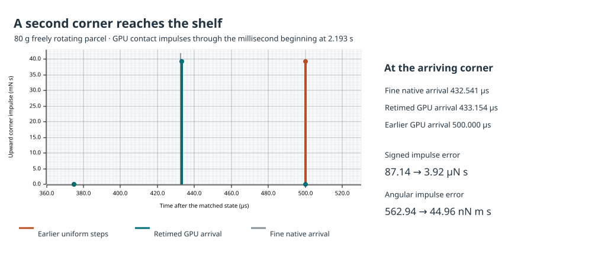
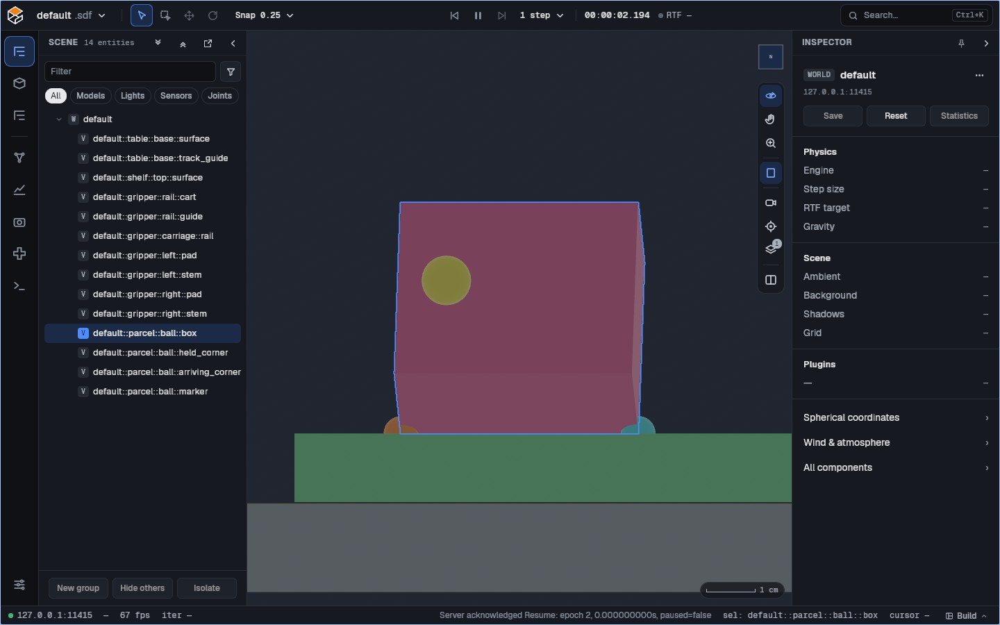

# The second corner takes the load

When the eccentric parcel rocked onto its next corner, the GPU used to apply the impact 500 µs into the public millisecond. The new contact solve placed it at **433.154 µs**. Independent Rapier located the arrival in the **432.541–432.556 µs** interval. Both mirrored releases gave the same time. The earlier corner unloaded during the impact. [Positive release in gz-web-rs](http://127.0.0.1:8082/?backend=primitive&ui=full&quality=low&replay=1&lifecycle=1&url=ws%3A%2F%2F127.0.0.1%3A11415%2F) · [Mirrored release](http://127.0.0.1:8082/?backend=primitive&ui=full&quality=low&replay=1&lifecycle=1&url=ws%3A%2F%2F127.0.0.1%3A11416%2F)



| Positive release, instantaneous strike | Earlier GPU | Retimed GPU | Independent plastic impact |
| --- | ---: | ---: | ---: |
| Impulse X (mN s) | −17.5922 | −17.5559 | −17.5575 |
| Impulse Y (mN s) | +2.1621 | +2.1513 | +2.1519 |
| Impulse Z (mN s) | +39.3878 | +39.3050 | +39.3085 |
| Angular impulse X about the mass center (µN m s) | −45.7021 | −45.7404 | −45.7354 |
| Angular impulse Y (µN m s) | −362.7564 | −363.2732 | −363.3170 |
| Angular impulse Z (µN m s) | −0.5001 | −0.5473 | −0.5387 |
| Magnitude of linear impulse error | 87.14 µN s | 3.92 µN s | |
| Magnitude of angular impulse error | 562.94 nN m s | 44.96 nN m s | |

Reflecting the release across the XZ plane reversed linear Y and angular X and Z. The impulse magnitudes and improvements held on both sides. The table records the impulse of the actual impact. Smaller support impulses followed it during the same millisecond.

## Independent references

Both runs started with the recorded GPU state at 2.193 s. Corner 0 on the positive release, or corner 2 on the mirror, was already supported. The arriving corner was 339 µm above the shelf and approaching at 0.782 m/s. Halving Rapier's native interval from 30.52 ns to 15.26 ns changed the plastic point prediction by 0.021 µN s. These settings are dedicated impact diagnostics. [Frozen incoming states and earlier contact results](gpu-shelf-glance.md)

At the first native substep that loaded the arriving material vertex, the diagnostic independently solved the three impulse components using the incoming velocity, the rotated inertia and the eccentric contact arm. It enforces zero outgoing normal speed and maximum friction opposing the outgoing slip at the circular Coulomb limit. The old corner separated at +48.49 mm/s in this solution, confirming that it should carry zero impulse at the strike. The impact dissipated 17.32 mJ. On the GPU, the sum of actual per-corner substep impulses matched the change in linear momentum within 10⁻¹² N s. Their moments about the moving center matched the angular momentum change within 10⁻¹³ N m s. Both GPU modes gave zero load on the old corner during the main impact.

The separately stepped native solver retains its own contact and friction algorithm. The diagnostic reads each active material point, transforms its accumulated tangent impulse through Rapier's solver basis and sums its moment with Rapier's world-space contact arm. All forty resolution and mirror controls remained inside the friction bound to numerical precision. Native angular momentum residuals were below 2 × 10⁻⁸ N m s, including frozen-arm and finite-step integration error. From the matched GPU state, the outgoing native yaw speeds at the three finest resolutions still varied. The instantaneous plastic solution converged near 1.6043 rad/s. A stable final yaw for the full sequence of glancing events remains open. [Signed native impulses, hardware substeps, convergence and checks](gpu-glancing-corner.json)

## A local change to the normal SDF step

The host considers adding a solve only if the preceding spatial shelf step loaded one vertex, that vertex still touches the surface at low normal speed, and the swept motion predicts one adjacent vertex will reach the interior during this tick. Two competing candidates, a separating or stale witness, a face already touching, or a nearly coincident existing time boundary preserve the ordinary eight intervals. The extra solve splits one 125 µs interval in two. The GPU still computes the geometric gap and unilateral reaction at each boundary. The actuator, hand and public simulation clock keep the same 1 ms step. The two marked releases remained identical through 2.193 s.

The symmetric release, the two rough spinning arrests and the frictionless spinning control reproduced their earlier trajectories bit-for-bit. The two larger glancing releases changed final yaw by 0.009°. Every settling case retained its earlier 40 ms sustained-rest onset. The positive glancing case finished at −1.090°, while the continuous 32-substep native run finished at +2.441°.

Across three alternating paired release runs, median single-world throughput was 193.4 public steps/s with retiming and 197.9 before. Median p95 was 7.636 ms and 7.710 ms, respectively. These observed times include the full Bevy step and GPU readback on a shared RTX 5090. All 47 ordinary hardware SDF cases, the matched device substep audit and the split admission controls passed. Changed production coverage was 97/99 lines and 165/170 regions. The qualification examples covered 238/239 changed lines and 499/503 regions. Native WebGPU playback checked 4,200 poses across the two new marked archives and rewound both to zero.

## Run and inspect the strike

The ordinary Rust example runs the complete SDF pickup, carry, release and landing on the named GPU, then repeats each release after reset. The optional `corner-window` selection adds two visual markers to the parcel. Cyan is the originally supported corner and orange is the arriving corner. The recorder publishes every public step from 2.182 to 2.206 s. At 2.194 s, select the parcel's box, choose a side view and press F for the close-up below.

```bash
RUSTC_WRAPPER= cargo run --release --locked -p gz-sim-cli --features gpu-batch \
  --example gpu_box_shelf_spatial -- 'NVIDIA GeForce RTX 5090' artifacts/corner-impulse corner-window
RUSTC_WRAPPER= cargo run --release --locked -p gz-sim-cli --example gpu_box_shelf_glance -- --corners
GZ_GPU_ADAPTER='NVIDIA GeForce RTX 5090' RUSTC_WRAPPER= cargo test --release --locked \
  -p gz-physics-gpu --lib -- glancing_shelf --include-ignored --nocapture
```

The checked-in recordings also work without physics hardware. With gz-web-rs on port 8082, unpack them and launch a native replay server. [Both native recordings](gpu-glancing-corner-replays.tar.xz) · [Open local replay](http://127.0.0.1:8082/?backend=primitive&ui=full&quality=low&replay=1&lifecycle=1&url=ws%3A%2F%2F127.0.0.1%3A11417%2F)

```bash
mkdir -p artifacts/corner-replays
tar -xJf docs/measurements/local-manipulation/gpu-glancing-corner-replays.tar.xz -C artifacts/corner-replays
RUSTC_WRAPPER= cargo run --release --locked -p gz-sim-cli --bin gz-sim-rs -- \
  artifacts/corner-replays/oblique_plus-replay --server --replay --web-viewer 11417
```


