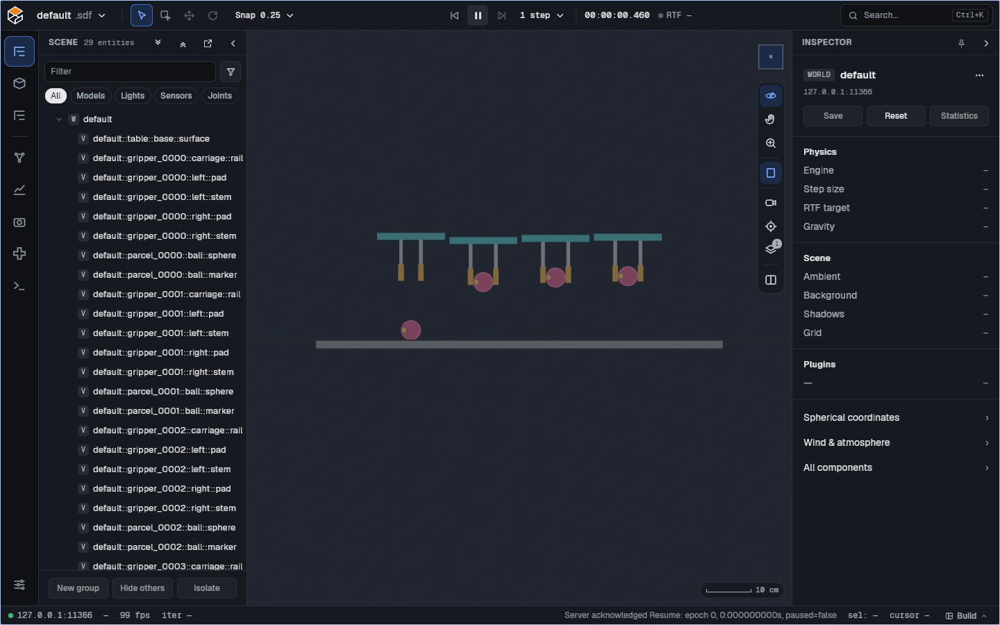

# 2,048 GPU grippers with free objects and live observations

The benchmark loads 2,048 independent grippers through the ordinary SDF world loader. It runs every actuator, fingertip, object and joint publisher on the public one-millisecond Bevy clock. The replay shows four members of the measured population. The frictionless gripper on the left rises without its ball. The other three carry their loads until their jaws open. [Open gz-web-rs](http://127.0.0.1:8082/?backend=primitive&ui=full&quality=low&replay=1&lifecycle=1&url=ws%3A%2F%2F127.0.0.1%3A11366%2F) · [Measurement receipt](gpu-gripper-population.json)



## Physical population and reference

Each gripper has a loaded vertical carriage, two independently actuated horizontal fingers, a free spinning sphere and a horizontal table. Dedicated lateral strips keep the finite finger and sphere geometries physically separated throughout their swept volumes. Admission verifies ownership, unique IDs, the shared static table and disjoint strips. Every row is sorted by stable environment ID, independent of SDF declaration order. The two supported action sources are SDF schedules and dense live displacement commands. An invalid live vector preserves every earlier target.

Every scenario has 256 members. Within each group, movement and release times are staggered by up to 15 ms and lift displacements span a further 2.55 mm. Each robot has a normal JointStatePublisher. It supplies the displacement and velocity of all three sliders at each public tick. The public population API also supplies sphere motion and three normal and tangential contact impulses. A complete SHA-256 digest covers the measured motion, targets, impulses and joint sensor values at every tick. One 1,000-tick episode emits 6,144,000 joint readings, each with position and velocity.

| Scenario | Result throughout the 500–640 ms hold | Members |
|---|---|---:|
| 80 g sphere, friction 0.6 | 118.68–121.32 mm minimum clearance | 256 |
| 200 g sphere, friction 0.6 | 114.40–117.14 mm minimum clearance | 256 |
| 350 g sphere, friction 0.6 | 103.93–106.54 mm minimum clearance | 256 |
| 80 g sphere, frictionless pads | Ball on table | 256 |
| 80 g sphere, open jaws | Ball on table | 256 |
| 200 g sphere, friction 0.3 | Slipped back to table | 256 |
| 80 g sphere, closed stationary gripper | Ball on table | 256 |
| 80 g sphere, delayed lift and release | 118.84–121.49 mm minimum clearance | 256 |

The 1,024 lifted spheres all exceeded 100 mm of clearance and had zero table impulse throughout the hold. Independent f64 Rapier multibody worlds replayed all eight scenarios at each end of the command range. The maximum path error among the eight successful lifts was 2.223 mm. The two low-friction 200 g trials both slipped in Rapier and on GPU, with up to 9.612 mm path error during slip. The open, frictionless and stationary controls agreed within 0.482 mm. The CPU reference uses geometric cuboid/sphere collision detection, 62.5 µs substeps, and feedback from its own slider states. The device uses four 250 µs substeps. These fixtures qualify mixed loads, friction and commands within one planar collision profile. Interacting robots, changing topology, other shapes and overlapping environment volumes need separate validation. [Earlier force balance and friction boundary](gpu-parallel-gripper.md)

## Measured performance

Three independent release processes per action route ran 1,000 ticks and then repeated the full episode after resetting. The table gives the median of the six episodes per route. Aggregate throughput includes advancing the full Bevy schedule, force-reading every device record, validating and hashing the joint sensor and contact outputs, and writing the per-tick measurements. It excludes SDF parsing, device construction, rendering and the separate CPU reference.

| 2,048 environments | Scheduled SDF commands | Dense live commands |
|---|---:|---:|
| Aggregate environment-steps/s | 382,888 | 301,212 |
| Range across six episodes | 344,238–422,793 | 266,444–357,983 |
| Simulated seconds per wall second per environment | 0.187 | 0.147 |
| Complete observed step p99 | 8.666 ms | 10.740 ms |
| Range of observed p99 | 8.420–10.631 ms | 8.804–13.576 ms |
| Device dispatch p99 | 0.378 ms | 0.378 ms |
| Host → device per 1,000 ticks | 102,236,160 B | 851,968,000 B |
| Device → host per 1,000 ticks | 852,000,000 B | 852,000,000 B |

The slowest measured episode still exceeded the TDD target of 10,000 aggregate environment-steps/s. All twelve episodes produced the same digest, including the two different command routes and every world reset. GPU dispatch is one part of observed step latency. The latter also includes the host transfer, Bevy publication and the consuming application. Individual dispatch p99 values reached 2.80 ms during concurrent workstation activity. The separate finer CPU reference measured 158–312 µs for individual single-world p95 times. It serves as an accuracy reference.

Host hardware was an AMD Ryzen 9 9950X3D with an NVIDIA GeForce RTX 5090 on driver 595.99.02, Linux 7.0.0-43-generic and Rust 1.97.1. The device used f64 Vulkan and 32 workgroups. Physical state occupied 851,968 B and explicit state, readback and timestamp buffers totaled 1,704,000 B. The remaining 32 B read back per tick were device timestamps. Host resident memory was 610–611 MiB after loading all 65,536 Bevy entities. Peak process RSS ranged from 687 to 689 MiB, including the generated SDF, host allocations and subsequent validation. Driver-private GPU allocations were outside the measured buffer total.

## How to run

The measurement executable writes its generated ordinary SDF, per-tick timings, source visual poses and JSON receipt. Both action routes force dense device-to-host copies and read every joint sensor on every step. With live input the host supplies all 6,144 joint displacements per tick. The GPU receives the full state buffer on those uploads. The benchmark does not publish 2,048 Zenoh topics or render 2,048 robots on every step. Those are separate workloads.

```sh
RUSTC_WRAPPER= cargo run --release --locked -p gz-sim-scene --features gpu-batch --example gpu_gripper_population -- \
  'NVIDIA GeForce RTX 5090' 2048 artifacts/gripper-population
RUSTC_WRAPPER= cargo run --release --locked -p gz-sim-scene --features gpu-batch --example gpu_gripper_population -- \
  --live-actions 'NVIDIA GeForce RTX 5090' 2048 artifacts/gripper-actions
```

For the same four-gripper recording in the stock CLI and native web viewer, use fresh output paths.

```sh
RUSTC_WRAPPER= cargo run --release --locked -p gz-sim-scene --features gpu-batch --example gpu_gripper_population -- \
  --write-sdf 4 four_grippers.sdf
RUSTC_WRAPPER= cargo run --release --locked -p gz-sim-cli --features gpu-batch --bin gz-sim-rs -- four_grippers.sdf \
  --physics-engine gpu-batch --gpu-adapter 'NVIDIA GeForce RTX 5090' --server --run --iterations 1000 \
  --web-viewer 11367 --web-lifecycle --record-scene artifacts/four-grippers
RUSTC_WRAPPER= cargo run --release --locked -p gz-sim-cli --features gpu-batch --bin gz-sim-rs -- \
  artifacts/four-grippers --server --replay --web-viewer 11368
```

Point the gz-web-rs frontend at the replay socket. Native WebGPU playback checked 29 visuals through all 35 frames against the four corresponding trajectories in the full population, then rewound to zero. [Open the new recording](http://127.0.0.1:8082/?backend=primitive&ui=full&quality=low&replay=1&lifecycle=1&url=ws%3A%2F%2F127.0.0.1%3A11368%2F)

The hardware tests compare per-tick SDF and live actions, including reversed environment declaration order, and check rejected duplicate ownership, overlapping swept volumes, stale topology and an invalid last action. The prismatic joint type survives native Gazebo packet encoding. Changed production coverage was **265/269 executable lines (98.51%) and 470/484 regions (97.11%)**. The linked receipt records the exact executable and profile hashes and the six independent process runs. [Measurements and coverage](gpu-gripper-population.json)
