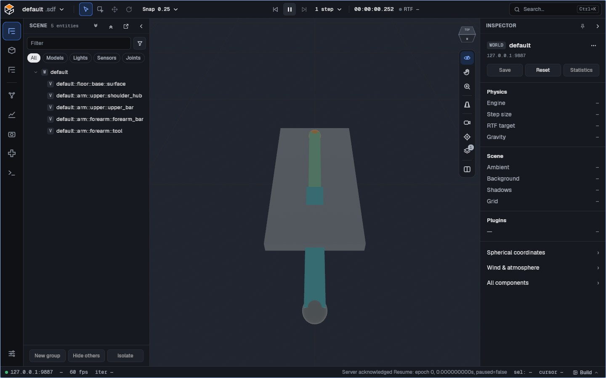
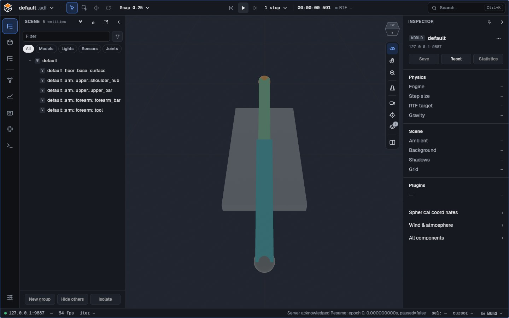

# Shoulder travel stops during tool contact

An RTX 5090 simulated a two-link SDF arm commanded through the ordinary Gazebo joint-controller and world-control interfaces. The arm pushed its round tool against the floor, reached its lower shoulder stop while still pushing, then reversed and hit the upper stop with the tool clear. Both the hardware and independent Rapier arm reached the same stops for the first time at 211 and 510 ms. [Measured results](gpu-joint-stops.json) · [Open the gz-web-rs replay](http://127.0.0.1:8082/?backend=primitive&ui=full&quality=low&replay=1&lifecycle=1&url=ws%3A%2F%2F127.0.0.1%3A9887%2F)

| Over 600 actuator ticks of 1 ms | GPU | Native Rapier |
|---|---:|---:|
| First lower stop reaction at 211 ms | +0.05919 N m s | +0.05822 N m s |
| First upper stop reaction at 510 ms | −0.07518 N m s | −0.08022 N m s |
| Cumulative signed shoulder-stop impulse | −0.37483 N m s | −0.37786 N m s |
| Peak excursion past either angular limit | 1.74 × 10⁻¹⁷ rad | 9.23 × 10⁻¹² rad |
| First and last tick carrying tool contact | 65 and 307 ms | 65 and 307 ms |
| First normal landing impulse | 0.29771 N s | 0.31638 N s |
| Total normal tool impulse | 4.11197 N s | 4.09326 N s |

The GPU applied both a lower shoulder-stop reaction and a tool-floor reaction on 90 ticks. The largest tool-path difference against Rapier was 0.840 mm. Peak shoulder and elbow angle differences were 0.000913 and 0.003999 rad. An earlier trial that corrected only the stopped coordinate reached 1.398 mm of tool-path error. The accepted correction accounts for the coupled motion of the other link.

The GPU reports signed impulses on each hinge directly. Rapier independently solves its native reduced-coordinate revolute limits and floor contacts on 62.5 µs steps. Its limit impulses in the table are estimated from the change in generalized momentum after subtracting applied torque, gravity and measured tool contact. With the elbow clear of both stops, the largest single-tick native elbow residual was 0.000108 N m s. A separate native run removed both shoulder limits and another kept only the lower limit. Those trajectories first departed from the bounded native trajectory at 211 and 510 ms respectively. The first floor impulse remained 5.9% below Rapier.

The [authored SDF](../../../examples/gpu_stopped_tool_world.sdf) sets the shoulder range to [−0.36, +0.02] rad and the elbow to [−0.15, +1.20] rad. From rest, the client sent shoulder and elbow targets of −8 and +0.12 rad, then +8 and +0.47 rad for tick 301. The elbow stayed between its stops in this run. Separate tests exercise both directions on both axes, a locked elbow, one-sided travel, multiple revolutions, positive sliding and sticking friction, and simultaneous angular and tool contact. A paused reset after 100 ms of motion and a queued reverse command reproduced both the fresh 600-sample trace and terminal state byte for byte. Both runs' published joint-state messages matched independent GPU readback to 2.23 × 10⁻¹⁶ in SI units.

The native renderer checked all 165 displayed poses and shapes over 33 recorded frames against angles and authored visual transforms, then rewound to 0 ms. The floor is a contact surface for the round tool in this GPU profile.

| Lower shoulder stop with tool on floor, 252 ms | Upper shoulder stop with tool raised, 591 ms |
|---|---|
|  |  |

Eleven solver tests, twelve SDF scene tests, the native replay audit and strict Clippy passed. LLVM measured 265/265 changed lines (100.00%) and 650/651 regions (99.85%) in the implementation. The qualification programs covered 157/160 changed lines (98.12%) and 343/345 regions (99.42%). Combined coverage was 422/425 changed lines (99.29%) and 993/996 regions (99.70%).

## Reproduce the run

Choose a fresh output directory and substitute the full name of your hardware f64 Vulkan adapter. The probe starts a separate Gazebo server, sends standard messages and records the native replay.

```sh
export RUSTC_WRAPPER=
export CARGO_TARGET_DIR="${CARGO_TARGET_DIR:-$PWD/target}"
cargo build --release --locked -p gz-sim-cli --features gpu-batch --bin gz-sim-rs --example gpu_joint_probe
"$CARGO_TARGET_DIR/release/examples/gpu_joint_probe" "$CARGO_TARGET_DIR/release/gz-sim-rs" \
  'NVIDIA GeForce RTX 5090' artifacts/gpu-stop-run --stops
cargo run --release --locked -p gz-sim-scene --features gpu-batch --example gpu_sdf_tool -- \
  --stops artifacts/gpu-stop-run/trace.json artifacts/gpu-stop-run/native.json
"$CARGO_TARGET_DIR/release/gz-sim-rs" --replay artifacts/gpu-stop-run/replay --web-viewer 9871
```

With gz-web-rs running on port 8082, [open the new recording](http://127.0.0.1:8082/?backend=primitive&ui=full&quality=low&replay=1&lifecycle=1&url=ws%3A%2F%2F127.0.0.1%3A9871%2F). For the reset check, use another fresh directory and append `--after-reset` to the probe command.
