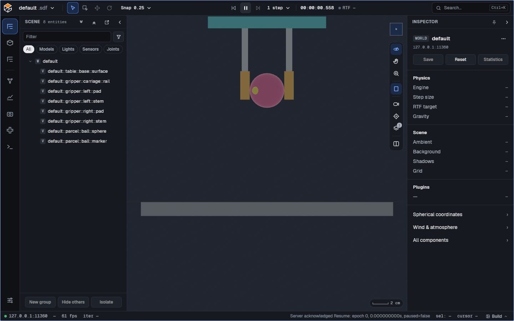

# A free sphere lifted between two moving GPU fingertips

On the RTX 5090, a three-joint gripper held 80, 200 and 350 g spheres clear of the table with pad friction 0.6. At 651 ms the jaws opened, releasing all three spheres. The 80 g sphere landed at 806 ms in both the GPU solver and independent CPU simulation. Opening the jaws throughout the trial or setting pad friction to zero left the ball on the table. [Watch the lift](http://127.0.0.1:8082/?backend=primitive&ui=full&quality=low&replay=1&lifecycle=1&url=ws%3A%2F%2F127.0.0.1%3A11360%2F) · [Watch the frictionless control](http://127.0.0.1:8082/?backend=primitive&ui=full&quality=low&replay=1&lifecycle=1&url=ws%3A%2F%2F127.0.0.1%3A11362%2F) · [Machine-readable measurements](gpu-parallel-gripper.json)



## Compared with independent CPU dynamics

The ordinary SDF scene starts the 22 mm radius solid sphere resting on the table. At the start the two force-limited horizontal jaws close. At 201 ms a force-limited vertical carriage starts lifting them. All three sliders receive displacement commands relative to their initial positions. There is no attachment constraint between the ball and either jaw. The reference uses independent 3D Rapier multibody sliders, colliders, collision detection and contact laws, including geometric fingertip edges. It computes servo forces from its own positions and velocities. Both solvers receive identical displacement targets.

The table gives the minimum clearance from the table during 500–640 ms inclusive, maximum center trajectory difference across the entire second, and average upward load from the two fingertips during the hold. GPU force comes from the two contact impulses. Rapier force is recovered independently from sphere momentum, gravity and the plane impulse.

| Mass | Clearance GPU / Rapier | Max trajectory error | Total upward force GPU / Rapier | Ball weight | Landing GPU / Rapier |
|---:|---:|---:|---:|---:|---:|
| 80 g | 118.68 / 119.22 mm | 0.635 mm | 0.7832 / 0.7832 N | 0.7848 N | 806 / 806 ms |
| 200 g | 114.31 / 114.95 mm | 0.706 mm | 1.9686 / 1.9685 N | 1.9620 N | 802 / 803 ms |
| 350 g | 103.47 / 102.27 mm | 1.760 mm | 3.4471 / 3.4454 N | 3.4335 N | 794 / 794 ms |

All six trajectories first registered positive normal loads on both fingers at 29 ms. At 80 g the GPU finger impulses were 0.09935 and 0.09942 N·s, compared with 0.09745 and 0.09728 N·s in Rapier. Each finger supported about half the suspended weight. Both simulators reported exactly zero plane impulse during all 141 held samples. During the lift the measured support can differ from static weight because the ball accelerates.

## Friction and geometry limits

These are discrete trials with 0.38 kg carriage, two 0.12 kg fingers, 12 × 64 × 36 mm pads, 9 N maximum horizontal drive effort and 25 N maximum lift effort. The stronger-friction trials above met a 100 mm clearance requirement throughout the hold. Open and frictionless 80 g controls had zero upward displacement. At friction 0.3 the 350 g ball rose less than 1 mm and the 200 g ball slipped, briefly rising 23.55 mm on GPU against 18.88 mm in Rapier. At friction 0.15 the 200 g ball stayed within 0.02 mm of the table.

The 80 g, friction 0.15 result depends on reference resolution. CPU substeps of 250, 62.5 and 31.25 µs dropped the ball. At 15.625, 7.8125 and 3.90625 µs the CPU held it 105.95, 106.66 and 106.94 mm clear. The GPU held it 106.27 mm clear. Contact at this threshold can decide the entire lift, so the operational qualification uses the three loads at friction 0.6. A separate rotating two-link tool wedging a sphere against a table still shows 39.95 mm trajectory error. Moving an arm carrying this gripper, general shapes, self-contact and oblique wedging remain separate work. [Original wedge comparison](gpu-rolling-sphere.md)

## Execution and replay

The Rust-authored Vulkan f64 kernel steps two independently actuated horizontal box fingertips, their vertical carriage, a freely translating and spinning solid sphere in their plane, and a horizontal static plane. It projects normal, tangential and joint-stop impulses together and applies separate penetration corrections. A 1 ms Bevy tick contains four 250 µs substeps with eight contact sweeps per solve. Both pad and floor friction use Coulomb bounds. Admitted pad travel prevents pad–pad and pad–plane collisions for the full travel range. Initial overlap, other contact shapes, rotated or offset pads, extra joints, unsupported material laws and configurations outside the vertical planar mechanism fail scene admission. The model uses discrete contacts.

Select the named adapter through the stock CLI and authored SDF. The scene commits link poses, twists and all three relative slider samples through Bevy. Its public scene API also exposes pad and floor impulses and accepts slider targets at the public step boundary. The operator opens the fixed GPU population read-only. Native gz-web-rs WebGPU playback tracked eight visual poses through every archive frame, including rewind. The device repeated all nine lanes byte-for-byte over 1,000 ticks after reset. The loaded Bevy scene independently repeated its 1,000-step run after a world reset.

```sh
RUSTC_WRAPPER= cargo run --release --locked -p gz-sim-cli --features gpu-batch --bin gz-sim-rs -- \
  examples/gpu_parallel_gripper.sdf --physics-engine gpu-batch --gpu-adapter 'NVIDIA GeForce RTX 5090' \
  --server --run --web-viewer 11361 --web-lifecycle --iterations 1000 --record-scene artifacts/gripper-lift
RUSTC_WRAPPER= cargo run --release --locked -p gz-sim-cli --features gpu-batch --bin gz-sim-rs -- \
  artifacts/gripper-lift --server --replay --web-viewer 11363
```

Launch the existing gz-web-rs frontend, open the new recording and press Play. The recording directory must be fresh. [Open local replay](http://127.0.0.1:8082/?backend=primitive&ui=full&quality=low&replay=1&lifecycle=1&url=ws%3A%2F%2F127.0.0.1%3A11363%2F)

```sh
RUSTC_WRAPPER= cargo run --release --locked -p gz-physics-gpu --example parallel_gripper -- \
  'NVIDIA GeForce RTX 5090' artifacts/gripper-comparison
GZ_GPU_ADAPTER='NVIDIA GeForce RTX 5090' RUSTC_WRAPPER= cargo test --release --locked -p gz-sim-scene \
  --features gpu-batch --test gpu_sdf_tool parallel_gripper -- --include-ignored --test-threads=1
```

## Step cost and verification

Three uninstrumented release runs each measured 1,000 public ticks of nine simultaneous lanes on NVIDIA 595.99.02. The median of the three p95 wall times was **481 µs for the GPU including dense readback**, versus **448 µs for the nine native worlds stepped serially on an AMD Ryzen 9 9950X3D**. The measured p95 ranges were 471–575 µs and 424–556 µs respectively. Both cost runs used four 250 µs substeps, with each solver's own contact algorithm. The trajectory reference above used sixteen 62.5 µs native substeps. These timings exclude world construction and the renderer.

Rust tests exercised unadmitted SDF mechanisms, public commands, independent joint and link samples, resets, stale topology and the real CLI. Changed production coverage was **699/711 lines (98.31%) and 1,340/1,399 regions (95.78%)**. The receipt includes exact instrumented binary and profile hashes. The physical replay and cost runs used an uninstrumented release build. [Measurement receipt](gpu-parallel-gripper.json)
