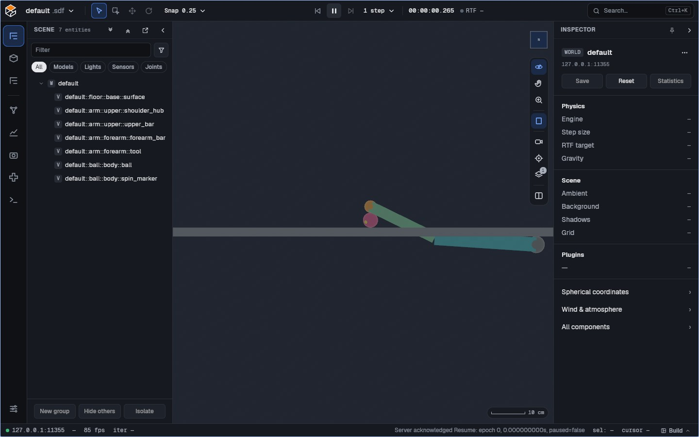

# Friction, spin and a table-supported GPU grasp

An 80 g sphere resisted a lateral disturbance when the articulated tool pressed it against the table. Its largest displacement from an undisturbed, identically driven twin was 0.295 mm during the next 100 ms. Raising the tool let the same disturbance move the sphere 22.688 mm. After the tool lifted, a second disturbance sent the formerly held sphere rolling. This qualifies retention against a fixed table. Two moving jaws and an unsupported lift remain open. [Watch the holding trial](http://127.0.0.1:8082/?backend=primitive&ui=full&quality=low&replay=1&lifecycle=1&url=ws%3A%2F%2F127.0.0.1%3A11355%2F) · [Watch the separate grazing strike](http://127.0.0.1:8082/?backend=primitive&ui=full&quality=low&replay=1&lifecycle=1&url=ws%3A%2F%2F127.0.0.1%3A11354%2F) · [All twelve cases](gpu-rolling-sphere.json)



## Contact and independent checks

The 22 mm radius sphere is free to translate and spin. An 18 mm radius tool on the two-link arm contacts it from above. The first lateral impulse is 0.024 N·s at 201 ms. Through 300 ms the average force over each millisecond exceeded 16.63 N at both contacts. The arm began retracting at 301 ms. The ball received the same pulse again at 351 ms, after the tool had separated. At 400 ms the released ball was 12.245 mm ahead of its undisturbed twin.

The GPU calculates normal and tangential impulses at the sphere/table, tool/sphere and tool/table contacts. It accounts for the moment arms from the sphere's surface and the arm's moving spherical tip. Each substep checks the sphere/table contact for release, forward sliding, reverse sliding and sticking. The selected response obeys the Coulomb bound. Numerical fixtures exercise all sixteen combinations with the tool/sphere contact. SDF accepts the minimum of the two isotropic surface coefficients at each contact, with authored coefficients between zero and one for this bounded profile. The table and rounded tool retain their original geometry.

| Trial | First tool contact on both engines | GPU / native total tool impulse | Largest sphere path difference |
|---|---:|---:|---:|
| Pressed sphere, two pulses | 30 ms | 4.81367 / 4.80358 N·s | 0.801 mm |
| Pressed sphere, undisturbed | 30 ms | 4.81177 / 4.80146 N·s | 0.844 mm |
| Raised tool, two pulses | No contact | 0 / 0 N·s | 0.040 mm |
| Grazing strike | 55 ms | 0.034471 / 0.034489 N·s | 1.954 mm |
| Sphere sliding initially in either direction | No contact | 0 / 0 N·s | 0.035 mm |
| Oblique strike starting at x = 503 mm | 21 ms | 1.24396 / 0.76438 N·s | 39.951 mm |

The independent reference uses Rapier 0.36.1 f64 with a free three-dimensional sphere and a two-link multibody. It integrates its own joint rates and torques at 31.25 µs with four internal projected Gauss–Seidel iterations. Contact geometry refreshes each step. The GPU runs four 250 µs substeps per public millisecond on an RTX 5090, NVIDIA Vulkan driver 595.99.02. Both receive the authored torque targets and the physical center impulses at the same public boundaries.

With an initial horizontal speed of ±0.4 m/s and zero spin, both GPU trials reached rolling at the 39 ms observation. The analytical crossing is 38.83 ms at μ = 0.30. The predicted rolling speed is 5/7 of the starting speed, or ±0.285714 m/s. The corresponding spin magnitude is 12.9870 rad/s. Each GPU trial reproduced these values within 10⁻⁹ and dissipated 1.828571 mJ at the sphere/table contact. A stationary missed sphere received zero tool impulse and stayed still.

Across the twelve cases, the largest linear momentum residual of the sphere was 5.54 × 10⁻¹⁷ N·s and its largest angular momentum residual was 1.90 × 10⁻¹⁹ N·m·s. The largest excess over a Coulomb impulse bound was 1.39 × 10⁻¹⁷ N·s. Total contact impulse work, calculated from impulses and midpoint contact speeds, never added kinetic energy over a public tick. Tangential work considered alone can be positive during an impact with coupled normal and tangential motion. Its largest observed positive tick was 0.183 mJ in the oblique trial.

**The oblique strike remains outside the demonstrated accuracy range.** All tested placements agreed on the first loaded millisecond. The 503 mm placement subsequently accumulated 63% more normal impulse on the GPU than in Rapier. Halving the GPU substep in a separate run increased the maximum sphere path difference to 58.0 mm. The grazing and centered hold results establish accuracy for those loads and placements. The next contact study should match the incoming oblique impact state and compare tangential impulses at the first point of divergence.

## Reproduce

Run the twelve hardware trials, independent Rapier comparisons, work and impulse balances, and a byte-for-byte reset repeat.

```sh
RUSTC_WRAPPER= cargo run --release --locked -p gz-physics-gpu --example planar_free_object -- \
  'NVIDIA GeForce RTX 5090' artifacts/gpu-sphere-friction --friction
GZ_GPU_ADAPTER='NVIDIA GeForce RTX 5090' RUSTC_WRAPPER= cargo test --release --locked \
  -p gz-sim-scene --features gpu-batch --test gpu_sdf_tool -- --include-ignored --test-threads=1
```

Record the holding trial from the standard SDF entry point. Substitute `examples/gpu_planar_rolling_sphere.sdf` to record the grazing trial instead. Use a fresh recording directory each time. The running gz-web-rs front end can connect to the recording's WebSocket. [Open fresh playback](http://127.0.0.1:8082/?backend=primitive&ui=full&quality=low&replay=1&lifecycle=1&url=ws%3A%2F%2F127.0.0.1%3A11358%2F)

```sh
RUSTC_WRAPPER= cargo run --release --locked -p gz-sim-cli --features gpu-batch --bin gz-sim-rs -- \
  examples/gpu_planar_opposed_sphere.sdf --physics-engine gpu-batch --gpu-adapter 'NVIDIA GeForce RTX 5090' \
  --server --run --iterations 400 --web-viewer 11357 --web-lifecycle --record-scene artifacts/gpu-opposed-replay
RUSTC_WRAPPER= cargo run --release --locked -p gz-sim-cli --features gpu-batch --bin gz-sim-rs -- \
  artifacts/gpu-opposed-replay --server --replay --web-viewer 11358
```

The Rust harness checked all 400 steps in each of twelve lanes after reset. The SDF test independently checked the public Bevy angular velocity, orientation, loads, pulse consumption and reset. Chromium verified all 98 visual poses and shapes in each of the two 14-frame recordings against a separate hardware run, including the rotating marker, and rewound both to zero. The release runs passed 17 planar-tool scene cases, four other GPU SDF cases and three solver unit cases. Exact LLVM measurements covered 284/289 changed production lines and 625/636 changed regions (98.27% each). The independent Rust qualification code covered 252/254 changed lines and 520/539 regions. [Smooth-contact baseline](gpu-free-object.md)
