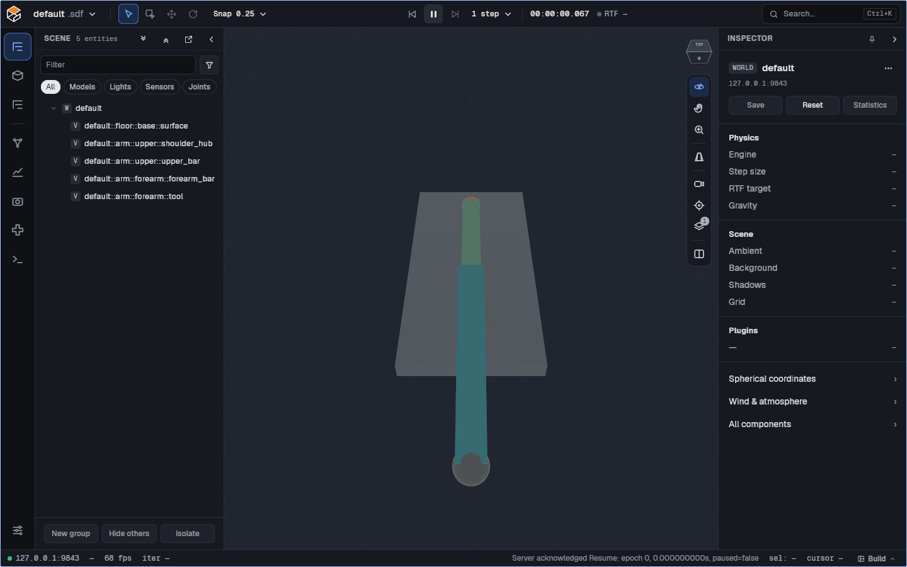

# GPU arm playback from an ordinary SDF world

The orange tool touches the floor at 51.718 ms and lifts after tick 314. The recording contains 19 displayed frames between 0 and 591 ms. The physics trace contains 601 public states from 0 through 600 ms. [Open the recorded arm in gz-web-rs](http://127.0.0.1:8082/?backend=primitive&ui=full&quality=low&replay=1&lifecycle=1&url=ws%3A%2F%2F127.0.0.1%3A9843%2F)



The native playback check composed each visual's SDF offset with its measured world link pose, compared each displayed shape and transform, then checked the rendered WebGPU frame clock, lifecycle catalog and rewind. All 95 visual poses and shapes passed. The full-rate tool-center trajectory differs by at most 0.076 mm from fine Cartesian integration and 0.250 mm from fine Rapier. [Physics measurements and recording commands](gpu-sdf-tool.md)

With the physics study and replay under `artifacts/local-gpu-sdf/qualified`, regenerate the comparison inputs with the following command.

```sh
GZ_GPU_SDF_REPLAY_AUDIT="$PWD/artifacts/local-gpu-sdf" RUSTC_WRAPPER= \
  cargo test --release --locked -p gz-sim-scene --test gpu_planar_sdf_replay all_displayed_arm_poses -- --ignored
```

## Transport-controlled arm

The command-driven run sends two standard `gz.msgs.Double` command topics and subscribes to one `gz.msgs.Model` joint-state topic that contains both joints. Independent forward kinematics from those 600 published angle pairs and the ordinary SDF reproduces the hardware tool gap at every public tick. gz-web-rs checked all 175 visual poses and shapes in 35 native frames, including loaded contact at 72 ms and lift at 321 ms. The final recorded frame is 591 ms. [Replay transport-controlled motion](http://127.0.0.1:8082/?backend=primitive&ui=full&quality=low&replay=1&lifecycle=1&url=ws%3A%2F%2F127.0.0.1%3A9863%2F)
