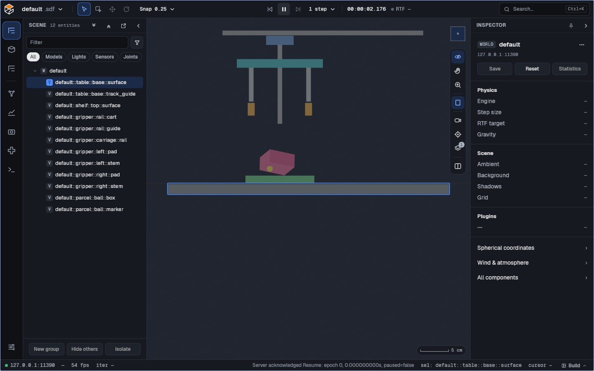

# First corner impact of a released GPU cuboid

A four-slider gripper lifted an 80 g box, moved it 180 mm horizontally and opened above a finite shelf. After the jaws separated, the existing 3D release impulse sent the box sideways and set it tumbling. One corner struck the shelf 2.175338537 s into the run. The corner approached at 1.06624 m/s and moved upward at 0.69306 m/s after the strike. The geometric center continued downward while the box pivoted. [Matched free-flight qualification](gpu-spatial-flight.md)

| Matched release | First upward impulse | Angular impulse about the mass center, world X / Y / Z | Outgoing corner speed | Accepted trajectory after impact |
| --- | ---: | --- | ---: | ---: |
| Restitution 0.65 | 0.033537781 N s | −0.000692601 / +0.000590231 / 0 N m s | +0.69306 m/s | 9.661 ms |
| Restitution 0.35 | 0.027440003 N s | −0.000566673 / +0.000482916 / 0 N m s | +0.37318 m/s | 8.661 ms |
| Shelf moved clear | 0 N s | 0 / 0 / 0 N m s | No shelf impact | Reached the floor boundary at public tick 2188 |

The contact was at world (0.172475286, 0.025025392, 0.014000000) m inside a 120 × 210 mm horizontal shelf. Both fingers still carried the body before the opening command at 2001 ms. The matched free state and its off-center impulse were taken at 2041 ms. All nine moving robot and parcel visual transforms were identical in the three cases on all 2,176 public states through the millisecond before impact. Reducing restitution kept the arrival time and witness fixed. It reduced the upward momentum change and both angular impulse components. A displaced shelf produced zero impulse. Moving a shelf edge into the swept footprint terminated the single-corner run before the uncertain collision.

## Independent dynamics and scope

The CPU reference starts from the exact mass-center position, orientation, linear velocity and angular momentum on the last whole millisecond before impact. It searches all eight actual vertices, advances the body-axis Euler equations with fourth-order Runge–Kutta at 31.25 µs, and bisects the first height crossing. The CPU computes the impulse from the change in witness speed under a unit load using the full world-space inverse inertia matrix. On the GPU, the shader advances the hand and body to the split time, applies the scalar Newton impulse and changes world angular momentum, then advances the rebounding box through the rest of the same 1 ms tick.

At restitution 0.65 the two arrival times differed by 9.85 ps and the contact points differed by 0.019 nm. The signed impulses agreed within 2.77 × 10⁻¹¹ N s in linear momentum and 7.60 × 10⁻¹³ N m s in angular momentum. Across ten published states including the impact, the maximum errors were 18.7 nm in geometric-link position, 7.88 × 10⁻⁶ rad in orientation and 3.38 × 10⁻⁵ rad/s in angular velocity. Reset reproduced every spatial state and impact receipt. [Timings, per-axis impulses, controls, coverage and replay hashes](gpu-shelf-corner.json)

The ordinary Rust SDF profile enables one frictionless, isolated corner impact using the authored shelf dimensions and the explicit pair restitution. The host checks swept extents and brackets a monotone corner crossing. A separate precompiled Rust-authored f64 Vulkan kernel on the same RTX 5090 computes the collision response. Each advancing tick dispatches one kernel. The corner-impact tick uploads 888 bytes and reads 920 bytes including device timestamps. The shelf reports the impulse for that tick, and a separate receipt retains the event until reset. The admission test requires the entire swept horizontal box footprint to fit inside the shelf when it approaches the top. An edge, face, pad, floor, ambiguous grazing contact or second impact preserves the last accepted public state. Multi-point support, sliding on the shelf and contact-generated motion within the grasp remain open.

On the RTX 5090 the off-center release ran at 4,725 observed spatial steps/s with 0.239 ms p95. Its impact tick took 0.270 ms. The lower-restitution case reached 4,594 steps/s (0.239 ms p95) and the shelf miss reached 4,531 steps/s (0.250 ms p95). These are medians over six observed intervals on the shared desktop, from three sequential optimized processes and their reset runs. Each timing includes the ordinary public step and forced readback.

All 38 GPU SDF tests and the narrow-phase regression passed. Changed GPU physics covered 369/371 executable lines and 671/680 regions. The changed Bevy scene loader covered 24/24 lines and 27/28 regions. The Rust qualification examples covered 259/263 lines and 578/598 regions. The previous six-degree-of-freedom free-flight comparison reproduced every public pose in its three cases bit-for-bit. The existing loaded shelf pickup also passed.

## Reproduce and view

The ordinary Bevy SDF run writes three finalized native archives plus its independent comparison for the named physical adapter. Use a new output directory each time.

```bash
RUSTC_WRAPPER= cargo run --locked --release -p gz-sim-cli --features gpu-batch \
  --example gpu_box_shelf_impact -- 'NVIDIA GeForce RTX 5090' artifacts/box-corner
```

The portable archives play on the standard Rust server. Start gz-web-rs on port 8082 and use the viewer pointed at 11393. The recordings include every public tick around impact. Select the table visual and press F to fit the scene. [Open the replay viewer](http://127.0.0.1:8082/?backend=primitive&ui=full&quality=low&replay=1&lifecycle=1&url=ws%3A%2F%2F127.0.0.1%3A11393%2F) · [Portable recordings](gpu-shelf-corner-replays.tar.xz)

```bash
mkdir -p artifacts/box-corner-replays
tar -xJf docs/measurements/local-manipulation/gpu-shelf-corner-replays.tar.xz \
  -C artifacts/box-corner-replays
RUSTC_WRAPPER= cargo run --locked --release -p gz-sim-cli --bin gz-sim-rs -- \
  artifacts/box-corner-replays/corner-replay --server --replay --web-viewer 11393
```

The browser checked 792 visual transforms on each of the 66-frame impact recordings and 804 on the 67-frame shelf-miss control. Each rewound to zero. [First corner impact](http://127.0.0.1:8082/?backend=primitive&ui=full&quality=low&replay=1&lifecycle=1&url=ws%3A%2F%2F127.0.0.1%3A11390%2F) · [Lower restitution](http://127.0.0.1:8082/?backend=primitive&ui=full&quality=low&replay=1&lifecycle=1&url=ws%3A%2F%2F127.0.0.1%3A11391%2F) · [Shelf miss](http://127.0.0.1:8082/?backend=primitive&ui=full&quality=low&replay=1&lifecycle=1&url=ws%3A%2F%2F127.0.0.1%3A11392%2F)


