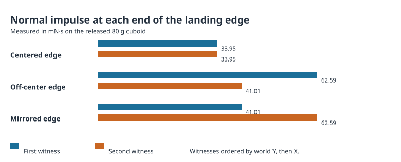
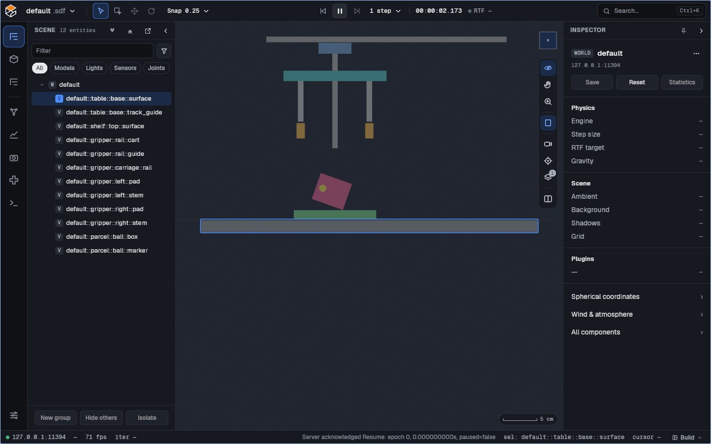

# A released cuboid lands on a finite shelf edge-first

A GPU gripper lifted an 80 g box, traveled 180 mm and opened above a shelf. A release that pitched the box onto its short edge produced two equal upward impulses. A sideways release put the long edge down first. The box's 5 mm mass offset then gave the two corners different shares. Mirroring that release exchanged the two measured loads.

| Landing | Arrival | Upward impulses, sorted by world Y then X | Next accepted motion |
| --- | ---: | ---: | ---: |
| Centered 24 mm edge | 2.172484754 s | 33.947651 and 33.947651 mN s | 13 public states through 2.185 s |
| Eccentric 48 mm edge | 2.179307939 s | 62.590381 and 41.007439 mN s | 4 public states through 2.183 s |
| Mirrored eccentric edge | 2.179307939 s | 41.007439 and 62.590381 mN s | 4 public states through 2.183 s |



The two eccentric releases use opposite lateral components of 0.017 N s and the same upward component of 0.045 N s. The impulse application point was chosen from the measured release state so the long edge would arrive together. In both cases the table, pads, source pose, mass and central moments match the preceding free-flight experiment. The shelf is 120 × 210 mm and its pair restitution is 0.65. [Prior free motion](gpu-spatial-flight.md) · [Isolated corner, lower restitution and shelf miss](gpu-shelf-corner.md)

## Contact model and control

The ordinary Rust SDF loader accepts an explicit `shelf_manifold="edge"` on the existing frictionless shelf-impact profile. Use `shelf_manifold="corner"` to select the existing one-point law explicitly. The host checks that the swept box stays inside the finite shelf footprint and locates approaching material corners. Two adjacent vertices must share the top within 10 pm and 100 ps, and the determinant of the effective mass matrix must exceed 10⁻¹⁰ times the product of its diagonal entries. The f64 Vulkan kernel solves the two normal equations together and applies linear and angular momentum changes to the body. If the unconstrained solution would pull on one corner, the unilateral solve drops that row and resolves the other. A native algebraic regression exercises both choices of unloaded row. The physical edge fixtures above apply positive impulses at both witnesses.

The independent CPU comparison starts from all six measured degrees of freedom on the last whole millisecond before impact. It advances body-axis Euler dynamics with fourth-order Runge–Kutta at 15.625 µs, bisects each of the eight vertex crossings and iteratively projects the two normal velocity constraints in alternating order. The maximum difference in an individual impulse across the five accepted trials was 2.08 × 10⁻¹² N s. The difference in arrival time was under 1 ps. Across the accepted post-impact samples the maximum difference in link position was 46.6 nm and the maximum orientation difference was 8.66 × 10⁻⁶ rad. Independent changes in linear and angular momentum match the sums of the observed impulses and their moments about the mass center. [Full signed components, motion, reset, timings and coverage receipts](gpu-shelf-edge.json)

Tiny positive and negative release offsets produced a 6.373 ps difference between the two unconstrained vertex arrivals. They qualified as a common impact and exchanged impulse shares under reflection. A 0.1 µm change in the point of application produced a 0.79662 µs separation. These cases stopped transactionally at the last clear public state, 2172 ms. For the eccentric pair, all 2,184 reflected parcel poses and all matched witness forces agreed exactly on the named hardware. The unqualified time-separated pair and continued contact after the first rebound remain open. The original single-corner, shelf-miss, free-flight and supported planar pickup checks remain part of the device suite.

Across six timed epochs on the RTX 5090, the median centered run delivered 3,835 public steps/s and a 0.340 ms p95. The eccentric run delivered 3,259 steps/s and a 0.574 ms p95. All 41 physical SDF/device tests passed. The changed production paths exercised 240/248 lines and 432/449 regions, with each production crate above 95% for both measures.

## Run and view

Use a new output directory. The example writes seven native archives with every public millisecond around touchdown, two reset-identical copies of each physical result, and the three mirrored-trajectory comparisons.

```bash
RUSTC_WRAPPER= cargo run --locked --release -p gz-sim-cli --features gpu-batch \
  --example gpu_box_shelf_edge -- 'NVIDIA GeForce RTX 5090' artifacts/box-edge
```

The portable recordings use the ordinary Rust replay server. Start gz-web-rs on port 8082, then connect the viewer to port 11398. The `lateral_plus-replay` recording shows the heavier corner. Select the table in the outliner and press F to fit the scene. [Portable native archives](gpu-shelf-edge-replays.tar.xz) · [Open the viewer](http://127.0.0.1:8082/?backend=primitive&ui=full&quality=low&replay=1&lifecycle=1&url=ws%3A%2F%2F127.0.0.1%3A11398%2F)

```bash
mkdir -p artifacts/box-edge-replays
tar -xJf docs/measurements/local-manipulation/gpu-shelf-edge-replays.tar.xz \
  -C artifacts/box-edge-replays
RUSTC_WRAPPER= cargo run --locked --release -p gz-sim-cli --bin gz-sim-rs -- \
  artifacts/box-edge-replays/lateral_plus-replay --server --replay --web-viewer 11398
```

The native WebGPU browser verified 816 transforms in the centered run, 720 in each eccentric run and 660 in the separated-arrival control. All four recordings rewound to zero. [Centered edge](http://127.0.0.1:8082/?backend=primitive&ui=full&quality=low&replay=1&lifecycle=1&url=ws%3A%2F%2F127.0.0.1%3A11394%2F) · [Eccentric edge](http://127.0.0.1:8082/?backend=primitive&ui=full&quality=low&replay=1&lifecycle=1&url=ws%3A%2F%2F127.0.0.1%3A11395%2F) · [Mirrored eccentric edge](http://127.0.0.1:8082/?backend=primitive&ui=full&quality=low&replay=1&lifecycle=1&url=ws%3A%2F%2F127.0.0.1%3A11396%2F) · [Separated arrivals](http://127.0.0.1:8082/?backend=primitive&ui=full&quality=low&replay=1&lifecycle=1&url=ws%3A%2F%2F127.0.0.1%3A11397%2F)


