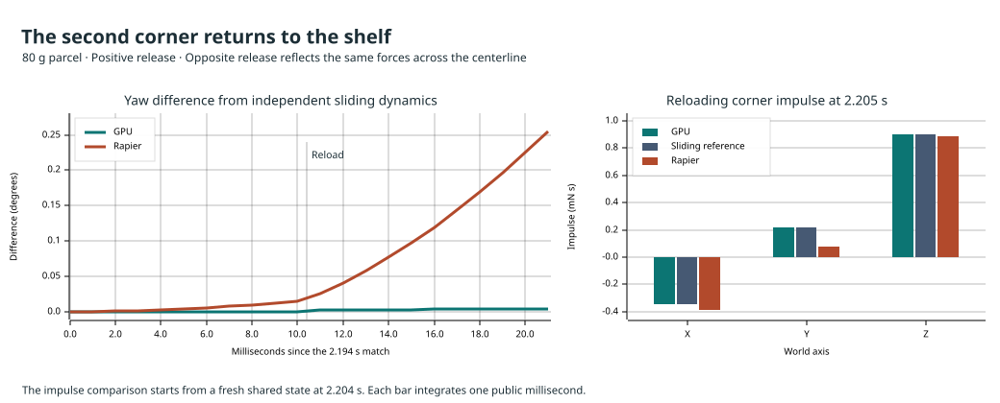
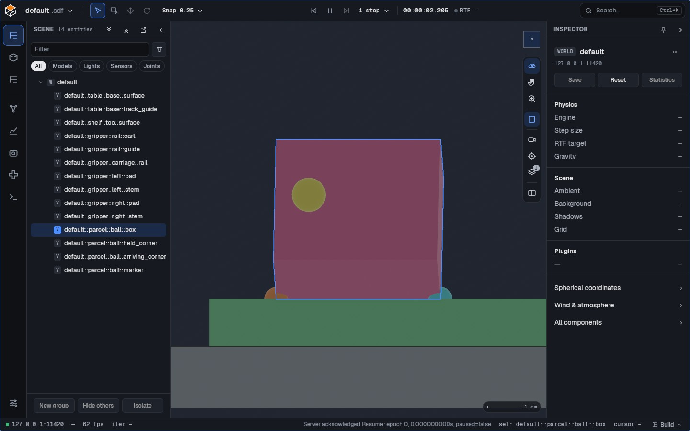

# When a sliding parcel puts its second corner back down

An 80 g parcel released by the local GPU gripper lands on one corner, tips onto its neighbor, then brings the first corner back into contact. Starting from the same state immediately after the second strike, the graphics processor and an independent hard sliding-contact calculation agreed within **0.00388° of yaw, 6.18 µm of link position and 0.561 µN·s of impulse at each corner per millisecond** through 2.215 s. Both mirrored releases passed. The results support the current GPU contact law over this interval. [Measurement and coverage](gpu-shelf-reload.json)



## Where the yaw starts to differ

Both CPU comparisons started from the exact GPU orientation, link origin, center velocity and world angular velocity at 2.194 s. They ran continuously from that state. The first reported Rapier yaw difference was 0.00025° at 2.195 s. It crossed 0.01° at 2.202 s while just one vertex was touching, 0.1° at 2.210 s with both vertices loaded, and 1° at 2.234 s. The values below are for the positive release. The mirrored release reverses yaw.

| Public time (s) | GPU yaw (°) | Independent sliding yaw (°) | Rapier yaw at 2,048 steps/ms (°) |
| ---: | ---: | ---: | ---: |
| 2.195 | −3.39808 | −3.39799 | −3.39783 |
| 2.204 | −2.49597 | −2.49501 | −2.48017 |
| 2.205 | −2.40088 | −2.40318 | −2.37806 |
| 2.215 | −1.72496 | −1.72883 | −1.47399 |
| 2.245 | −1.08986 | Outside qualified window | +0.30677 |

Over 32, 128, 512 and 2,048 Rapier steps per millisecond, the positive-release yaw at 2.215 s ranged from −1.47660° to −1.47399°. The same-resolution mirror differed by at most 0.00026° at that time. The two CPU methods have visibly different limits here.

## What the returning corner does

A separate comparison restarted every method at **2.204 s**, immediately before the return. The independent sliding control predicted touchdown 513.202480, 513.201989, 513.201958 and 513.201956 µs into that millisecond as its resolution rose from 8 to 512 steps/ms. Rapier first reported a positive impulse during the fine substep spanning 513.031–513.062 µs at 32,768 steps/ms. At the predicted impact, the returning vertex approached at 49.18 mm/s. Both vertices carried positive normal impulse.

| Corner and method | X impulse (mN·s) | Y impulse (mN·s) | Z impulse (mN·s) |
| --- | ---: | ---: | ---: |
| Returning, GPU | −0.341174 | +0.215999 | +0.897337 |
| Returning, sliding control | −0.341156 | +0.215987 | +0.897288 |
| Returning, Rapier | −0.388663 | +0.080562 | +0.882102 |
| Already loaded, GPU | −0.578736 | +0.083606 | +1.299548 |
| Already loaded, sliding control | −0.578795 | +0.083341 | +1.299594 |
| Already loaded, Rapier | −0.570889 | +0.093749 | +1.285691 |

These are net impulses from 2.204 to 2.205 s. The isolated impact pulse and all sustained loads are also available separately for the sliding control. The transverse Y impulse on the returning corner explains most of the shear disagreement. Rapier’s substep shear departed from the direction opposite its **own outgoing point velocity** by a normal-impulse-weighted 22.47° at the returning vertex and 0.75° at the continuously loaded vertex. Its 128–32,768-step sweep gave a 22.47–24.31° departure at the return. The circular friction bound alone allows different shear directions. Rapier 0.36.1 computes the full tangent inverse-effective-mass update and caps its magnitude. The independent sliding model sets the direction directly from the point velocity.

The public contact moment about the moving center of mass was (+2.323, +21.332, −6.497) µN·m·s on the GPU and (−0.322, +22.008, −2.378) µN·m·s in fine Rapier. Across every native test interval, the measured sum of solver impulses closed against linear momentum within 4.07 × 10⁻¹⁴ N·s. Their moments closed against angular momentum within 4.38 × 10⁻¹⁰ N·m·s. In the mirror, the returning point is vertex 2 instead of 0, Y impulses switch sign, and yaw reverses.

## Independent checks and limits

The Rust control integrates the center of mass, world angular momentum and quaternion using midpoint steps. For each sliding vertex it sets the shear to 0.45 times the normal force opposite slip, then solves one or two coupled normal-acceleration equations. It bisects the returning corner’s geometric gap and solves the coupled plastic impact using *outgoing* slip, requiring zero normal speed at both points, compressive loads, and a unique nonsingular normal-force system. This control uses separate equations from the device’s iterative projected-impulse solver. The 8-to-512-step refinement changed the maximum GPU yaw difference by 0.000002° or less.

From the earlier 2.194 s match, the control placed the return 396.713 µs into the 2.204–2.205 s interval. Rematching at 2.204 s removed the accumulated difference in gap and normal speed. A third comparison restarted immediately after the return at 2.205 s. The two vertices were within 24.1 nm of the shelf with normal speeds below 0.08 µm/s. Over the next 10 ms, the device stayed within 0.00179° of the two-contact sliding solution. Rapier differed from the device by 0.0942° even after this last rematch.

The independently qualified interval ends at 2.215 s while both material points still slide. Later Rapier checkpoints and GPU recordings extend through the transition toward sticking. A control that admits sticking and detachment at either point is needed to qualify that later interval.

## Run or watch

The Rust SDF example uses Vulkan f64 on an NVIDIA GeForce RTX 5090, records the real primitive scene, resets it and repeats the physics. The cyan marker identifies the returning corner. Orange marks the neighboring corner already on the shelf. Each native recording contains 175 frames with an exact public sample every millisecond from 2.182 through 2.245 s. The browser checked 2,450 independently reconstructed visual poses in each recording and reset to time zero. [Positive release in gz-web-rs](http://127.0.0.1:8082/?backend=primitive&ui=full&quality=low&replay=1&lifecycle=1&url=ws%3A%2F%2F127.0.0.1%3A11420%2F) · [Mirrored release in gz-web-rs](http://127.0.0.1:8082/?backend=primitive&ui=full&quality=low&replay=1&lifecycle=1&url=ws%3A%2F%2F127.0.0.1%3A11421%2F)

```bash
RUSTC_WRAPPER= cargo run --release --locked -p gz-sim-cli --features gpu-batch \
  --example gpu_box_shelf_spatial -- 'NVIDIA GeForce RTX 5090' artifacts/shelf-reload reload-window
RUSTC_WRAPPER= cargo run --release --locked -p gz-sim-cli \
  --example gpu_box_shelf_glance -- --reload artifacts/shelf-reload > artifacts/shelf-reload/controls.json
```

The two matched GPU input traces and full native results are archived for CPU-only reproduction. The native recordings can also be served without a physics device. With gz-web-rs on port 8082, the following commands reproduce the controls and serve the positive release. [Frozen inputs and native results](gpu-shelf-reload-controls.tar.xz) · [Native recordings](gpu-shelf-reload-replays.tar.xz)

```bash
mkdir -p artifacts/shelf-reload
tar -xJf docs/measurements/local-manipulation/gpu-shelf-reload-controls.tar.xz -C artifacts/shelf-reload
tar -xJf docs/measurements/local-manipulation/gpu-shelf-reload-replays.tar.xz -C artifacts/shelf-reload
RUSTC_WRAPPER= cargo run --release --locked -p gz-sim-cli \
  --example gpu_box_shelf_glance -- --reload artifacts/shelf-reload > artifacts/shelf-reload/repeated.json
cmp artifacts/shelf-reload/{matched-controls,repeated}.json
RUSTC_WRAPPER= cargo run --release --locked -p gz-sim-cli --bin gz-sim-rs -- \
  artifacts/shelf-reload/oblique_plus-replay --server --replay --web-viewer 11420
```



## Verification

All 47 ordinary GPU SDF cases and both lower-level corner regressions passed. The new recording mode produced identical GPU and Rapier trajectories to the prior release on both mirrors, and the original recording mode reproduced its exact native frames. The two earlier native comparison modes produced byte-identical results. Nine negative CLI or SDF input cases returned errors. Strict Clippy and formatting passed.

Relative to `71cd07a`, LLVM executed 317/319 changed Rust example lines (99.37%) and 744/748 regions (99.47%). The SDF recording example reached 6/6 lines and 17/17 regions. The native example and its modules reached 311/313 lines and 727/731 regions. This phase changed qualification and recording code only. [Exact executable and profile hashes](gpu-shelf-reload.json)
