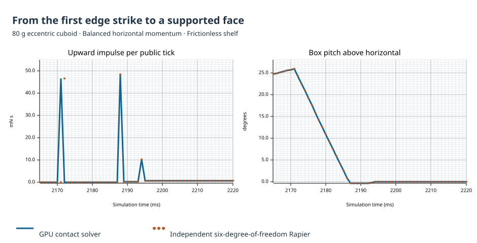
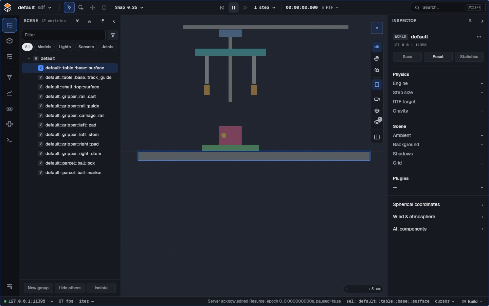

# A released cuboid rocks onto a finite shelf and stays supported

The 80 g eccentric box landed on an edge, lifted clear, struck again, and came to rest on its broad face. Both the GPU and an independently stepped, unconstrained 3D Rapier body first sustained rest at **2.195 s**. Over the last 200 ms, the shelf carried 0.784800 N. The GPU measured 0.310650 N and 0.474150 N at opposite ends of the face, matching the load split predicted by the 5 mm mass offset. [Balanced landing in gz-web-rs](http://127.0.0.1:8082/?backend=primitive&ui=full&quality=low&replay=1&lifecycle=1&url=ws%3A%2F%2F127.0.0.1%3A11398%2F)



| Matched release | GPU | Unconstrained 3D Rapier |
| --- | ---: | ---: |
| First public tick carrying shelf load | 2.171 s | 2.172 s |
| First upward impulse | 46.7077 mN s | 46.7199 mN s |
| Second landing | 2.188 s | 2.188 s |
| First 40 consecutive milliseconds settled | starting 2.195 s | starting 2.195 s |
| Mean upward reaction in final 200 ms | 0.784800 N | 0.784800 N |

Across 810 accepted public samples after release, the geometric link positions stayed within 11.32 µm and orientations within 0.000363 rad. At the end they differed by 3.48 µm and 0.000140 rad. The position metric follows the link origin. Gravity acts at the offset mass center. The box received one external impulse on public tick 2041, during separation from the fingers. The release had positive vertical velocity. Neither simulator saw a shelf load during the first 70 ms after release. Both retained contact identity throughout the transition to a supported face.

## Contact law and scope

The normal SDF entry uses the four-slider Bevy gripper, the existing eccentric 48 × 24 × 40 mm cuboid and the 120 × 210 mm shelf from the edge-impact case. The gripper picked it up, carried it 180 mm, opened and remained clear. The external impulse canceled the residual horizontal momentum of the opening hand and pitched the box. The receiving shelf is frictionless and has zero restitution. The earlier 0.65-restitution first-corner and first-edge profiles continue to qualify their rebounds separately. [Two-corner restitution and mirror controls](gpu-shelf-edge.md)

The SDF selects `shelf_manifold="planar-support"` and `shelf_restitution="0"`. Its symmetry plane is XZ. Gravity, release, mass offset and initial pitch lie in this plane, and the shelf spans the full transverse width. The spatial kernel advances the released body until its swept bounding circle reaches shelf height. At that public boundary the existing Vulkan rectangle-contact solver receives the current geometric pose, twist and controls. Four 250 µs device substeps per public millisecond clip finite contact edges and solve unilateral normal and Coulomb friction constraints. Support can migrate between endpoints, disappear, and return. A release with an out-of-plane force or moment is rejected. Reset restores the gripper and both contact owners.

The CPU comparison starts from the same 3D mass-center position, quaternion, linear velocity and world angular momentum at 2.041 s. Its cuboid has all six free degrees of freedom and remains awake against finite shelf and floor colliders. Rapier uses 32 steps per public millisecond, 32 solver iterations and eight internal sweeps, per-point Coulomb friction, and hard static contact regularization. Sleeping, prediction distance, allowed linear error and penetration correction velocity are zero. A measured resting window requires linear speed below 1 mm/s, spin below 0.05 rad/s and a reaction within 5 mN of the weight for 40 successive milliseconds. Each of the four runs repeats after reset, bit-identically across all published body states, endpoint impulses, tangential impulse and floor loads. [Measured states, balance, device timings and coverage](gpu-shelf-rest.json)

Normal reaction in Rapier comes from the active solver contact indices on the named surface. At the edge-to-face change, the convenience sum over all retained points can include stale impulses. The independent change in vertical momentum, corrected for gravity, agrees with the active-row sum to 1.41 × 10⁻¹⁵ N s in the two resting cases.

## Controls and current limit

- **Shelf miss.** Moving the shelf from X = +180 mm to −180 mm removed every shelf impulse in both solvers. The lower table carried the weight instead. [Shelf miss in gz-web-rs](http://127.0.0.1:8082/?backend=primitive&ui=full&quality=low&replay=1&lifecycle=1&url=ws%3A%2F%2F127.0.0.1%3A11401%2F)
- **Slide and separation.** Restoring the original sideways kick on the frictionless shelf gave a horizontal speed of 37.50 mm/s and 7.46 mm of travel in the 200 ms ending at 2.850 s. The finite shelf lost the load at 3.680 s on the GPU and 3.677 s in Rapier. Both recorded zero shelf force for the final 200 ms. The trajectories differed by up to 2.58 mm through the tip-off and landing on the lower table. [Slide off the shelf in gz-web-rs](http://127.0.0.1:8082/?backend=primitive&ui=full&quality=low&replay=1&lifecycle=1&url=ws%3A%2F%2F127.0.0.1%3A11400%2F)
- **Rough shelf with sideways momentum.** At friction 0.45 both models arrested the box and sustained its weight. The symmetry-constrained GPU box arrested at 2.227 s. Unconstrained 3D Rapier arrested at 2.377 s with a different yaw. The final orientations differed by 26.27° and the link origins by 8.22 mm. Orientation and impact trajectory for a rough, spinning, free 3D body remain open. [Rough shelf in gz-web-rs](http://127.0.0.1:8082/?backend=primitive&ui=full&quality=low&replay=1&lifecycle=1&url=ws%3A%2F%2F127.0.0.1%3A11399%2F)

On the RTX 5090, the median balanced run delivered 1,125 individually observed public steps/s after release, with 1.133 ms p95. The independent CPU comparison delivered 825 public intervals/s at 1.586 ms p95 while performing 32 native steps per interval. The GPU timing covers the ordinary Bevy step and device readback. Three repeated measurements each include two identical GPU epochs. All 45 SDF/device cases passed. Changed production coverage was 59/59 lines and 122/125 regions. Native WebGPU playback checked 4,692 transforms across the four archives and rewound every archive to zero.

## Run and replay

Use an empty output directory. The example writes the four native archives, every post-release GPU and CPU state, the measured support impulses and timings. The checked-in SDF selects the balanced case.

```bash
RUSTC_WRAPPER= cargo run --locked --release -p gz-sim-cli --features gpu-batch \
  --example gpu_box_shelf_rest -- 'NVIDIA GeForce RTX 5090' artifacts/shelf-rest
```

To view the portable recording, start gz-web-rs on port 8082, unpack the four archives, and start the Rust replay server. Select the table surface and press F to fit the scene. [Recorded archives](gpu-shelf-rest-replays.tar.xz) · [Open a replay on port 11402](http://127.0.0.1:8082/?backend=primitive&ui=full&quality=low&replay=1&lifecycle=1&url=ws%3A%2F%2F127.0.0.1%3A11402%2F)

```bash
mkdir -p artifacts/shelf-rest-replays
tar -xJf docs/measurements/local-manipulation/gpu-shelf-rest-replays.tar.xz \
  -C artifacts/shelf-rest-replays
RUSTC_WRAPPER= cargo run --release --locked -p gz-sim-cli --bin gz-sim-rs -- \
  artifacts/shelf-rest-replays/balanced-replay --server --replay --web-viewer 11402
```


