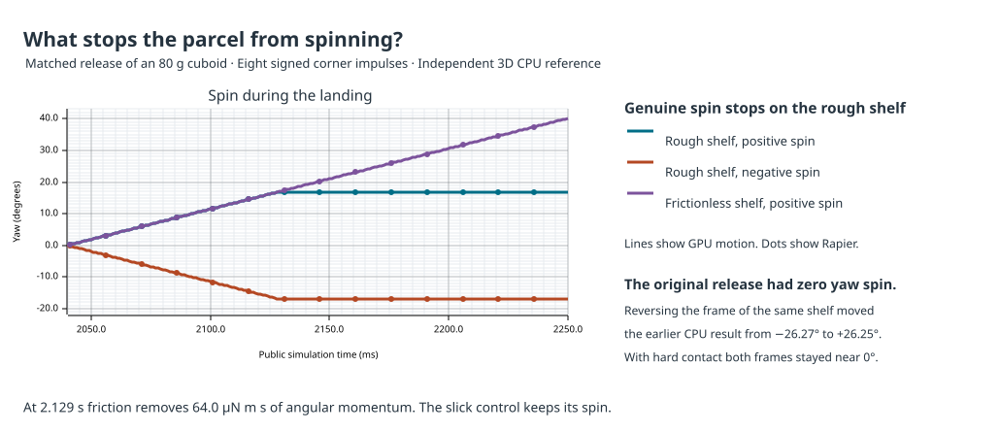
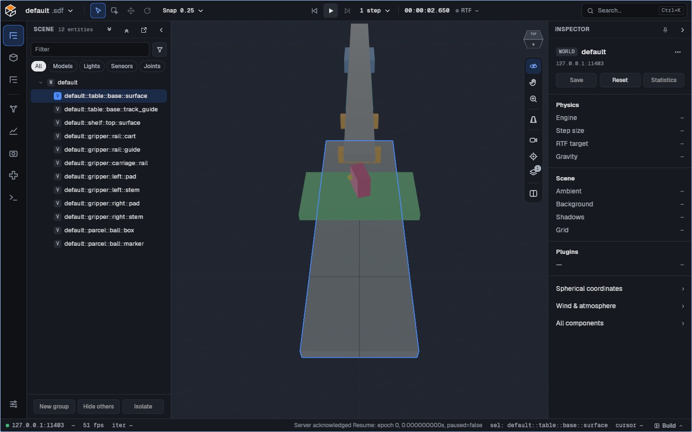

# A freely turning parcel stops on a rough shelf

An 80 g box picked up speed and spin when it left the gripper. Friction on the receiving shelf stopped the spin after **16.8543°** of rotation. Independent 3D Rapier predicted **16.8485°**. Both entered sustained rest at **2.130 s**. Reversing the spin gave the opposite turn. Removing friction let the box keep spinning at 3.3333 rad/s. [Rough landing](http://127.0.0.1:8082/?backend=primitive&ui=full&quality=low&replay=1&lifecycle=1&url=ws%3A%2F%2F127.0.0.1%3A11403%2F) · [Reversed spin](http://127.0.0.1:8082/?backend=primitive&ui=full&quality=low&replay=1&lifecycle=1&url=ws%3A%2F%2F127.0.0.1%3A11404%2F) · [Frictionless control](http://127.0.0.1:8082/?backend=primitive&ui=full&quality=low&replay=1&lifecycle=1&url=ws%3A%2F%2F127.0.0.1%3A11405%2F)



| Matched release | GPU | Independent 3D Rapier |
| --- | ---: | ---: |
| First shelf contact | 2.129 s | 2.129 s |
| First upward impulse | 101.2520 mN s | 101.2521 mN s |
| First longitudinal impulse | −7.9979 mN s | −7.9996 mN s |
| First angular impulse about world Z | −64.0002 µN m s | −64.0000 µN m s |
| Last 200 ms mean upward reaction | 0.7848 N | 0.7848 N |
| Final yaw with friction, reversed release | −16.8543° | −16.8485° |
| Frictionless yaw at 2.250 s | +40.1070° | +40.1070° |

The two rough, spinning landings agreed with Rapier within 29.23 µm of link position over the complete released trajectory. Each started from the same mass-center state, linear velocity, orientation and angular momentum at 2.041 s. The rough shelf removed 0.504 mJ of energy through friction. The slick shelf produced zero friction work and zero angular impulse about world Z. The normal contact still dissipated energy from the drop. Across all eight cases, the largest residual was 4.88 × 10⁻¹⁷ N s for linear impulse and 4.99 × 10⁻¹⁹ N m s for angular impulse. The largest measured excess beyond the circular Coulomb bound was 6.78 × 10⁻²¹ N s.

## What caused the original 26.3° difference?

The original sideways release preserved reflection symmetry across the XZ plane. Rotating only the stationary rectangular shelf's local coordinate frame by exactly 180° left the geometry and material identical. The earlier Rapier settings then predicted +26.2463° instead of −26.2743°. The profile's auxiliary stabilization step made the answer depend on the shelf's coordinate frame. With the hard unilateral contact comparison described below, Rapier agreed to within 0.0001° of zero in both frames. The GPU's spatial contact response also preserved zero yaw. The original stabilized comparisons remain in the measurements. [Symmetric sideways landing](http://127.0.0.1:8082/?backend=primitive&ui=full&quality=low&replay=1&lifecycle=1&url=ws%3A%2F%2F127.0.0.1%3A11406%2F) · [Previous planar milestone](gpu-shelf-rest.md)

For that original release the first upward impulse was 61.42 mN s on the GPU and 61.74 mN s in the hard-contact comparison. The GPU sustained rest from 2.225 s and Rapier from 2.228 s. The largest difference in link position was 0.475 mm.

## Geometry, contact and independent checks

The ordinary SDF loads the four-slider gripper, an eccentric 48 × 24 × 40 mm box and a finite, static 120 × 210 mm horizontal shelf. The hand picks the box up, carries it 180 mm, opens, then imparts the authored impulse once. The new mode uses eight 125 µs device substeps per public millisecond. It advances the mass center and orientation with all six degrees of freedom. The shelf tests the rotated position of every material vertex. Two simultaneous normal constraints span each transverse edge. Each vertex has a two-dimensional tangential impulse bounded in magnitude by its local normal impulse times the friction coefficient. Eight alternating sweeps permit load to pass between edges and constrain friction as each vertex loads or unloads.

The normal solve targets zero restitution. A split position correction handles penetration without changing the twist. The device returns all eight signed impulses, their total moment about the moving mass center and work measured from the actual midpoint velocity and spin. The ordinary step rejects an energy-adding solve above 1 pJ before publishing. Eight internal substeps and their 25 device dispatches share one submission and readback. The finite swept check admits contact only over the shelf interior. Approaching a side, finger or lower floor outside this contact mode preserves the last accepted state. The previously qualified planar profile retains its finite slide-off and lower-table behavior. [Earlier sliding and miss controls](gpu-shelf-rest.md)

The independent f64 Rapier cuboid remains freely rotating, with the same full inertia, moving mass center, finite shelf and floor colliders. The hard-contact comparison uses 32 native substeps per public millisecond, 32 solver iterations per substep, eight internal iterations, friction at individual contact points and zero auxiliary stabilization iterations. The legacy comparison retains one auxiliary stabilization iteration. Contact softness, zero restitution, zero allowed error, zero prediction and zero correction velocity are otherwise identical. All cases also run a 128-substep hard-contact comparison. For the spinning release, the finer CPU control yielded 16.8456° and the legacy control yielded 16.9599°.

## Glancing contacts and finite accuracy

A small oblique kick produced −1.058° on the GPU, +2.441° in the 32-substep hard Rapier control and +3.952° at 128 CPU substeps. The mirrored release reversed those signs. The first upward impulses were 66.31 and 66.77 mN s at 2.170 s. The first 0.1° yaw difference appeared at the second strike at 2.194 s, crossing 1° at 2.200 s. GPU vertices 0 and 1 carried that strike. Its upward impulse was 39.66 mN s versus 38.98 mN s on the CPU, while outgoing world yaw speeds were 1.6 and 4.8 rad/s. That later contact interval is the next matched-state comparison. At a stronger oblique kick, GPU yaw reached +18.544°, while the two native resolutions gave +16.363° and +4.605°. All of these parcels arrested and supported their weight. Their rotations through multiple glancing impacts remain unresolved. Increasing the GPU to 32 substeps moved the smaller oblique landing to −1.082° at substantially higher cost. [Oblique landing](http://127.0.0.1:8082/?backend=primitive&ui=full&quality=low&replay=1&lifecycle=1&url=ws%3A%2F%2F127.0.0.1%3A11407%2F) · [Full measured impulses, trajectories, timings and coverage](gpu-shelf-spatial.json)

## Cost and verification

Three sequential repeats of the positive-spin scene on the RTX 5090 yielded a median of 241 individually observed public steps/s and 5.828 ms p95. The independent CPU control, performing 32 steps for each public interval, delivered 451 intervals/s and 3.431 ms p95. GPU timing includes the full Bevy step and readback. These are single-world measurements on a shared development host. The raw results also include the concurrent qualification run and the 32-device-substep experiment.

All 47 ordinary SDF/device cases passed along with four shared resident-scene checks and two contact-law tests. The four previous support cases, seven edge cases and three isolated-corner controls reproduced all archived poses and frames byte-for-byte. Eight new native gz-web-rs archives verified 12,300 displayed poses against their independently recorded transforms and each rewound to zero. Changed production coverage was 319/321 lines and 756/775 regions. The qualification examples covered 471/488 changed lines and 992/1,022 regions.

## Reproduce and replay

The Rust example runs all eight release cases, repeats each after reset, compares the three mirrored pairs and exports native recordings. An optional final argument selects one case, such as `spin_plus` or `center`. The ordinary scene file selects the rough spinning release.

```bash
RUSTC_WRAPPER= cargo run --release --locked -p gz-sim-cli --features gpu-batch \
  --example gpu_box_shelf_spatial -- 'NVIDIA GeForce RTX 5090' artifacts/shelf-spatial
```

Start gz-web-rs on port 8082, unpack the archives, then start the Rust replay server. [Portable native recordings](gpu-shelf-spatial-replays.tar.xz) · [Open local replay](http://127.0.0.1:8082/?backend=primitive&ui=full&quality=low&replay=1&lifecycle=1&url=ws%3A%2F%2F127.0.0.1%3A11411%2F)

```bash
mkdir -p artifacts/shelf-spatial-replays
tar -xJf docs/measurements/local-manipulation/gpu-shelf-spatial-replays.tar.xz \
  -C artifacts/shelf-spatial-replays
RUSTC_WRAPPER= cargo run --release --locked -p gz-sim-cli --bin gz-sim-rs -- \
  artifacts/shelf-spatial-replays/spin_plus-replay --server --replay --web-viewer 11411
```


