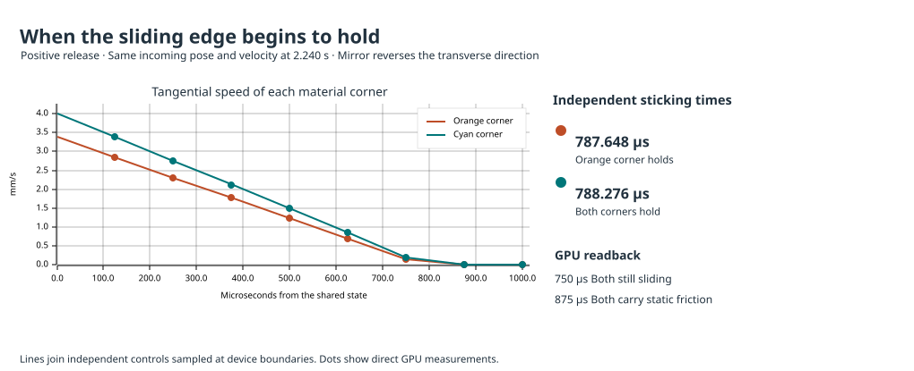
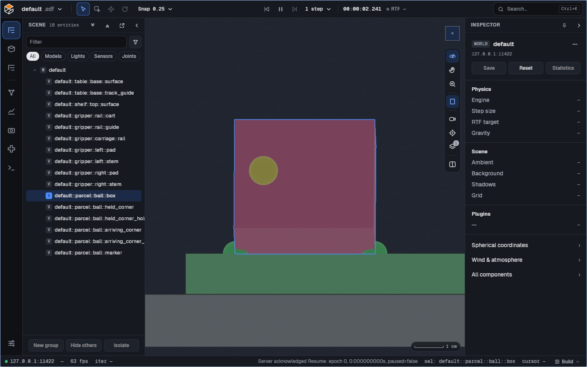

# When the parcel’s sliding edge starts to hold

The two loaded corners stick in quick succession. From identical incoming states at **2.240 s**, the independent rigid-body calculation places the first stop **787.648 µs** later and the second at **788.276 µs**. Both mirrors give the same sequence. The GPU brackets both stops between its 750 and 875 µs readbacks. The rolling parcel carries its weight through two points while its body continues rotating. [Measurements, convergence and coverage](gpu-shelf-stick.json)



## Which corner stops first

Orange identifies the neighbor that began carrying the parcel at the earlier glancing strike. Cyan identifies the original corner that subsequently reloaded. Both support the parcel before sliding ends. At the first stop the orange point can hold while the cyan point still moves at 4.84 µm/s. About 0.628 µs later both can hold. At 2.245 s the GPU body still rotates at 3.66 rad/s about its nearly stationary edge.

| Time after the 2.240 s match | GPU orange / cyan slip (mm/s) | Independent orange / cyan slip (mm/s) |
| ---: | ---: | ---: |
| 0 µs | 3.38162 / 3.99967 | 3.38162 / 3.99967 |
| 750 µs | 0.16173 / 0.20636 | 0.16057 / 0.21216 |
| 875 µs | 0.00441 / 0.00446 | Both below 0.00000002 |
| 1,000 µs | 0.00294 / 0.00299 | Both below 0.00000002 |

On the device, each point’s shear-to-normal impulse ratio was 0.450 at 750 µs. It fell to 0.308 and 0.252 by 875 µs. Both corners retained compressive normal impulses. The eight actual GPU solves place each measured speed within 5.81 µm/s of the reference at the same timestamp. The 125 µs device interval spans the short one-corner sticking phase. The result qualifies the transition to two-point support at device resolution. It leaves a few µm/s of residual slip.

An independent control added 20 mm/s to the incoming X velocity while keeping geometry, gravity, rotations, friction and clock fixed. Both GPU points continued sliding for the entire millisecond, reaching 19.394 and 19.183 mm/s. The independent control gave 19.416 and 19.186 mm/s. The device’s shear remained at the Coulomb limit on every substep.

## Why the contact can hold

The CPU control continues the earlier yaw-and-slip calculation through the single-corner strike, the return to two-point support and slowing under kinetic friction. While two points slide, traction opposes each point’s own velocity. The first sticking trial constrains all three acceleration components at one point and keeps kinetic friction at the moving neighbor. Both receive positive normal force. At first capture the holding point has 0.134 N of spare shear capacity.

When both points stop, five independent constraints pin their positions. Equal, opposite forces along the edge can vary without changing the parcel’s motion. The control intersects the two friction cones with that one-dimensional freedom and chooses the midpoint of the feasible interval. For that solution the normal forces are 0.4481 and 0.2936 N. The remaining shear capacities are 0.1352 and 0.0886 N. An independent hinge calculation uses gravity and inertia about the stationary edge to check the angular acceleration. Across both mirrors and every resolution, it agrees within 7.3 × 10⁻¹² rad/s². The maximum constrained-point acceleration residual is 1.7 × 10⁻¹² m/s².

Over the first full holding millisecond, the GPU and the fine control differ in each corner’s normal impulse by at most 0.035 µN·s when started at 2.240 s. Their admissible splits of internal longitudinal force differ. All eight GPU impulse records independently close the measured linear and angular momentum changes. Across the 2.215–2.245 s public states, every other corner stayed at least 8.58 mm above the top and every vertex remained at least 16.64 mm inside the shelf footprint.

## Convergence and the preceding trajectory

The control reduces its timestep as slip approaches zero. Each change of constraint requires a compressive, friction-feasible reaction. Refining timestep, capture-speed tolerance and fractional speed change gives these timings from the same 2.240 s state.

| Maximum stepsize (µs) | Capture speed (m/s) | Fractional speed step | First sticks (µs) | Both stick (µs) |
| ---: | ---: | ---: | ---: | ---: |
| 62.500 | 10⁻⁶ | 0.09 | 787.387 | 788.265 |
| 15.625 | 10⁻⁷ | 0.09 | 787.622 | 788.274 |
| 3.906 | 10⁻⁸ | 0.09 | 787.645 | 788.276 |
| 15.625 | 10⁻¹⁰ | 0.09 | 787.648 | 788.275 |
| 0.977 | 10⁻¹¹ | 0.02 | 787.648 | 788.276 |

Starting continuously at the earlier 2.194 s strike gave stopping offsets of 779.654 and 780.313 µs into the final millisecond. Rematching at 2.215 s gave 783.017 and 783.678 µs. These comparisons use 256 steps/ms and a capture tolerance of 10⁻⁸ m/s. Across the 25 additional full sliding ticks following 2.215 s, the longer continuous run matched each GPU corner’s slip speed within 0.036 mm/s and its impulse within 0.131 µN·s. Its worst yaw difference through 2.245 s was 0.00778°, and the link-origin difference stayed within 13.22 µm. Starting just before stopping at 2.240 s reduced those bounds to 0.000087° and 0.533 µm.

These results support retaining the current device solver. The independently verified interval ends at 2.245 s. Following the rolling edge to the next contact or loss of support is a separate physical transition.

## Native playback and reproduction

The material points are orange and cyan while sliding. A green indicator appears at each supported point when its computed public speed falls below 5 µm/s and its shear-to-normal impulse ratio drops below 0.449. Both indicators appear at **2.241 s**. The indicators are recording annotations derived from the physical state. Each browser replay checked all 16 visual poses in all 175 frames and reset to time zero. [Positive release in gz-web-rs](http://127.0.0.1:8082/?backend=primitive&ui=full&quality=low&replay=1&lifecycle=1&url=ws%3A%2F%2F127.0.0.1%3A11422%2F) · [Mirrored release in gz-web-rs](http://127.0.0.1:8082/?backend=primitive&ui=full&quality=low&replay=1&lifecycle=1&url=ws%3A%2F%2F127.0.0.1%3A11423%2F)



Run the actual SDF example on Vulkan f64 hardware, followed by the independent CPU control.

```bash
RUSTC_WRAPPER= cargo run --release --locked -p gz-sim-cli --features gpu-batch \
  --example gpu_box_shelf_spatial -- 'NVIDIA GeForce RTX 5090' artifacts/edge-stick stick-window
RUSTC_WRAPPER= cargo run --release --locked -p gz-sim-cli \
  --example gpu_box_shelf_glance -- --stick artifacts/edge-stick > artifacts/edge-stick/control.json
GZ_GPU_ADAPTER='NVIDIA GeForce RTX 5090' RUSTC_WRAPPER= cargo test --release --locked \
  -p gz-physics-gpu --lib -- glancing_shelf --include-ignored --nocapture
```

The checked-in controls reproduce from the frozen inputs without a GPU. The recordings can be served by the native CLI with gz-web-rs running on port 8082. [Frozen inputs, native controls and device readbacks](gpu-shelf-stick-controls.tar.xz) · [Both native recordings](gpu-shelf-stick-replays.tar.xz)

```bash
mkdir -p artifacts/edge-stick
tar -xJf docs/measurements/local-manipulation/gpu-shelf-stick-controls.tar.xz -C artifacts/edge-stick
tar -xJf docs/measurements/local-manipulation/gpu-shelf-stick-replays.tar.xz -C artifacts/edge-stick
RUSTC_WRAPPER= cargo run --release --locked -p gz-sim-cli \
  --example gpu_box_shelf_glance -- --stick artifacts/edge-stick > artifacts/edge-stick/repeated.json
cmp artifacts/edge-stick/{matched-controls,repeated}.json
RUSTC_WRAPPER= cargo run --release --locked -p gz-sim-cli --bin gz-sim-rs -- \
  artifacts/edge-stick/oblique_plus-replay --server --replay --web-viewer 11422
```

All 47 ordinary hardware SDF cases and three direct corner tests passed. The earlier native controls, physics traces and recording mode reproduced their exact saved results. Strict Clippy and formatting passed. Relative to `aeedd46`, the Rust measurement and recording examples executed 382/383 changed lines (99.74%) and 853/858 regions (99.42%). The phase changed the native qualification, hardware tests and replay annotations. [Exact source inputs, executable and profile checksums](gpu-shelf-stick.json)
