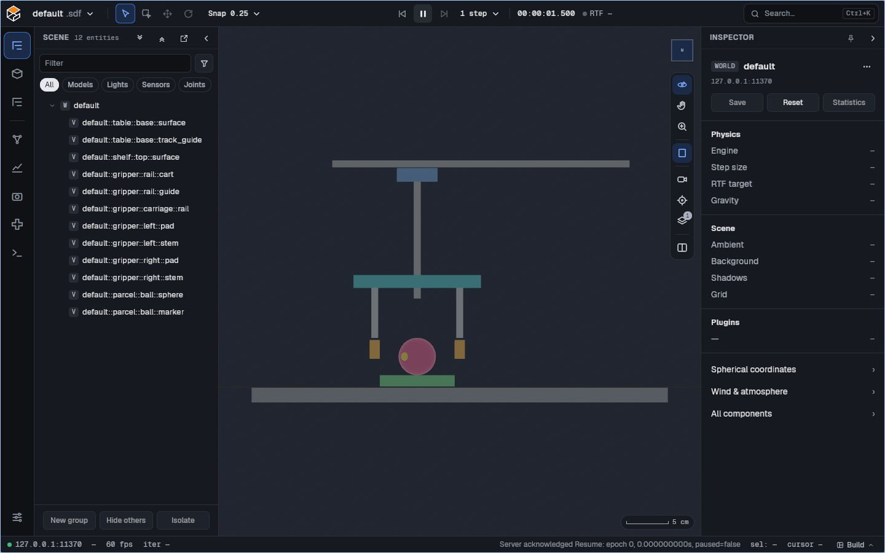

# Horizontal GPU transfer onto a finite shelf

A fourth driven slider carries a free sphere 180 mm from its pickup point to a separate shelf. The gripper opens after 24 consecutive one-millisecond samples establish that the intended shelf bears the load. It then raises the open fingers and retracts, leaving the sphere on the shelf. [Watch the transfer](http://127.0.0.1:8082/?backend=primitive&ui=full&quality=low&replay=1&lifecycle=1&url=ws%3A%2F%2F127.0.0.1%3A11370%2F) · [Watch the missed shelf](http://127.0.0.1:8082/?backend=primitive&ui=full&quality=low&replay=1&lifecycle=1&url=ws%3A%2F%2F127.0.0.1%3A11372%2F) · [Data and costs](gpu-shelf-transfer.json)



## Comparing the handover with a native reference

The device integrates the horizontal track, vertical carriage, independent horizontal fingers and translating, spinning solid sphere. The finger drives and travel stops exchange horizontal reaction with the track. A static ground plane and finite receiving box have separate contact impulses. The CPU reference uses a real four-prismatic-joint Rapier f64 multibody, finite pad and shelf cuboids and a free sphere in three dimensions. Each solver computes forces from its own motion and decides when to open using its own measurements.

| Measurement | 80 g GPU / Rapier | 200 g GPU / Rapier |
|---|---:|---:|
| First two-sided grip | 29 / 29 ms | 29 / 29 ms |
| Minimum free clearance during travel, 800–1,100 ms | 95.90 / 97.06 mm | 91.33 / 92.68 mm |
| Opening command | 1,418 / 1,429 ms | 1,397 / 1,405 ms |
| Upward shelf force when opening | 1.024 / 0.662 N | 1.948 / 1.521 N |
| Final shelf force | 0.7848 / 0.7848 N | 1.9620 / 1.9620 N |
| Maximum center path difference over 2.3 s | 1.600 mm | 1.799 mm |

Each qualifying sample requires the center to clear the shelf edges by at least the sphere radius, bottom clearance within 0.8 mm of the shelf top, vertical speed at most 25 mm/s, zero ground reaction and a positive shelf load between 65% and 140% of the sphere's weight. Pausing does not advance the dwell. For the 80 g case the first shelf contact occurred at 1,382 ms on the GPU and 1,395 ms on the CPU. Their first tick impulses were 0.01368 and 0.01394 N·s. Those brief impacts exceeded the steady-load window. An earlier, deeper lowering command opened under 8.71 N. The accepted command raises the final lift target by 16.5 mm and requires the bounded load window.

**Controls.** Frictionless pads left the sphere at pickup. With the shelf displaced to 340 mm the GPU gripper held the 80 g sphere about 8.24 mm above ground at its commanded destination and kept the fingers closed. A deeper descent there generated 1.393 N on the wrong ground plane and still did not open. A separate unconditional opening at 1,202 ms released the sphere while the shelf reaction was zero and the sphere was 81.74 mm above it on GPU, or 83.05 mm in Rapier. Both subsequently landed on the shelf. The final resting location alone cannot distinguish a drop from a load-supported handover.

**Geometry.** The qualified kernel admits axis-aligned finite pads and shelf, a horizontal track along X, vertical lift, one coplanar solid sphere and a static floor. The full travel range must keep the fingers clear of each other, the floor and shelf. Under the admitted geometry the sphere can hit the shelf face, side or corner. The release rule accepts the interior of the upward face. Arbitrary three-dimensional motion, off-axis grasps, high-speed continuous collision detection and an articulated carrying wrist remain open.

## Reproduce the SDF recording

```sh
RUSTC_WRAPPER= cargo run --release --locked -p gz-sim-cli --features gpu-batch --bin gz-sim-rs -- \
  examples/gpu_carry_gripper.sdf --physics-engine gpu-batch --gpu-adapter 'NVIDIA GeForce RTX 5090' \
  --server --run --iterations 2300 --web-lifecycle --web-viewer 11371 --record-scene artifacts/rail-transfer
RUSTC_WRAPPER= cargo run --release --locked -p gz-sim-cli --features gpu-batch --bin gz-sim-rs -- \
  artifacts/rail-transfer --server --replay --web-viewer 11373
```

Use a fresh recording directory and press Play in the existing gz-web-rs frontend. The native WebGPU viewers checked all 12 visuals against independent device source poses for 72 placement and 73 missed-shelf frames, including rewind. [Open a new recording](http://127.0.0.1:8082/?backend=primitive&ui=full&quality=low&replay=1&lifecycle=1&url=ws%3A%2F%2F127.0.0.1%3A11373%2F)

```sh
RUSTC_WRAPPER= cargo run --release --locked -p gz-physics-gpu --example carry_gripper -- \
  'NVIDIA GeForce RTX 5090' artifacts/rail-native
RUSTC_WRAPPER= cargo run --release --locked -p gz-sim-scene --features gpu-batch --example gpu_shelf_transfer -- \
  'NVIDIA GeForce RTX 5090' artifacts/rail-sdf
```

## End-to-end cost and regression checks

Three release processes each measured a 2,300-tick episode and then its complete reset repeat on an RTX 5090, Vulkan f64, driver 595.99.02, with an AMD Ryzen 9 9950X3D and Rust 1.97.1. The median 80 g SDF episode advanced 1,483 complete observed steps/s, or 1.483 simulated seconds per wall second, with a 1.083 ms p95 and 1.709 ms p99 public step. At 200 g the corresponding measurements were 1,409 steps/s, 1.225 ms and 1.943 ms. These costs include the Bevy schedule, four-joint publication and dense readback. Each placement read 1,361,600 B and uploaded 3,920 B per episode. Individual slow ticks exceeded the one-millisecond public timestep.

In the separate six-lane device/reference comparison, the median p95 across three runs was 829 µs for GPU step plus readback, 505 µs for six native worlds run serially at the matched 250 µs substep, and 1,591 µs for the finer 62.5 µs reference. The qualified SDF profile currently runs one horizontal carrier per world. Re-running 2,048 of the previous three-axis grippers produced their original digest. [Batched gripper qualification](gpu-gripper-population.md)

All six device lanes repeated byte-for-byte over 2,300 ticks after reset. Separate SDF episodes repeated the physical state and release decision, including a test with 30 paused updates during the support dwell. The missed shelf and frictionless controls each kept the jaws closed. The missed-shelf trajectory differed from independent Rapier by up to 2.85 mm while the sphere remained suspended. Changed production coverage was **765/775 executable lines (98.71%) and 1,375/1,428 regions (96.29%)**. [Executable hashes, cost repetitions and verification](gpu-shelf-transfer.json)
