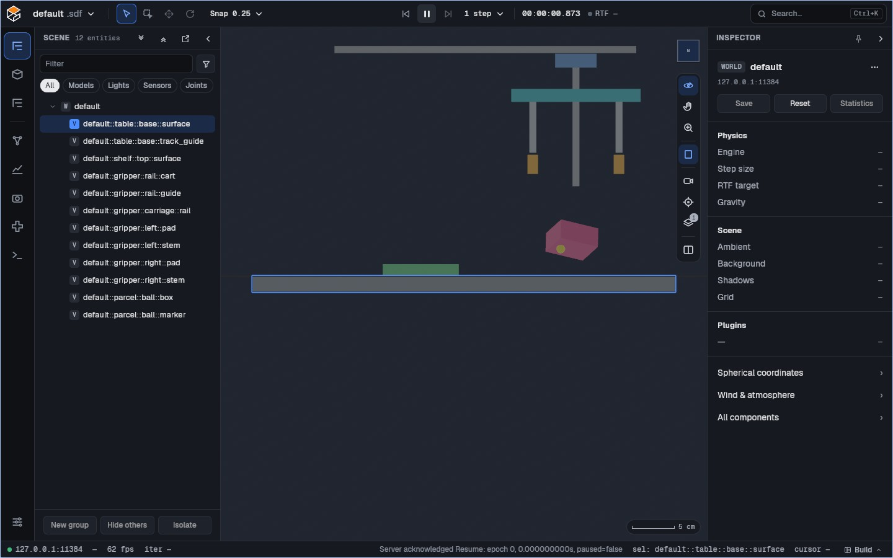
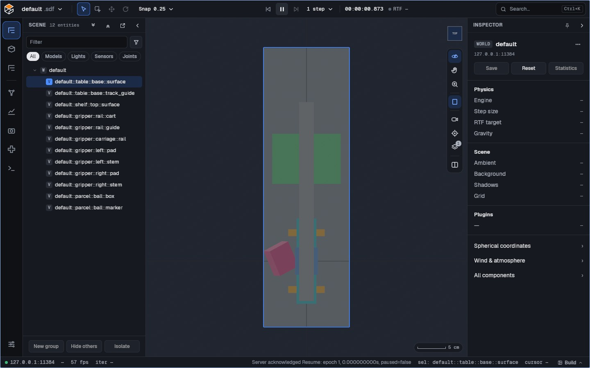

# A GPU-held cuboid tumbles after the fingers open

An 80 g box rose approximately 96 mm in the existing four-slider gripper. At 700 ms both fingers still carried load. The ordinary SDF schedule opened both jaws at 701 ms. At 740 ms there was geometric clearance and all four normal reactions were zero. The next tick applied one known impulse. The pink box traveled 49.507 mm sideways and turned 75.689° before the next possible contact. The ordinary shelf pickup remains available through the same profile. [Pickup and shelf measurements](gpu-box-pickup.md)

| Release from the matched 740 ms state | Last clear tick | Lateral travel | Observed steps/s | Step p95 | Step p99 |
| --- | ---: | ---: | ---: | ---: | ---: |
| Off-center impulse | 888 ms | 49.507 mm | 4,832 | 0.239 ms | 0.260 ms |
| Same impulse through the mass center | 892 ms | 51.300 mm | 4,422 | 0.274 ms | 0.464 ms |
| Gravity alone | 840 ms | 0 mm | 4,303 | 0.259 ms | 0.288 ms |

The device was a physical NVIDIA GeForce RTX 5090 using Vulkan f64. Rates and latency percentiles are medians from six observed free intervals per case, across three process launches with a reset in each. The timed public 1 ms step includes the four joint states, spatial link publication and a forced 880-byte readback. The contact and free kernels share one device and queue, reserve 3,168 bytes of simulation buffers, and dispatch once per advancing step. The handoff writes 848 bytes once. The 148-step off-center flight read 130,240 bytes. Reset reproduced the motion bit-for-bit. [Numerical receipts, timings, coverage objects and archive hashes](gpu-spatial-flight.json)

## Mechanics and validity

The collision box measures 48 × 24 × 40 mm and has its mass center 5 mm along local X and 2 mm below the visual origin. Its three central principal moments are 1.45067, 2.60267 and 1.92000 × 10⁻⁵ kg m². The handoff preserves the velocity of the mass center and the inherited planar angular momentum. The off-center run adds world impulse (0.003, 0.027, 0.045) N s at local (0.007, 0.001, 0.004) m. The resulting torque impulse is the world moment arm crossed with that impulse. Gravity advances the mass center and a quaternion midpoint update advances the full orientation from conserved world angular momentum in four 250 µs substeps. Published link position and velocity include the rotating offset between the mass center and the authored link.

An independent native implementation integrates Euler's body-axis torque-free equations with fourth-order Runge–Kutta at 31.25 µs and compares translation with the exact ballistic solution. In the off-center run the maximum difference was 4.25 × 10⁻¹⁶ m at the mass center, 0.91 nm at the visual origin, 4.96 × 10⁻⁷ rad in orientation and 6.90 × 10⁻⁷ rad/s in angular velocity. World angular momentum differed by less than 2 × 10⁻¹⁸ N m s and rotational energy differed by at most 2.92 × 10⁻¹² J. The centered impulse and gravity-only controls retained the tiny initial planar spin. The ordinary scene also rejected an impulse attempted at 702 ms while the fingers still held the load. Pausing retained the public state and the sliders continued to accept commands in flight.

The SDF option admits one initially planar pickup with a cuboid and aligned principal axes. Spatial motion starts only after separation. Each advancing substep bounds the rotating box, the mass offset and both moving pads. The finite pad and shelf extents are conservatively extended along the transverse axis for this test. At first possible contact with the floor, shelf or either pad, the simulator returns a typed spatial-contact boundary and retains the last complete public state. Resolving the new collision and predicting sideways impulses generated inside the jaws remain open. The previously observed 8.35 mm pickup drift from three-dimensional contact is still outside this scope. All 35 real-device SDF tests passed. Changed production coverage reached 461/463 lines and 798/809 regions. The qualification example reached 196/201 lines and 446/465 regions.

## Reproduce and view

Run the ordinary SDF comparison on the named device from the repository root.

```bash
RUSTC_WRAPPER= cargo run --locked --release -p gz-sim-scene --features gpu-batch \
  --example gpu_box_flight -- 'NVIDIA GeForce RTX 5090' artifacts/box-flight
```

The two portable recordings open with the ordinary Rust replay server. Start gz-web-rs on port 8082, then open the viewer connected to port 11389. Select the table surface in the outliner and press F to fit the apparatus in view. [Open the replay viewer](http://127.0.0.1:8082/?backend=primitive&ui=full&quality=low&replay=1&lifecycle=1&url=ws%3A%2F%2F127.0.0.1%3A11389%2F)

```bash
mkdir -p artifacts/box-flight-replays
tar -xJf docs/measurements/local-manipulation/gpu-spatial-flight-replays.tar.xz \
  -C artifacts/box-flight-replays
RUSTC_WRAPPER= cargo run --locked --release -p gz-sim-cli --bin gz-sim-rs -- \
  artifacts/box-flight-replays/final-eccentric-replay --server --replay --web-viewer 11389
```

Select `final-control-replay` for the gravity-only recording. The WebGPU browser checked all 12 rendered transforms against the device trajectory on each of 29 off-center and 27 control frames, including rewind to zero. The side and top views below show the same 873 ms frame. [Off-center live replay](http://127.0.0.1:8082/?backend=primitive&ui=full&quality=low&replay=1&lifecycle=1&url=ws%3A%2F%2F127.0.0.1%3A11384%2F) · [Gravity-only live replay](http://127.0.0.1:8082/?backend=primitive&ui=full&quality=low&replay=1&lifecycle=1&url=ws%3A%2F%2F127.0.0.1%3A11386%2F) · [Portable recordings](gpu-spatial-flight-replays.tar.xz)




